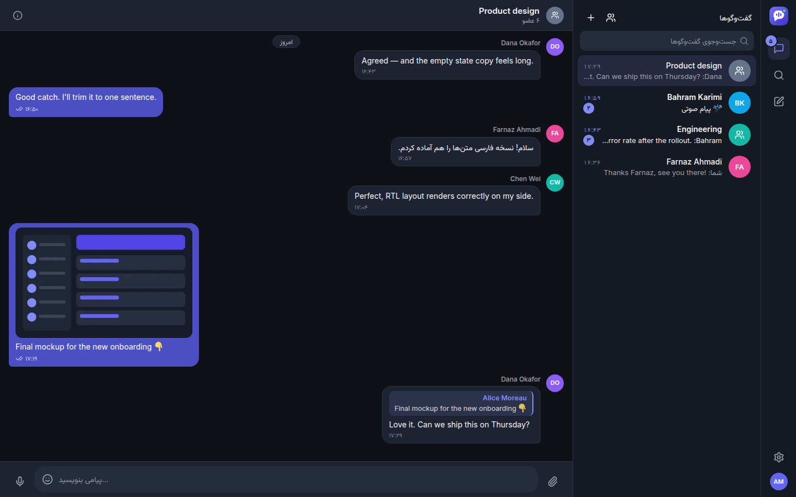
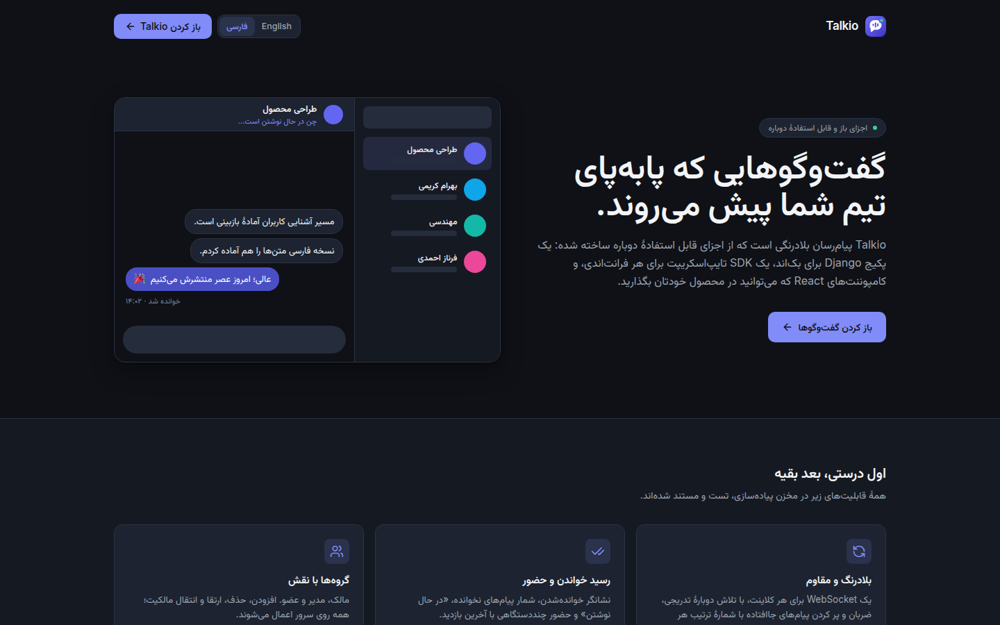
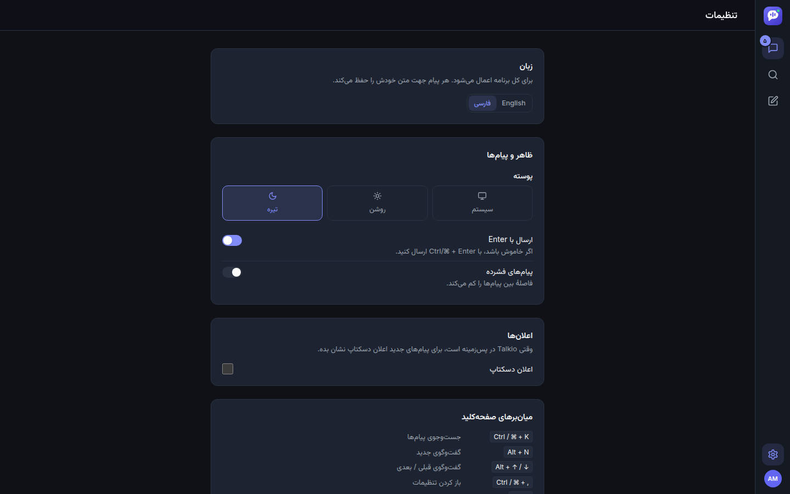
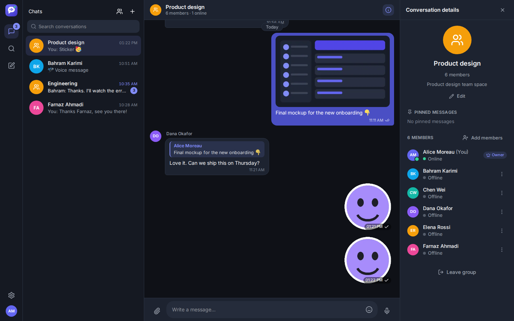
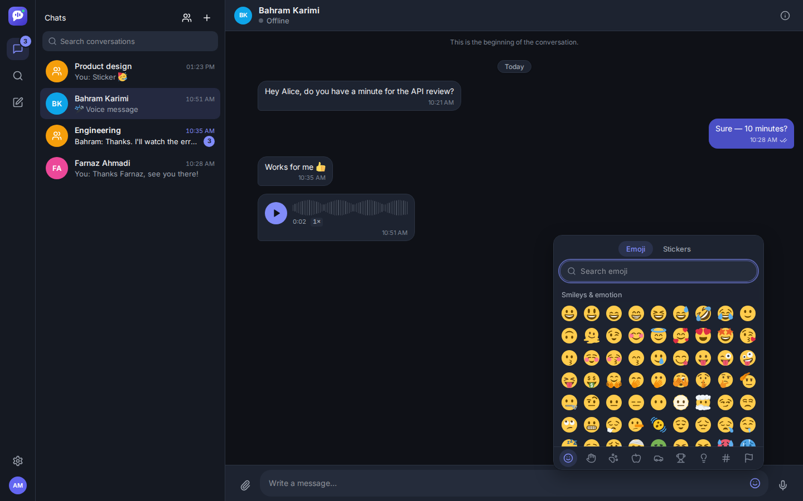
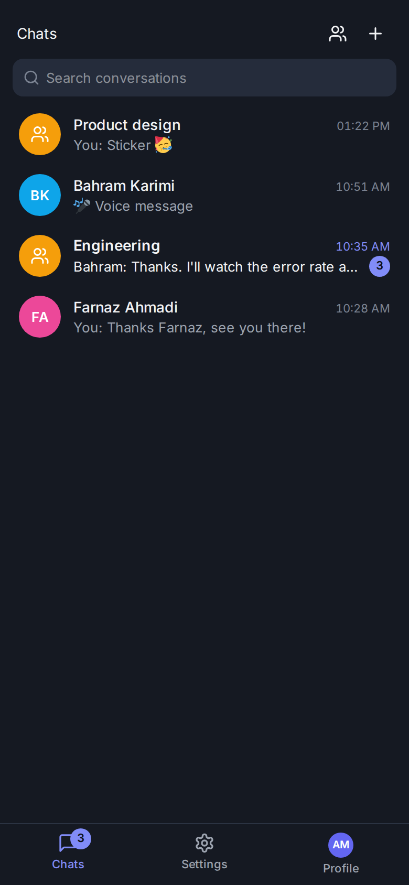
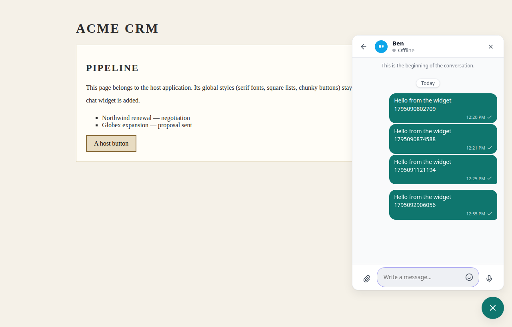

<p align="center"></p>

<h1 align="center">Talkio</h1>

<p align="center"><a href="README.md">English</a> · <b>فارسی</b></p>

پیام‌رسان بلادرنگی که از اجزای قابل استفادهٔ دوباره ساخته شده:

| جزء | چیست |
| --- | --- |
| **`django-realtime-chat`** (`packages/django-chat`) | اپ Django قابل نصب با pip: مدل‌ها، سرویس‌ها، REST API (DRF) و مصرف‌کنندهٔ WebSocket (Channels) |
| **`@realtime-chat/client`** (`packages/chat-client`) | SDK تایپ‌اسکریپت مستقل از فریم‌ورک: کلاینت REST تایپ‌شده، سوکت مقاوم، store واکنش‌گرا |
| **`@realtime-chat/react`** (`packages/react-chat`) | کامپوننت‌های React دسترس‌پذیر و قابل تغییر ظاهر، به‌همراه ویجت قابل جاسازی |
| **اپ Talkio** (`apps/server`، `apps/web`) | محصول مستقل، ساخته‌شده روی سه پکیج بالا |

اپ مستقل از پکیج‌ها دقیقاً همان‌طور استفاده می‌کند که یک پروژهٔ دیگر می‌کرد؛ یک بک‌اند پیام‌رسانی و یک مجموعه کامپوننت چت وجود دارد.

<p align="center">
  <a href="#تصاویر">تصاویر</a> ·
  <a href="#شروع-سریع">شروع سریع</a> ·
  <a href="#راهنمای-استفاده">راهنمای استفاده</a> ·
  <a href="#مستندات">مستندات</a> ·
  <a href="#استفاده-از-پکیجها-در-پروژهٔ-خودتان">پکیج‌ها</a> ·
  <a href="#توسعه">توسعه</a>
</p>



## تصاویر

همهٔ تصاویر با [`apps/web/e2e/screenshots.spec.ts`](apps/web/e2e/screenshots.spec.ts) از اپ در حال اجرا و دادهٔ `seed_demo` گرفته شده‌اند؛ پس همیشه صفحه‌های واقعی و سالم را نشان می‌دهند.

<table>
<tr>
<td width="50%"></td>
<td width="50%"></td>
</tr>
<tr>
<td align="center"><b>صفحهٔ اول</b><br/>چیدمان کامل راست‌به‌چپ</td>
<td align="center"><b>تنظیمات</b><br/>زبان، پوسته، ارسال با Enter، اعلان‌ها، میان‌برها</td>
</tr>
<tr>
<td></td>
<td></td>
</tr>
<tr>
<td align="center"><b>گفت‌وگوی گروهی (انگلیسی، تیره)</b><br/>عکس با پیش‌نمایش، پاسخ، واکنش، تیک خوانده‌شدن، پنل اعضا</td>
<td align="center"><b>ایموجی و پیام صوتی</b><br/>جست‌وجو، دسته‌ها، رنگ پوست؛ پیام صوتی با شکل موج</td>
</tr>
</table>

<p align="center">
  
  &nbsp;&nbsp;
  
</p>

تصاویر بیشتر (پوستهٔ روشن، پیام مستقیم، ساخت گروه، استیکرها، ورود) در [README انگلیسی](README.md#screenshots) هستند.

## قابلیت‌ها

- گفت‌وگوی مستقیم و گروهی؛ نقش‌ها (مالک/مدیر/عضو)، افزودن/حذف/ارتقا، انتقال مالکیت، ترک گروه
- تاریخچهٔ مرتب با شمارهٔ ترتیب برای هر گفت‌وگو و صفحه‌بندی با cursor؛ اسکرول بی‌پایان که جای شما را حفظ می‌کند
- ارسال خوش‌بینانه با نمایش پیشرفت، تلاش دوباره و دور انداختن؛ ساخت idempotent با client id (تلاش دوبارهٔ امن روی HTTP و WebSocket)
- ویرایش، حذف (با نشان «حذف شد»)، پاسخ، هدایت، سنجاق، واکنش، جست‌وجوی سمت سرور
- رسید خواندن، شمار نخوانده‌ها، جداکنندهٔ «پیام‌های جدید»، «در حال نوشتن»، حضور چنددستگاهی با آخرین بازدید
- رسانه مثل پیام‌رسان‌های امروزی: عکس (با پیش‌نمایش ساخته‌شده و نمایش بزرگ)، GIF، ویدیو، صوت و فایل؛ **پیام صوتی** ضبط‌شده در مرورگر با پخش‌کنندهٔ شکل موج و سرعت پخش؛ **استیکر** از بسته‌های انتخاب‌شده توسط مدیران؛ **انتخابگر ایموجی** با جست‌وجو؛ واکنش با **هر ایموجی**
- همهٔ آپلودها با تشخیص نوع واقعی محتوا، سقف حجم، ذخیرهٔ خصوصی و دانلود با بررسی مجوز
- یک WebSocket برای هر کلاینت با backoff و jitter، تشخیص اتصال مرده با ضربان، مدیریت آفلاین و پر کردن پیام‌های جاافتاده پس از اتصال دوباره
- محدودیت نرخ روی عملیات HTTP و WebSocket؛ سوکت با بررسی مبدأ؛ احراز هویت نشست با محافظت CSRF
- ایموجی از مجموعهٔ باز Twemoji (روی همهٔ سیستم‌عامل‌ها یکسان، بدون مربع‌های خالی)، با رنگ پوست، موارد اخیر و پیام‌های فقط‌ایموجی بزرگ
- **رابط انگلیسی و فارسی**: اپ، کامپوننت‌های چت (`faStrings`)، پیام‌های خطای سرور (کاتالوگ‌های gettext داخل پکیج) و خطاهای سوکت از زبان انتخاب‌شده پیروی می‌کنند؛ با چیدمان کامل راست‌به‌چپ، ارقام و تاریخ فارسی. اگر متنی ترجمه نداشته باشد CI می‌شکند
- جهت خودکار متن هر پیام (فارسی، عربی)، ناوبری و میان‌بر صفحه‌کلید، کاهش حرکت، پوستهٔ تیره و روشن
- ویجت قابل جاسازی `<ChatWidget/>` با ایزوله‌سازی استایل، توکن‌های ظاهری و احراز هویت در دست میزبان

## معماری

```mermaid
flowchart LR
  Web[apps/web] --> React[@realtime-chat/react]
  Host[Your React app] --> React
  React --> SDK[@realtime-chat/client]
  SDK -- HTTPS --> API[REST /api/chat/v1]
  SDK -- WSS --> WS[WebSocket /ws/chat/v1]
  API --> Svc[django_realtime_chat services]
  WS --> Svc
  Svc --> PG[(PostgreSQL)]
  Svc -- on_commit --> Redis[(Redis)]
  WS <--> Redis
```

جزئیات (انگلیسی): [نمای کلی](docs/architecture/overview.md) · [معماری هدف](docs/architecture/target-architecture.md) · [بررسی کد اولیه](docs/architecture/current-state.md) · [تصمیم‌ها](docs/architecture/decisions/).

**فناوری‌ها:** Python 3.12، Django 5.2 LTS (پکیج از 4.2 هم پشتیبانی می‌کند)، DRF، Channels، Daphne، PostgreSQL، Redis · TypeScript (strict)، React 19، Vite، Tailwind CSS 4، Radix UI، Lucide، TanStack Query، React Router، Motion · pytest، Vitest، Testing Library، Playwright · npm workspaces.

## شروع سریع

پیش‌نیاز: Python 3.10 به بالا (3.12 پیشنهاد می‌شود)، Node 20 به بالا.

```bash
# بک‌اند
python3 -m venv .venv && . .venv/bin/activate
pip install -r apps/server/requirements-dev.txt     # از ریشهٔ مخزن؛ CI از apps/server نصب می‌کند
cd apps/server
DEBUG=1 python manage.py migrate
DEBUG=1 python manage.py seed_demo             # کاربران، گروه‌ها، پیام‌ها، یک بستهٔ استیکر و یک پیام صوتی نمونه
DEBUG=1 daphne -b 127.0.0.1 -p 4800 core.asgi:application

# فرانت‌اند (ترمینال دوم، ریشهٔ مخزن)
npm install
npm run build:packages
npm run dev:web                                # http://127.0.0.1:4801  (/api و /ws را به :4800 می‌فرستد)
```

با Docker: `cp .env.example .env && docker compose up --build` (PostgreSQL، Redis، Daphne روی 4800، Vite روی 4801).

پیکربندی در [.env.example](.env.example) و [docs/fa/deployment.md](docs/fa/deployment.md) توضیح داده شده است.

## راهنمای استفاده

بعد از شروع سریع، **http://127.0.0.1:4801** را باز کنید. زبان رابط از مرورگر گرفته می‌شود و از صفحهٔ اول، صفحهٔ ورود یا تنظیمات قابل تغییر است.

### ورود

| روش | چطور |
| --- | --- |
| **تلفن و کد** (فقط حالت توسعه؛ زبانهٔ پیش‌فرض) | هر شماره‌ای و کد **`1234`** را وارد کنید. در اولین ورود حساب ساخته می‌شود. کد با `DEMO_AUTH_CODE` تنظیم می‌شود و با `DEBUG=0` همیشه خاموش است. |
| **حساب‌های نمونه** | زبانهٔ *نام کاربری*: `alice`، `bahram`، `chen`، `dana`، `elena` یا `farnaz` با رمز **`talkio-demo-2026`** (ساخته‌شده با `seed_demo`). با دو کاربر در دو مرورگر وارد شوید تا ارسال بلادرنگ را ببینید. |
| **ثبت‌نام** | *ساخت حساب* با نام کاربری، نام نمایشی و رمز. |

### گفت‌وگوها

- **پیام مستقیم جدید:** دکمهٔ **+** (یا <kbd>Alt</kbd>+<kbd>N</kbd>) و بعد انتخاب یک نفر. شروع گفت‌وگو با کسی که قبلاً با او حرف زده‌اید همان گفت‌وگو را باز می‌کند.
- **گروه جدید:** آیکون افراد کنار **+**، بعد نام، توضیح اختیاری و اعضا. سازنده مالک گروه است.
- **مدیریت گروه:** روی عنوان گفت‌وگو یا دکمهٔ ⓘ بزنید: تغییر نام، افزودن عضو، مدیر کردن، انتقال مالکیت، حذف عضو، ترک گروه، پیام‌های سنجاق‌شده.
- **پیدا کردن:** فهرست را با *جست‌وجوی گفت‌وگوها* فیلتر کنید؛ متن پیام‌ها را در همهٔ گفت‌وگوها با <kbd>Ctrl</kbd>/<kbd>⌘</kbd>+<kbd>K</kbd> بگردید؛ با <kbd>Alt</kbd>+<kbd>↑</kbd>/<kbd>↓</kbd> بین گفت‌وگوها بروید.

### پیام‌ها

| کار | چطور |
| --- | --- |
| ارسال / خط جدید | <kbd>Enter</kbd> / <kbd>Shift</kbd>+<kbd>Enter</kbd> (در تنظیمات می‌توانید به <kbd>Ctrl</kbd>+<kbd>Enter</kbd> تغییر دهید) |
| پاسخ، واکنش، کپی، ویرایش، سنجاق، هدایت، حذف | روی پیام بروید و **⋯** را بزنید، یا راست‌کلیک کنید |
| ویرایش آخرین پیام خودتان | <kbd>↑</kbd> در کادر خالی پیام |
| لغو پاسخ یا ویرایش | <kbd>Esc</kbd> |
| واکنش با هر ایموجی | **⋯** ← **+** کنار واکنش‌های سریع |
| ارسال دوبارهٔ پیام ناموفق | **تلاش دوباره** زیر پیام (با همان شناسه فرستاده می‌شود و هیچ‌وقت تکراری نمی‌شود) |
| رفتن به پیام نقل‌شده | روی نقل‌قول بزنید |

تیک‌ها وضعیت را نشان می‌دهند: 🕓 در حال ارسال، ✓ ارسال شد، ✓✓ کسی خواند.

### ایموجی، استیکر، فایل و صدا

- **ایموجی:** دکمهٔ 🙂 در کادر پیام. با نام جست‌وجو کنید، با نوار دسته‌ها جابه‌جا شوید، برای **رنگ پوست** روی ایموجی راست‌کلیک کنید (یا روی صفحهٔ لمسی نگه دارید). پیام‌هایی که فقط یک تا سه ایموجی دارند بزرگ نمایش داده می‌شوند.
- **استیکر:** 🙂 ← زبانهٔ **استیکرها** و بعد انتخاب یک استیکر. مدیران بسته‌های استیکر را در ادمین Django اضافه می‌کنند (`/admin/` ← *Sticker packs*؛ PNG، WebP یا GIF، حداکثر ۵۱۲ کیلوبایت و ۵۱۲×۵۱۲).
- **عکس، GIF، ویدیو، فایل:** 📎، کشیدن و رها کردن روی کادر پیام، یا چسباندن عکس. پیشرفت آپلود نشان داده می‌شود؛ برای دیدن عکس در اندازهٔ کامل رویش بزنید.
- **پیام صوتی:** با کادر پیام خالی 🎤 را بزنید (اجازهٔ میکروفون بدهید). برای فرستادن **ارسال** و برای دور انداختن 🗑️ یا <kbd>Esc</kbd>. پخش با جابه‌جایی و سرعت ۱×، ۱٫۵× و ۲×.

### تنظیمات و پروفایل

- **تنظیمات** (آیکون چرخ‌دنده، <kbd>Ctrl</kbd>/<kbd>⌘</kbd>+<kbd>,</kbd>): زبان (English / فارسی)، پوسته (سیستم / روشن / تیره)، ارسال با Enter، پیام‌های فشرده، اعلان دسکتاپ، فهرست میان‌برها، خروج.
- **پروفایل** (تصویر شما): نام، نام کاربری، ایمیل، عکس و رمز. روی یک عضو گروه بزنید تا پروفایلش را ببینید و به او پیام بدهید.
- عنوان صفحه تعداد پیام‌های نخوانده را نشان می‌دهد. با روشن بودن اعلان‌ها، وقتی زبانه در پس‌زمینه است و پیامی می‌رسد اعلان دسکتاپ می‌گیرید.

### ادمین

`http://127.0.0.1:4800/admin/` (با `python manage.py createsuperuser` یک ابرکاربر بسازید): مدیریت گفت‌وگوها و اعضا، دیدن فرادادهٔ پیام‌ها (فهرست‌ها هیچ‌وقت متن پیام را نشان نمی‌دهند)، پیوست‌ها و حضور، و ساخت بسته‌های استیکر. جدول‌های چت قدیمی فقط‌خواندنی نمایش داده می‌شوند.

## مستندات

وقتی سرور در حال اجراست، همهٔ مستندات **داخل ادمین** در **http://127.0.0.1:4800/admin/docs/** در دسترس است (فقط حساب‌های staff). نمایشگر این README، همهٔ محتوای `docs/` و نسخه‌های فارسی را با ناوبری، فهرست مطالب، کد رنگی، نمودارهای Mermaid، پوستهٔ روشن و تیره و چیدمان راست‌به‌چپ برای صفحه‌های فارسی نشان می‌دهد.

| سند | برای |
| --- | --- |
| [مستندات فارسی](docs/fa/README.md) | مرجع بک‌اند و فرانت‌اند، API، یکپارچه‌سازی، امنیت، استقرار و سیستم طراحی به فارسی |
| راهنمای یادگیری: [فارسی](docs/learn/README.md) · [English](docs/learn/en/README.md) | ۱۳ فصل دربارهٔ مفاهیم پشت کد، با باگ‌های واقعی که در مسیر ساخت پیدا شدند و تمرین |
| [مستندات انگلیسی](README.md#documentation) | همهٔ اسناد اصلی، به‌علاوهٔ تصمیم‌های معماری (ADR) و تاریخچه |

## استفاده از پکیج‌ها در پروژهٔ خودتان

```bash
pip install "django-realtime-chat[redis,images]"
npm install @realtime-chat/client @realtime-chat/react
```

```python
INSTALLED_APPS += ["rest_framework", "channels", "django_realtime_chat"]
urlpatterns += [path("api/chat/v1/", include("django_realtime_chat.urls"))]
# asgi.py: "websocket": chat_websocket_application()
```

```tsx
import '@realtime-chat/react/styles.css';
import { ChatProvider, ChatWidget, faStrings } from '@realtime-chat/react';

const client = createChatClient({ baseUrl: '/api/chat/v1', wsUrl: '/ws/chat/v1', auth: sessionAuth(), language: () => 'fa' });

<ChatProvider client={client} strings={faStrings} locale="fa-IR" tokens={{ primary: '#0f766e' }}>
  <ChatWidget />
</ChatProvider>
```

راهنماها: [یکپارچه‌سازی Django](docs/fa/integration-django.md) · [React و SDK](docs/fa/integration-react.md) · [سیستم طراحی](docs/fa/design-system.md). نمونه‌های کامل در یک میزبان جدا: [examples/django-integration](examples/django-integration) و [examples/react-integration](examples/react-integration).

## پروتکل‌ها

- REST: [docs/fa/rest-api.md](docs/fa/rest-api.md)
- WebSocket (رویدادها، احراز هویت، کدهای خطا، ترتیب، اتصال دوباره، idempotency): [docs/fa/websocket.md](docs/fa/websocket.md)

نوشتن‌ها دست‌کم یک بار تحویل می‌شوند (idempotent با `client_id`) و رویدادها با بهترین تلاش؛ ترتیب در هر گفت‌وگو با `seq` تضمین می‌شود. ادعای تحویل دقیقاً یک‌باره نداریم.

## توسعه

| کار | فرمان |
| --- | --- |
| تست‌های پکیج پایتون (Django 5.2؛ برای PostgreSQL `TEST_DATABASE_URL`) | `cd packages/django-chat && pytest` |
| تست‌های سرور | `cd apps/server && DEBUG=1 pytest` |
| lint پایتون | `ruff check . && ruff format --check .` (برای هر پروژه) |
| lint، قالب، نوع و تست JS | `npm run lint`، `npm run format:check`، `npm run typecheck`، `npm test` |
| ترجمه‌ها | `npm run i18n:check -w @talkio/web`؛ `python scripts/i18n.py extract \| compile \| check` |
| ساخت همه‌چیز | `npm run build` و `cd packages/django-chat && python -m build` |
| end-to-end (با سرورهای در حال اجرا) | `cd apps/web && npx playwright test --project=desktop --project=mobile --project=example` |
| بررسی پکیج‌های قابل نصب | `./scripts/verify-packages.sh` |

## محدودیت‌های شناخته‌شده

- رمزنگاری سرتاسری، اعلان push روی موبایل، تماس صوتی/تصویری و رشتهٔ پیام (thread) نداریم.
- آفلاین شدن به‌خاطر کرش worker پخش نمی‌شود (فقط lease منقضی می‌شود).
- کادر نوشتن پیام ایموجی را با فونت خود دستگاه نشان می‌دهد (جاهای دیگر تصویر است).
- ایموجی‌های جدیدتر از نسخهٔ Twemoji همراه (یونیکد ۱۵٫۱ به بعد) در انتخابگر پنهان‌اند.
- ارسال‌ها در هر گفت‌وگو با قفل ردیف سریالی می‌شوند (ADR 0003)؛ ادعای عدد توان عملیاتی نداریم.
- زبان خطاهای سوکت هنگام اتصال تعیین می‌شود؛ بعد از عوض کردن زبان، تا اتصال دوبارهٔ بعدی زبان قبلی می‌ماند.
- پکیج‌ها در PyPI/npm منتشر نشده‌اند.

## اعتبارها

تصاویر ایموجی: [Twemoji](https://github.com/jdecked/twemoji) © Twitter, Inc و مشارکت‌کنندگان، با مجوز [CC-BY 4.0](https://creativecommons.org/licenses/by/4.0/). دادهٔ ایموجی: [Emojibase](https://emojibase.dev) (MIT).
