<p align="center"></p>

<h1 align="center">Talkio</h1>

Real-time messaging built from reusable parts:

| Part | What it is |
| --- | --- |
| **`django-realtime-chat`** (`packages/django-chat`) | pip-installable Django app: models, services, REST API (DRF) and WebSocket consumer (Channels) |
| **`@realtime-chat/client`** (`packages/chat-client`) | Framework-independent TypeScript SDK: typed REST client, resilient socket, reactive store |
| **`@realtime-chat/react`** (`packages/react-chat`) | Accessible, themeable React components and an embeddable widget |
| **Talkio app** (`apps/server`, `apps/web`) | The standalone product, built on the three packages above |

The standalone app consumes the packages exactly as a third-party project would — there is one messaging backend and one set of chat components.

<p align="center">
  <a href="#screenshots">Screenshots</a> ·
  <a href="#quick-start">Quick start</a> ·
  <a href="#how-to-use">How to use</a> ·
  <a href="#documentation">Docs</a> ·
  <a href="#using-the-packages-in-your-project">Packages</a> ·
  <a href="#protocols">Protocols</a> ·
  <a href="#development">Development</a>
</p>

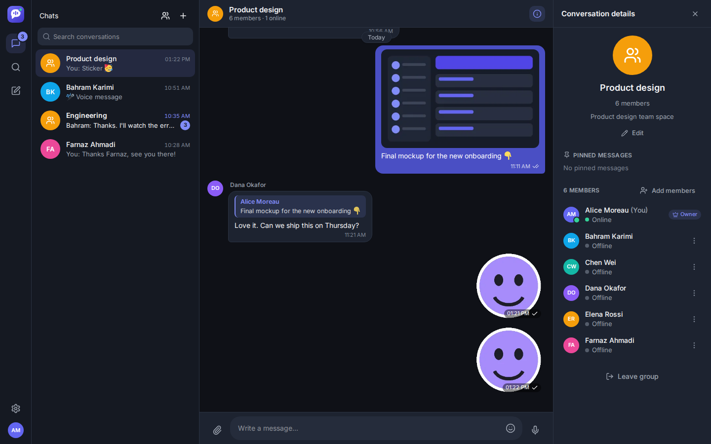

## Screenshots

All images are captured from the running app by [`apps/web/e2e/screenshots.spec.ts`](apps/web/e2e/screenshots.spec.ts) against the `seed_demo` data, so they always show real, working screens.

### Messaging

<table>
<tr>
<td width="50%"></td>
<td width="50%">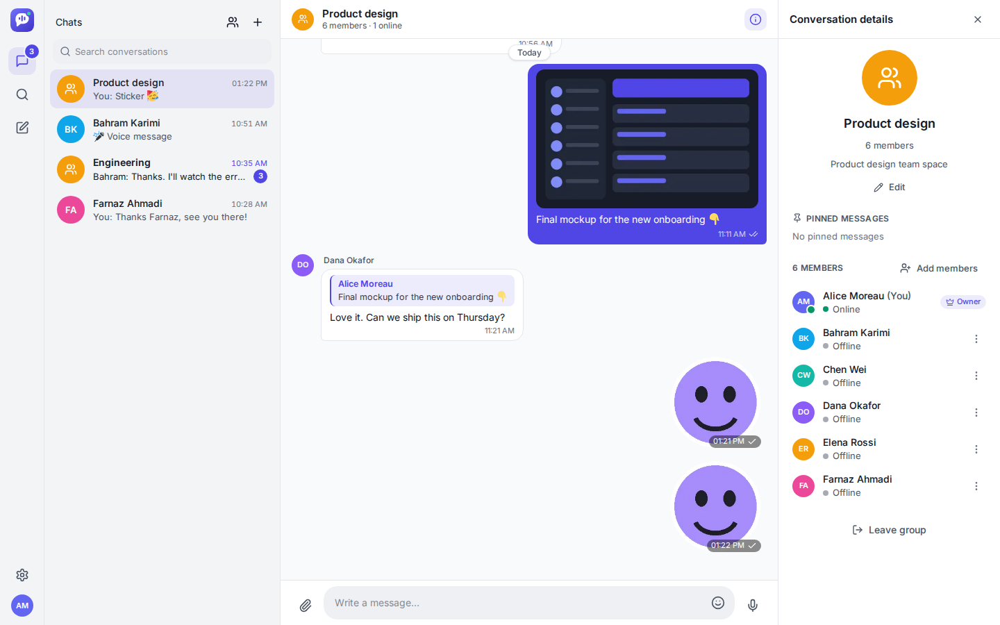</td>
</tr>
<tr>
<td align="center"><b>Group chat (dark)</b><br/>Photo with preview, reply, reactions, read ticks, members panel</td>
<td align="center"><b>Group chat (light)</b><br/>Same screen in the light theme</td>
</tr>
<tr>
<td>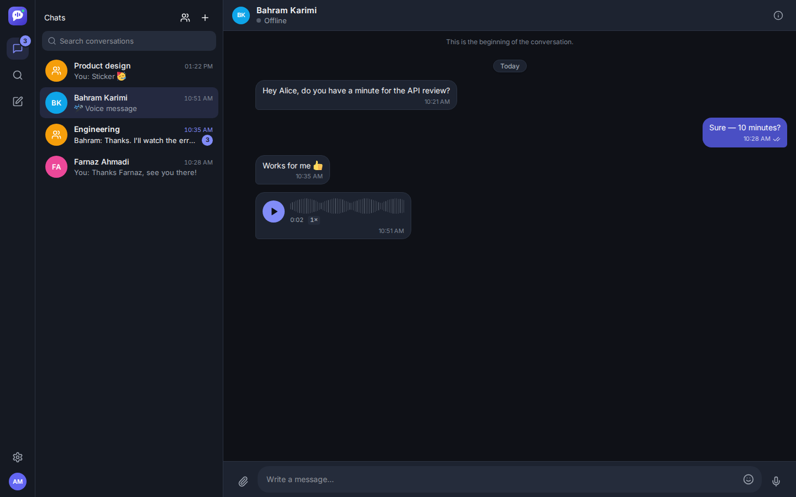</td>
<td>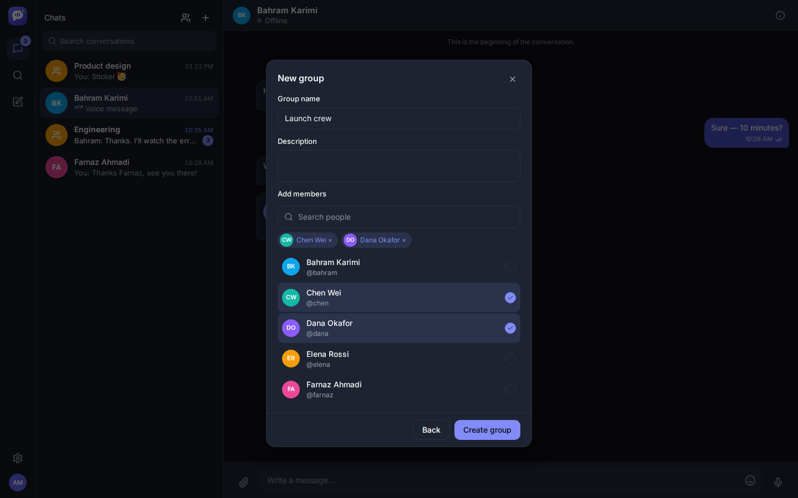</td>
</tr>
<tr>
<td align="center"><b>Direct message</b><br/>Presence / last seen in the header</td>
<td align="center"><b>New group</b><br/>Name, description and member picker</td>
</tr>
</table>

### Emoji, stickers and voice

<table>
<tr>
<td width="50%">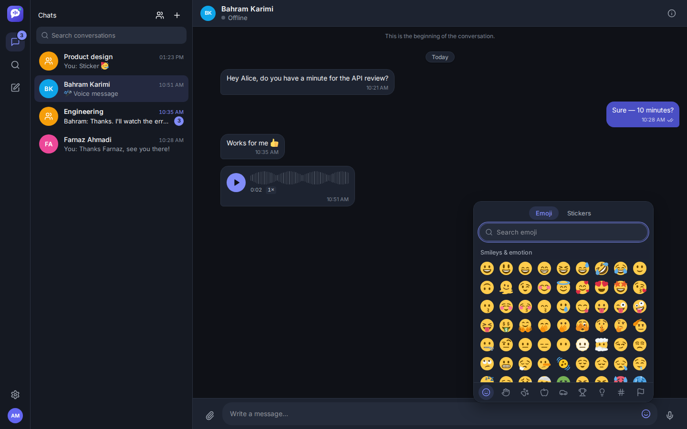</td>
<td width="50%">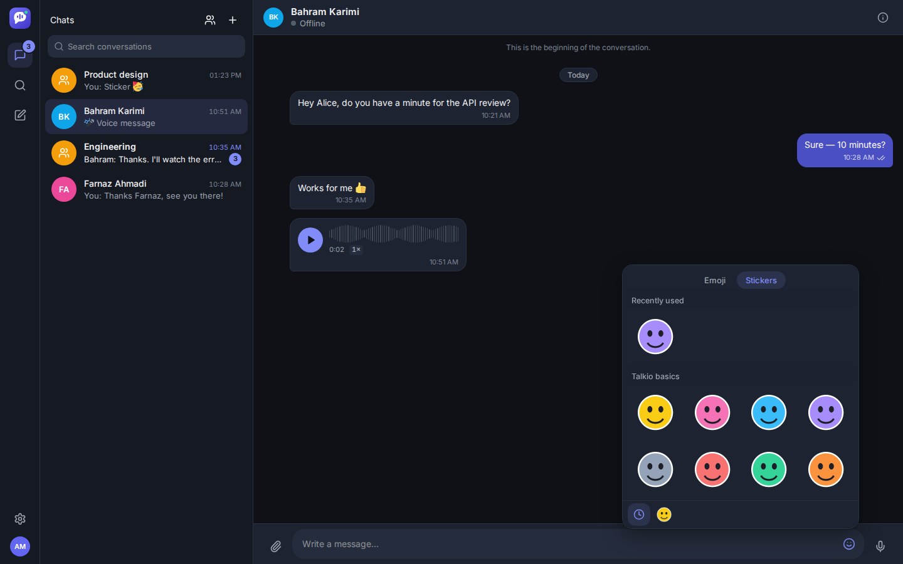</td>
</tr>
<tr>
<td align="center"><b>Emoji panel</b><br/>Search, categories, skin tones; voice message with waveform</td>
<td align="center"><b>Stickers</b><br/>Recent stickers and packs</td>
</tr>
</table>

### Mobile

<p align="center">
  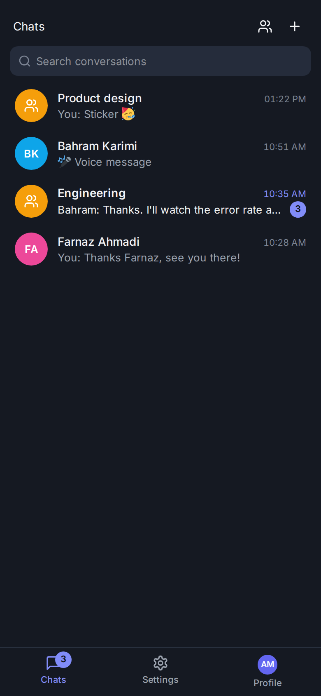
  &nbsp;&nbsp;
  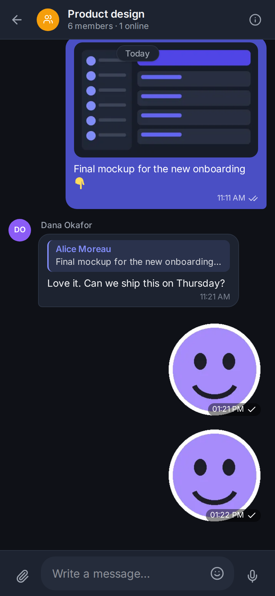
</p>
<p align="center"><b>Conversation list</b> and <b>conversation</b>: separate full-screen views with a bottom tab bar</p>

### Embedding, account and settings

<table>
<tr>
<td width="50%">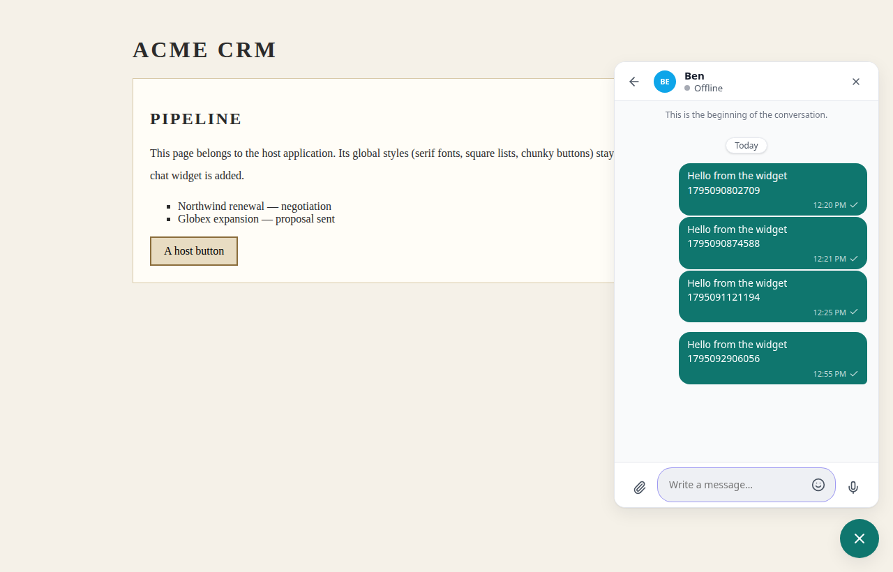</td>
<td width="50%">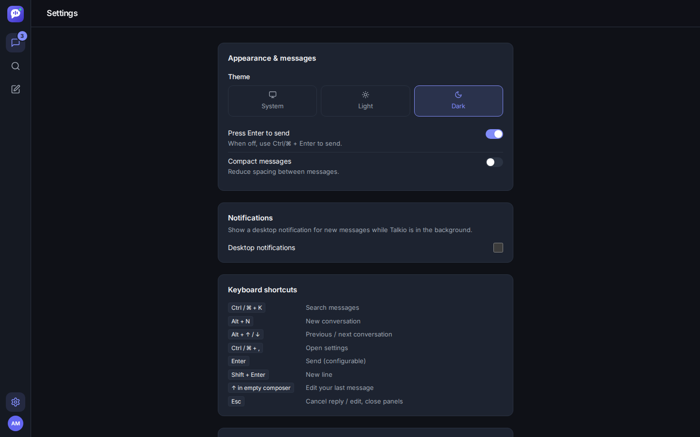</td>
</tr>
<tr>
<td align="center"><b>Embedded widget</b><br/><code>&lt;ChatWidget/&gt;</code> in a host app with its own CSS and brand color</td>
<td align="center"><b>Settings</b><br/>Theme, Enter-to-send, compact mode, notifications, shortcuts</td>
</tr>
<tr>
<td>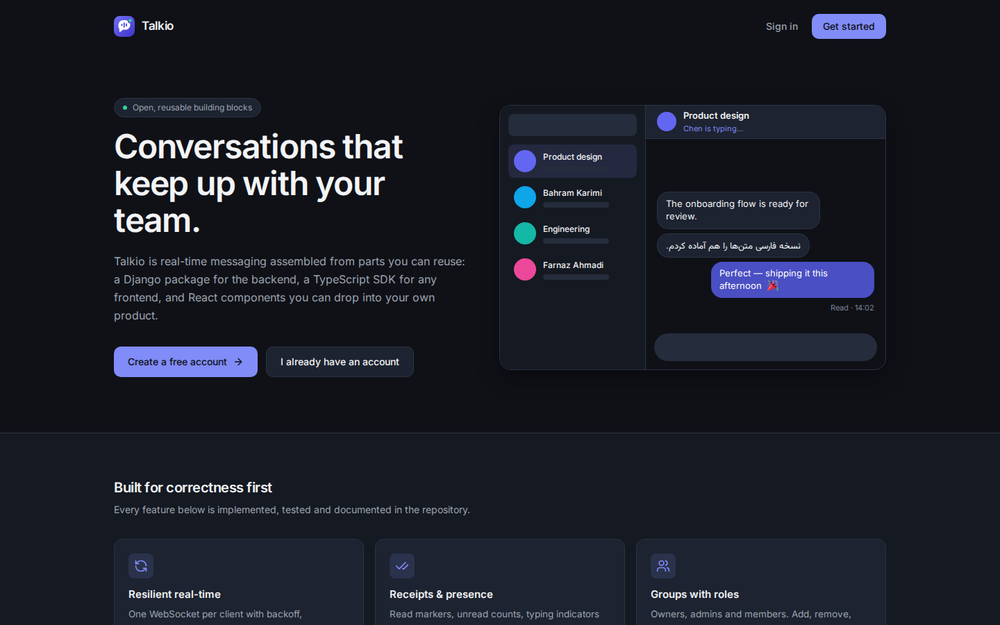</td>
<td>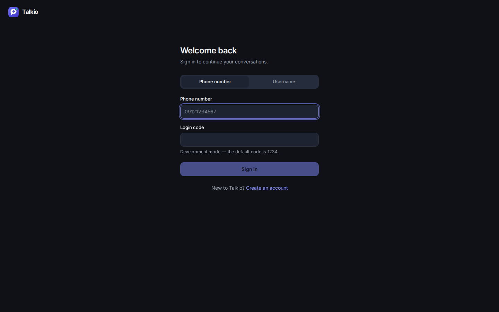</td>
</tr>
<tr>
<td align="center"><b>Landing page</b></td>
<td align="center"><b>Sign in</b><br/>Phone + code (development) or username / password</td>
</tr>
</table>

## Features

- Direct and group conversations; roles (owner/admin/member), add/remove/promote, ownership transfer, leave
- Ordered history with per-conversation sequence numbers and cursor pagination; infinite scroll that keeps your place
- Optimistic sending with progress, retry and discard; idempotent creation by client id (safe retries over HTTP and WebSocket)
- Edit, delete (tombstones), reply, forward, pin, reactions, server-side search
- Read receipts, unread counts, "new messages" divider, typing indicators, multi-device presence with last seen
- Media like a modern messenger: photos (with generated previews and a lightbox), GIFs, video, audio and files; **voice messages** recorded in the browser with a waveform player and playback speed; **stickers** from staff-curated packs; a searchable **emoji picker**; reactions with **any emoji**
- All uploads content-sniffed, size-limited, privately stored and served through authorized downloads
- One WebSocket per client with backoff + jitter, heartbeat stale detection, offline handling and gap recovery after reconnect
- Rate limits on HTTP and WebSocket operations; origin-validated sockets; CSRF-protected session auth
- Emoji rendered from the open Twemoji set (identical on every OS, no missing-font boxes), with skin tones, recents and large emoji-only messages
- RTL/automatic direction (Persian, Arabic), keyboard navigation and shortcuts, reduced motion, dark and light themes
- Embeddable `<ChatWidget/>` with style isolation, theme tokens and host-controlled auth

## Architecture

```mermaid
flowchart LR
  Web[apps/web] --> React[@realtime-chat/react]
  Host[Your React app] --> React
  React --> SDK[@realtime-chat/client]
  SDK -- HTTPS --> API[REST /api/chat/v1]
  SDK -- WSS --> WS[WebSocket /ws/chat/v1]
  API --> Svc[django_realtime_chat services]
  WS --> Svc
  Svc --> PG[(PostgreSQL)]
  Svc -- on_commit --> Redis[(Redis)]
  WS <--> Redis
```

Details: [overview](docs/architecture/overview.md) · [target architecture](docs/architecture/target-architecture.md) · [audit of the original code](docs/architecture/current-state.md) · [decisions](docs/architecture/decisions/).

**Stack:** Python 3.12, Django 5.2 LTS (package also supports 4.2), DRF, Channels, Daphne, PostgreSQL, Redis · TypeScript (strict), React 19, Vite, Tailwind CSS 4, Radix UI, Lucide, TanStack Query, React Router, Motion · pytest, Vitest, Testing Library, Playwright · npm workspaces.

## Quick start

Requirements: Python 3.10+ (3.12 recommended), Node 20+.

```bash
# backend
python3 -m venv .venv && . .venv/bin/activate
pip install -r apps/server/requirements-dev.txt
cd apps/server
DEBUG=1 python manage.py migrate
DEBUG=1 python manage.py seed_demo             # demo users, groups, messages, a sticker pack and a voice note
DEBUG=1 daphne -b 127.0.0.1 -p 4800 core.asgi:application

# frontend (second terminal, repository root)
npm install
npm run build:packages
npm run dev:web                                # http://127.0.0.1:4801  (proxies /api and /ws to :4800)
```

With Docker: `cp .env.example .env && docker compose up --build` (PostgreSQL, Redis, Daphne on 4800, Vite on 4801).

The ports follow the shared development server's rules (4000–4999 on 127.0.0.1). Configuration is documented in [.env.example](.env.example) and [docs/deployment.md](docs/deployment.md).

## How to use

Open **http://127.0.0.1:4801** after the quick start.

### Signing in

| Method | How |
| --- | --- |
| **Phone + code** (development only, the default tab) | Enter any phone number and the code **`1234`**. An account is created on first sign-in. The code is set by `DEMO_AUTH_CODE`; this method is always off when `DEBUG=0`. |
| **Demo accounts** | Tab *Username*: `alice`, `bahram`, `chen`, `dana`, `elena` or `farnaz`, password **`talkio-demo-2026`** (created by `seed_demo`). Sign in as two different users in two browsers to see real-time delivery. |
| **Register** | *Create an account* with a username, display name and password. |

### Conversations

- **New direct message:** the **+** button (or <kbd>Alt</kbd>+<kbd>N</kbd>), then pick a person. Starting a chat with someone you already talk to reopens the same conversation.
- **New group:** the people icon next to **+**, then name, optional description and members. The creator is the owner.
- **Manage a group:** click the conversation title or the ⓘ button to open details: rename, add members, promote to admin, transfer ownership, remove members, leave, see pinned messages.
- **Find things:** filter the list with *Search conversations*; search message text across all chats with <kbd>Ctrl</kbd>/<kbd>⌘</kbd>+<kbd>K</kbd>; jump between chats with <kbd>Alt</kbd>+<kbd>↑</kbd>/<kbd>↓</kbd>.

### Messages

| Action | How |
| --- | --- |
| Send / new line | <kbd>Enter</kbd> / <kbd>Shift</kbd>+<kbd>Enter</kbd> (switch to <kbd>Ctrl</kbd>+<kbd>Enter</kbd> in Settings) |
| Reply, react, copy, edit, pin, forward, delete | Hover a message and click **⋯**, or right-click it |
| Edit your last message | <kbd>↑</kbd> in an empty composer |
| Cancel reply / edit | <kbd>Esc</kbd> |
| React with any emoji | **⋯** → **+** next to the quick reactions |
| Retry a failed message | **Retry** under the message (it is resent with the same id, never duplicated) |
| Jump to a quoted message | Click the quote |

Ticks show delivery: 🕓 sending, ✓ sent, ✓✓ read by someone.

### Emoji, stickers, files and voice

- **Emoji:** the 🙂 button in the composer. Search by name, jump with the category bar, right-click (or long-press on touch) an emoji for **skin tones**. Messages with only one to three emoji are shown large.
- **Stickers:** 🙂 → **Stickers** tab, then tap a sticker to send it. Staff add sticker packs in the Django admin (`/admin/` → *Sticker packs*; PNG, WebP or GIF, at most 512 KB and 512×512).
- **Photos, GIFs, videos, files:** 📎, drag-and-drop onto the composer, or paste an image. Upload progress is shown; click a photo to open it full size.
- **Voice message:** with an empty composer, click 🎤 (allow the microphone). Click **Send** to send or 🗑️ / <kbd>Esc</kbd> to discard. Play it back with seeking and 1× / 1.5× / 2× speed.

### Settings and profile

- **Settings** (gear icon, <kbd>Ctrl</kbd>/<kbd>⌘</kbd>+<kbd>,</kbd>): theme (system / light / dark), Enter-to-send, compact messages, desktop notifications, keyboard shortcut list, sign out.
- **Profile** (your avatar): name, username, e-mail, photo and password. Click a member in a group to see their profile and message them.
- The page title shows your unread count. With notifications on, you get a desktop notification when a message arrives while the tab is in the background.

### Admin

`http://127.0.0.1:4800/admin/` (create a superuser with `python manage.py createsuperuser`) lets staff manage conversations and members, see message metadata (list views never show message bodies), attachments and presence, and create sticker packs. The legacy chat tables are shown read-only.

## Documentation

When the server is running, all documentation is available **inside the admin** at **http://127.0.0.1:4800/admin/docs/** (staff accounts only; there is also a *Documentation* link in the admin header). The viewer renders this README and everything under `docs/` with navigation, a table of contents, highlighted code, Mermaid diagrams, light/dark themes, and right-to-left layout for the Persian guide. Create an admin with `DEBUG=1 python manage.py createsuperuser`.

| Document | For |
| --- | --- |
| [Backend technical reference](docs/backend.md) | Package internals: models, services, transactions, WebSocket consumer, presence, rate limits, files, server modules |
| [Frontend technical reference](docs/frontend.md) | SDK state machine and store, React library, styling isolation, media, web app |
| [Learning guide (Persian)](docs/learn/README.md) | 12 chapters explaining the concepts behind the code, with the real bugs found while building it and exercises |
| [REST API](docs/api/rest-api.md) · [WebSocket protocol](docs/api/websocket.md) · [Migration from v1](docs/api/migration-from-v1.md) | Contracts |
| [Django integration](docs/integration/django.md) · [React & SDK integration](docs/integration/react.md) | Embedding in other projects |
| [Architecture overview](docs/architecture/overview.md) · [Decisions (ADR)](docs/architecture/decisions/) · [Design system](docs/design-system.md) | Design |
| [Deployment](docs/deployment.md) · [Security](docs/security.md) | Operations |

## Using the packages in your project

```bash
pip install "django-realtime-chat[redis,images]"
npm install @realtime-chat/client @realtime-chat/react
```

```python
INSTALLED_APPS += ["rest_framework", "channels", "django_realtime_chat"]
urlpatterns += [path("api/chat/v1/", include("django_realtime_chat.urls"))]
# asgi.py: "websocket": chat_websocket_application()
```

```tsx
import '@realtime-chat/react/styles.css';
const client = createChatClient({ baseUrl: '/api/chat/v1', wsUrl: '/ws/chat/v1', auth: sessionAuth() });

<ChatProvider client={client} tokens={{ primary: '#0f766e' }}>
  <ChatWidget />            {/* or <ConversationList/> + <ChatWindow conversationId={id}/> */}
</ChatProvider>
```

Guides: [Django integration](docs/integration/django.md) · [React & SDK](docs/integration/react.md) · [design system & theming](docs/design-system.md). Working examples in a separate host: [examples/django-integration](examples/django-integration) (stock `auth.User`, custom policy) and [examples/react-integration](examples/react-integration) (widget on a page with aggressive global CSS).

## Protocols

- REST: [docs/api/rest-api.md](docs/api/rest-api.md)
- WebSocket (events, auth, error codes, ordering, reconnection, idempotency): [docs/api/websocket.md](docs/api/websocket.md)
- Migrating from the old `/api/v1/` and `/ws/chat/<slug>/`: [docs/api/migration-from-v1.md](docs/api/migration-from-v1.md)

Delivery is at-least-once for writes (idempotent by `client_id`) and best-effort for events, with ordering per conversation by `seq`. Exactly-once delivery is not claimed.

## Authentication & security

The package uses the host's authentication (DRF classes; session or signed single-use tickets for sockets) and never accepts a user id from the client. Highlights: membership-scoped 404s, origin-validated sockets, CSRF on login/registration, inert message rendering, content-sniffed private attachments, throttles. Read [docs/security.md](docs/security.md), including its known limitations.

## Development

| Task | Command |
| --- | --- |
| Python package tests (Django 5.2; add `TEST_DATABASE_URL` for PostgreSQL) | `cd packages/django-chat && pytest` |
| Server tests | `cd apps/server && DEBUG=1 pytest` |
| Lint Python | `ruff check . && ruff format --check .` (per project) |
| JS lint / format / typecheck / unit tests | `npm run lint`, `npm run format:check`, `npm run typecheck`, `npm test` |
| Build everything | `npm run build` and `cd packages/django-chat && python -m build` |
| End-to-end (servers running) | `cd apps/web && npx playwright test --project=desktop --project=mobile --project=example` |
| Verify installable packages (wheel + npm tarballs in clean environments) | `./scripts/verify-packages.sh` |

CI (`.github/workflows/ci.yml`) runs the package on Django 4.2 and 5.2 (SQLite and PostgreSQL), the server, JS checks, package verification and Playwright.

### Test status at the time of writing

Run locally on 2026-11-19: Django package 106 passed on Django 5.2 and on 4.2 (1 PostgreSQL-only concurrency test skipped on SQLite), server 17, Django example 4, SDK 25, React library 26, web app 2, Playwright 15 (desktop, mobile, phone + code sign-in, emoji/stickers/voice with a synthetic microphone, and the embedded widget). `scripts/verify-packages.sh` passed. The CI workflow has not been run on GitHub yet.

## Known limitations

- No end-to-end encryption, push notifications to mobile devices, voice/video calls, or message threads.
- Presence offline transitions caused by a crashed worker are not broadcast (leases just expire).
- The composer's text box shows emoji with the device's own font (images are used everywhere else); devices without a color-emoji font show plain glyphs while typing.
- Emoji newer than the bundled Twemoji release (Unicode 15.1+) are hidden from the picker.
- Sends within one conversation are serialized by a row lock (see ADR 0003); no throughput figures are claimed.
- Packages are not published to PyPI/npm, and no license has been chosen yet — the owner should pick one before publishing.

## Roadmap

1. GIF search through a provider (needs a product decision: it sends search terms to a third party), user-created sticker packs, animated (Lottie) stickers, video thumbnails.
2. Web push notifications and per-conversation mute.
3. Message threads and link previews (server-side, SSRF-safe).
4. Reproducible load tests and observability (metrics, tracing).

## Credits

Emoji graphics: [Twemoji](https://github.com/jdecked/twemoji) © Twitter, Inc and other contributors, licensed under [CC-BY 4.0](https://creativecommons.org/licenses/by/4.0/). Emoji data: [Emojibase](https://emojibase.dev) (MIT).
