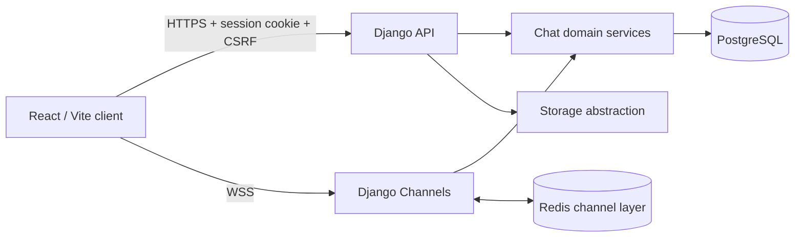

# Pulse Chat

Pulse Chat is a portfolio-oriented real-time messaging application built around a Django API, Django Channels, Redis, PostgreSQL, and a React client.

The repository is intentionally a modular monolith: durable conversation/message state stays in Django and PostgreSQL, while Redis carries live events and ephemeral connection state. React owns the interaction-heavy workspace; Django templates remain only as legacy compatibility pages during the migration.

## Current verified features

- Session login/logout/me API with CSRF bootstrap.
- React/Vite client with responsive dark-first chat workspace.
- Conversation list and membership-filtered message history.
- WebSocket message creation with server IDs, timestamps, request IDs, and duplicate prevention.
- WebSocket authentication and conversation membership checks.
- Basic typing, read, and presence event shapes.
- Cursor-shaped history response and database indexes for room/time and idempotency lookup.
- PostgreSQL/Redis Docker Compose development path.
- Behavioral tests for API isolation, invalid payloads, idempotent writes, pagination, and WebSocket authorization/persistence.

Features such as attachments, group role management, message editing/deletion, durable read receipts, TTL-backed multi-device presence, and complete rate limiting remain on the roadmap. They are not presented as implemented here.

## Architecture



See [architecture guide](docs/architecture/architecture.md), [current state](docs/architecture/current-state.md), and [proposed design](docs/architecture/proposed-design.md).

## Engineering decisions

- **React client, Django backend:** the product now has a dedicated client boundary, but backend domain logic remains in one deployable service.
- **Session auth first:** the browser and WebSocket handshake share Django session authentication and CSRF protection. JWT is intentionally deferred until a separate mobile/public API requirement exists.
- **At-least-once WebSockets:** clients submit a request ID; database uniqueness makes retries idempotent. The system does not claim exactly-once delivery.
- **Durable vs ephemeral state:** messages belong in PostgreSQL; presence and typing belong in the live transport layer and should not be treated as message history.
- **Clean baseline migrations:** the local legacy SQLite database and old generated app migrations were reset because this portfolio repository has no data that needs preserving. Do not repeat that reset against a real deployment.

## Local setup

### Backend

```bash
cd src
python -m venv .venv
# Windows: .venv\Scripts\activate
pip install -r requirements.txt
copy .env.example .env  # PowerShell: Copy-Item .env.example .env
python manage.py migrate
python manage.py createsuperuser
python manage.py runserver
```

### React client

```bash
cd frontend
npm install
npm run dev
```

Open `http://localhost:5173`. Vite proxies `/api` and `/ws` to Django during development.

### Docker Compose

```bash
cd src
copy .env.example .env
docker compose up --build
```

Compose runs PostgreSQL, Redis, Daphne, and the Vite development server. The local Compose credentials are placeholders for development only.

## Environment variables

See [.env.example](.env.example). Important values include `DJANGO_SECRET_KEY`, `DEBUG`, `ALLOWED_HOSTS`, `CSRF_TRUSTED_ORIGINS`, database settings, `REDIS_URL`, `USE_REDIS_CHANNEL_LAYER`, and optional social-auth credentials. Never commit real secrets.

## WebSocket protocol

Endpoint: `ws(s)://host/ws/chat/<conversation-slug>/`.

```json
{"event":"message.create","request_id":"client-uuid","body":"Hello"}
```

```json
{"type":"message.created","request_id":"client-uuid","message":{"id":"server-uuid","body":"Hello","created_at":"2026-11-18T10:00:00Z"}}
```

Typing, read, errors, reconnect expectations, and security semantics are documented in [websocket-protocol.md](docs/api/websocket-protocol.md).

## Tests and quality checks

```bash
python manage.py check
python manage.py test
cd frontend && npm run build
```

CI runs backend checks/tests and the frontend production build. A reproducible load-test script and benchmark procedure are planned; this repository currently makes no performance claims.

## Security

Do not run with `DEBUG=1` in production. Use a unique secret, explicit hosts, HTTPS, PostgreSQL, Redis, and protected attachment storage. All conversation access is membership-scoped. Message text must remain plain text in the client. See [security.md](docs/security.md).

## Known limitations

- The current React slice is the first working client foundation, not the complete feature list in the product brief.
- Legacy template pages still exist for compatibility and are not the primary UI.
- Redis-backed TTL presence, uploads, rate limits, and full group administration still require implementation and tests.
- No benchmark results are included.

## Roadmap

1. Complete conversation/membership API and registration/profile flows.
2. Add durable read state, unread counts, typing throttling, and TTL presence.
3. Add edit/delete permissions and validated attachment storage/downloads.
4. Expand Channels integration tests to Redis and concurrent duplicate submissions.
5. Add reproducible load testing, observability, and deployment hardening.

## License

No license file has been added yet. The project owner should choose the license before publishing.
