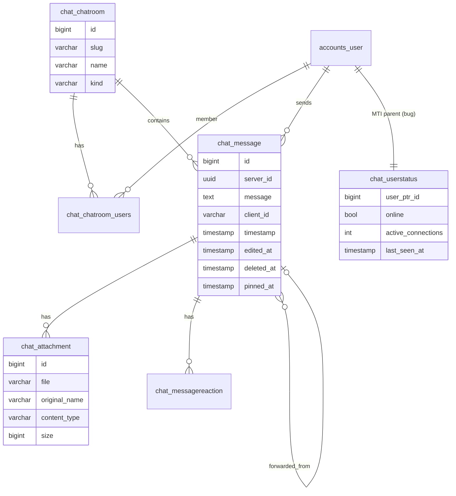

# Current State Audit

Audited on 2026-11-19 against commit `db391e2` (branch `main`). This document describes the repository as it was found, before the monorepo transformation. It replaces an earlier audit (2026-11-18) that referred to a `src/` layout that no longer exists.

## 1. Repository layout (as found)

| Path | Content |
| --- | --- |
| `core/` | Django project: settings, root URLconf, ASGI (`core/asgi.py` and a duplicate `core/routing.py`), WSGI. |
| `accounts/` | Custom `User` (`AbstractUser`, `USERNAME_FIELD = "phone"`), `VerificationCode`, custom auth backend, template-based login/signup/profile views, ~300 vendored static assets (Bootstrap, Font Awesome, CKEditor, TinyMCE, jQuery plugins). |
| `chat/` | `ChatRoom`, `Message`, `Attachment`, `MessageReaction`, `UserStatus`; DRF-style JSON API (`chat/api.py`, mounted at `/api/v1/`), a Channels consumer (`/ws/chat/<slug>/`), legacy template views (`/chat/`). |
| `frontend/` | React 18 + Vite + Tailwind 4 client. One 25 KB `Workspace.tsx`, a hand-rolled `ChatSocket`, a fetch wrapper, plus two leftover JS files (`App.jsx`, `api.js`). |
| `docs/` | Short architecture notes, two ADRs, a WebSocket note, security and design notes. |
| Deployment | `Dockerfile`, `docker-compose.yml` (Postgres 16, Redis 7, Daphne, Vite), `liara.json`, `run.sh`, `win-run.cmd`. |
| CI | `.github/workflows/ci.yml` (backend tests + frontend build). |

## 2. What works

Verified by reading code and the existing test suite (`chat/tests.py`, 16 tests):

- Session login/registration/logout/me API with a CSRF bootstrap endpoint; demo phone+code login behind `DEMO_AUTH_ENABLED`.
- Conversation list scoped to membership; direct and group creation; direct-chat reuse.
- Message history (50 per page) with a timestamp cursor; idempotent creation by `(chat_room, sender, client_id)` with a partial unique constraint.
- Edit/delete (sender only, soft delete), reactions (toggle, fixed allow-list), pin/unpin, forward with provenance, server-side message search limited to the caller's conversations.
- Attachment upload with a content-type allow-list and 10 MB limit; download through a membership-checked endpoint.
- WebSocket consumer rejects anonymous users and non-members (close code 4403) and persists messages idempotently.
- Health and readiness endpoints.
- Environment-driven settings (`.env` loader), Postgres/Redis switch, production cookie flags when `DEBUG=0`.

## 3. Valuable, reusable pieces

- The idempotency design (`client_id` + partial unique constraint + `IntegrityError` fallback) is correct and is kept.
- Membership-scoped querysets (`ChatRoom.objects.filter(users=request.user)`) are the right authorization primitive.
- Attachment download through an authorized view (never via public `MEDIA_URL`).
- The feature set (pin, forward, search, reactions) is broader than the original brief and is preserved.
- Existing ADRs (modular monolith; at-least-once + idempotent writes) remain valid.

## 4. Technical debt and defects

### Correctness

1. **`UserStatus(User)` uses multi-table inheritance _and_ a `OneToOneField` to `User`.** `UserStatus.objects.get_or_create(user=u)` inserts a second, phantom `accounts_user` row (the parent of the MTI child). Every WebSocket connect for a new user therefore creates a bogus user. The presence counter is also a DB integer that never recovers from crashed processes (no TTL).
2. **No per-conversation ordering.** History uses `timestamp` as cursor; messages with equal timestamps can be skipped or duplicated across pages.
3. **Read state** is a `seen_by` M2M per message that nothing writes. There are no unread counts.
4. **Direct-chat creation is racy**: the "does a direct room already exist" check loads every direct room of the user in Python and has no database constraint, so two concurrent requests can create two rooms.
5. **REST writes are not broadcast.** Messages created/edited/deleted over HTTP never reach connected sockets; the client compensates with `window.dispatchEvent('chat:refresh')`.
6. **Attachments must reference an existing message**, so a file message is two non-atomic requests; the client-declared `content_type` is trusted.
7. **N+1 queries**: conversation list does one query per room for the last message plus per-member serialization; `message_payload` aggregates reactions per message.
8. Room slugs are derived from `unidecode(name)` and must be unique: two groups called "Team" collide (`IntegrityError` → 409).
9. Migrations were generated by Django 5.2 while `requirements.txt` pins Django 4.2.3; the pinned stack does not install on current Python versions.

### Security

1. **No WebSocket origin validation** (`AllowedHostsOriginValidator` missing) → cross-site WebSocket hijacking is possible with a victim's session cookie.
2. Attachment type is taken from the client (`upload.content_type`); no magic-byte sniffing; served `inline` for images/audio/video without `nosniff`/sandbox headers.
3. User directory returns `email` of every user to every authenticated user and lets anyone enumerate all accounts.
4. Rate limiting is a single 1-second cache key for HTTP message creation only; WebSocket events are unlimited (typing floods every member).
5. `SECRET_KEY` silently falls back to a hard-coded value when unset, even with `DEBUG=0`.
6. Legacy template chat page (`chat/templates/chat/chat_room.html`) renders incoming messages with `innerHTML`.

### Coupling and structure

1. `chat` imports `accounts.models.User` directly; it cannot be installed in another project.
2. Business logic lives inside API view methods and is partially duplicated in the consumer (`MAX_MESSAGE_LENGTH`, `message_payload`).
3. No settings namespace; limits are module constants.
4. The React client is one monolithic component; transport, state and UI are intertwined; nothing is reusable by another application.
5. CI points at a non-existent `src/` working directory, so it cannot pass.
6. Two ASGI entry points (`core/asgi.py`, `core/routing.py`) diverge; Compose uses one, settings the other.
7. Legacy dependencies (`django-ckeditor`, TinyMCE, CKEditor, jQuery plugins) are unused by the chat product.

## 5. Database schema (as found)

Indexes: `(chat_room, -timestamp)`, `(sender, chat_room, client_id)`; partial unique `(chat_room, sender, client_id) WHERE client_id IS NOT NULL`; unique `(message, user, emoji)`.

## 6. Existing contracts

- REST: `/api/v1/auth/*`, `/api/v1/conversations/`, `/api/v1/conversations/<slug>/messages/`, `/api/v1/messages/<uuid>/…`, `/api/v1/attachments/…`, `/api/v1/users/`, `/api/v1/health/…`.
- WebSocket: `/ws/chat/<slug>/` with `message.create`, `typing.start|stop`, `read.update`; server events `message.created`, `presence.changed`, `typing.changed`, `message.read`, `error`.

Migration guidance for these contracts is in [`docs/api/migration-from-v1.md`](../api/migration-from-v1.md).
