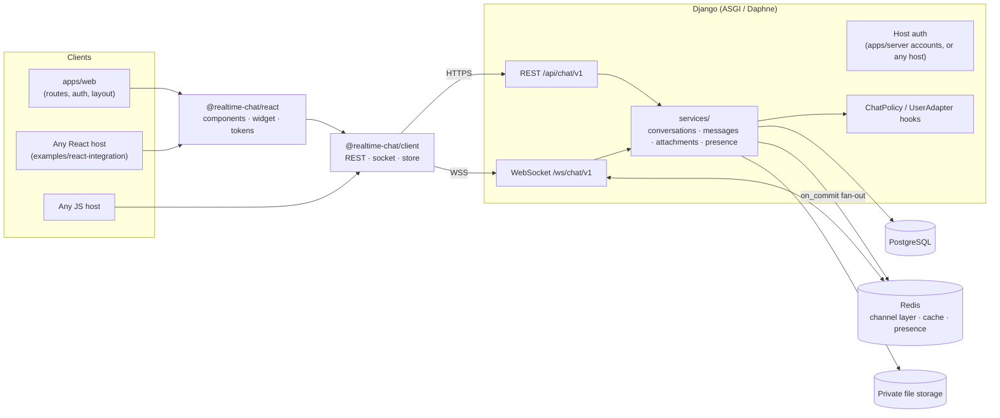
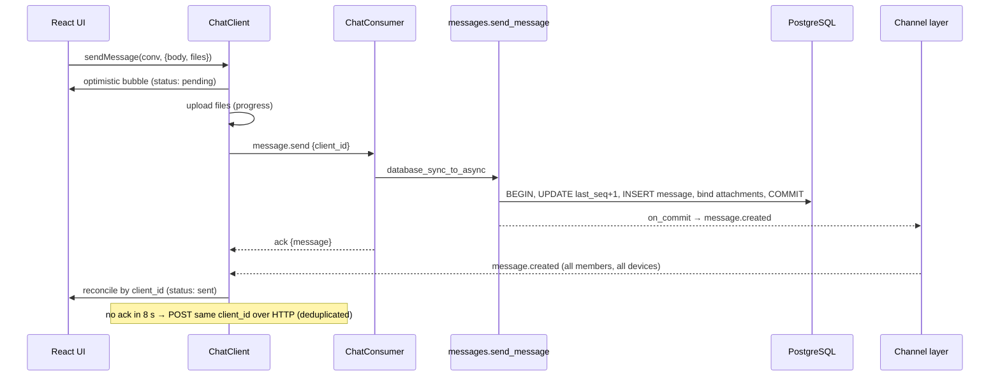

# Architecture overview

Talkio is a modular monolith plus three reusable packages. The standalone product consumes the packages exactly like a third-party host; there is one messaging backend and one set of chat components.

## Request paths

**Sending a message (socket path):**

**Reconnect:** backoff with full jitter → `connection.ready` → reload conversations → `after=<last seq>` per open conversation → `updated_since=<last ready>` → resend failed messages with their `client_id`.

## Module map

| Area | Path |
| --- | --- |
| Settings + validation | `packages/django-chat/src/django_realtime_chat/conf.py`, `checks.py` |
| Models / migrations | `…/models.py`, `…/migrations/` |
| Business rules | `…/services/` |
| Authorization hooks | `…/permissions.py` (`ChatPolicy`), `…/users.py` (`DefaultUserAdapter`) |
| REST | `…/api/views.py`, `…/api/urls.py` |
| WebSocket | `…/ws/consumer.py`, `…/ws/middleware.py`, `…/ws/tickets.py` |
| Fan-out | `…/events.py` |
| Presence | `…/presence.py` (memory/Redis leases), `…/services/presence.py` |
| SDK | `packages/chat-client/src/` (`client.ts`, `socket.ts`, `store.ts`, `api.ts`, `http.ts`, `auth.ts`) |
| Components | `packages/react-chat/src/components/` |
| Standalone server | `apps/server/` (`core/`, `accounts/`, legacy `chat/`) |
| Standalone web app | `apps/web/src/` |

Decisions are recorded in [decisions/](decisions/). The pre-transformation audit is in [current-state.md](current-state.md).
