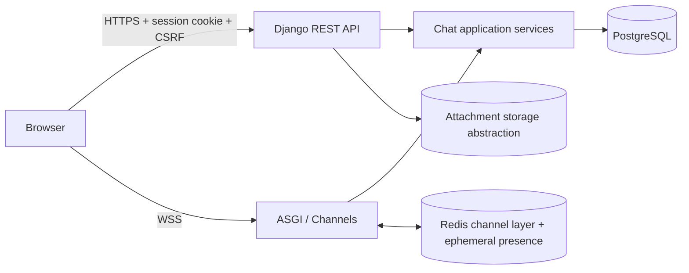

# Proposed Design

## Goals

Keep a single Django deployment with clear domain boundaries, durable message state, and ephemeral connection state. Prefer simple relational constraints and explicit services over a distributed architecture.

## Target shape

The browser is a separate React/Vite application. Django remains the API and WebSocket backend. This is a deliberate change from the server-rendered baseline to support a richer client and an explicit API boundary.

## Domain model evolution

- Retain `ChatRoom` as the compatibility-facing conversation record initially.
- Add an explicit membership model with roles, active/revoked state, and uniqueness per user/conversation.
- Extend messages with a server UUID, client idempotency key scoped to sender/conversation, lifecycle state, edited/deleted timestamps, and indexes on `(conversation, created_at, id)`.
- Represent read state per member and conversation rather than marking every message seen on connect. Unread counts are derived or maintained transactionally.
- Store attachments in a separate record with validated metadata and an authorization-checked download endpoint.
- Keep presence and typing out of durable message tables. Presence uses connection leases/TTL; typing events are short-lived and rate-limited.

## Request and WebSocket boundaries

HTTP and WebSocket operations call the same authorization/query services. Every operation resolves the conversation through the authenticated user’s active membership. WebSocket writes use `transaction.atomic()`, uniqueness constraints, and idempotency lookup so retries are safe under at-least-once delivery. The server is authoritative for message IDs and timestamps.

History is returned newest-first with an opaque cursor derived from stable ordering. Reconnect performs history recovery before or alongside live subscription and clients deduplicate by server message ID.

## Reliability and security

- Redis is used only when configured; local development may use the in-memory backend explicitly.
- Authentication uses Django’s session middleware for both HTTP and WebSocket handshakes.
- Payload length, message content, attachment type/size, and event names are validated at the boundary.
- User-visible message content is rendered as text, never as HTML.
- Logging uses event names and IDs, never message bodies, credentials, cookies, or raw attachment data.
- Health checks distinguish process health from database and Redis readiness.
- No exactly-once WebSocket claim: durable writes are idempotent and delivery is treated as at-least-once.

## Delivery sequence

1. Authenticate and authorize the connection.
2. Subscribe to a conversation group and establish a connection lease.
3. Validate an incoming event.
4. Persist the message atomically, returning an existing record for a duplicate idempotency key.
5. Broadcast the canonical server representation.
6. On reconnect, fetch the cursor gap and resume the group subscription.

## Incremental migration

1. Add settings hygiene, health checks, service/query boundaries, and tests around current behavior.
2. Add membership/read/idempotency fields and backfill from current room membership without deleting legacy data.
3. Move HTTP and WebSocket authorization to the shared boundary.
4. Replace the consumer and UI event protocol after compatibility tests pass.
5. Make Redis/PostgreSQL the documented deployment path while retaining SQLite as a development fallback.
