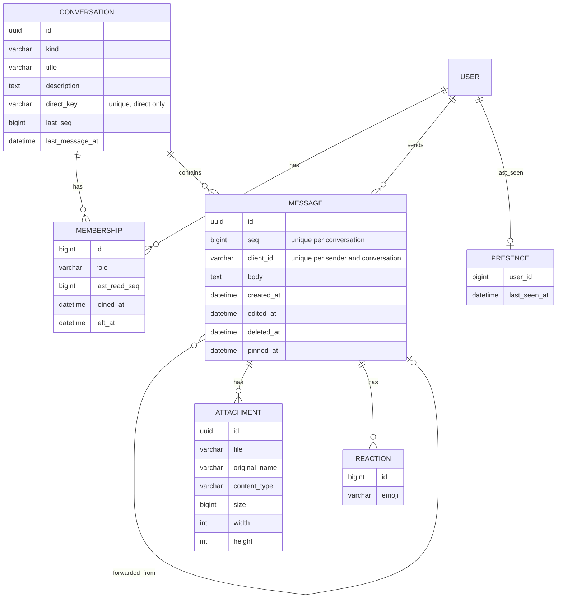

# Target Architecture

## Goals

1. A complete standalone chat product (registration, login, direct and group chat).
2. A pip-installable Django app (`django-realtime-chat`) that any Django project can mount.
3. A framework-independent TypeScript SDK (`@realtime-chat/client`) and a React UI library (`@realtime-chat/react`) that any React app can embed.

The standalone product is **a consumer of the same packages** offered to integrators. There is one messaging backend and one set of chat components.

## Repository layout

```
talkio/
  apps/
    server/                 Standalone Django project (settings, accounts, auth API, legacy import)
    web/                    Standalone React app (routing, auth screens, layout) — uses the packages
  packages/
    django-chat/            pip: django-realtime-chat  → import django_realtime_chat
    chat-client/            npm: @realtime-chat/client (no framework dependency)
    react-chat/             npm: @realtime-chat/react  (components + widget + design tokens)
  examples/
    django-integration/     A separate Django project using django.contrib.auth.User
    react-integration/      A separate React "host app" that embeds <ChatWidget/>
  docs/                     architecture, api, integration, design system, security, deployment
  docker-compose.yml        Postgres + Redis + Daphne + Vite
```

Deviation from the suggested structure: there is no separate `apps/demo`; `examples/react-integration` is the integration demo, because a demo that lives outside `apps/` proves the packages work without monorepo-internal shortcuts.

## Layering

```mermaid
flowchart TB
  subgraph Browser
    Web[apps/web<br/>routes, auth screens, layout]
    Host[Any host React app]
    React[@realtime-chat/react<br/>components, widget, tokens]
    SDK[@realtime-chat/client<br/>REST client, socket manager, store]
    Web --> React
    Host --> React
    React --> SDK
  end
  subgraph Server["Django process (ASGI)"]
    Accounts[apps/server accounts<br/>User model + auth API]
    subgraph Pkg[django_realtime_chat]
      API[api/ — DRF views, serializers]
      WS[ws/ — Channels consumer, auth middleware]
      Services[services/ — business rules, transactions]
      Policy[permissions policy hooks]
      Presence[presence store — TTL leases]
      Models[(models)]
      API --> Services
      WS --> Services
      Services --> Policy
      Services --> Models
      WS --> Presence
    end
  end
  SDK -- HTTPS session/bearer --> API
  SDK -- WSS --> WS
  Services -- on_commit broadcast --> Redis[(Redis channel layer)]
  WS <--> Redis
  Presence --> Redis
  Models --> PG[(PostgreSQL)]
```

| Concern | Location | Notes |
| --- | --- | --- |
| Messaging rules (membership, idempotency, ordering, unread, edits) | `django_realtime_chat/services/` | Sync functions; used by REST and (via `database_sync_to_async`) WebSocket. |
| Persistence | `django_realtime_chat/models.py` | Uses `settings.AUTH_USER_MODEL`; no import of host apps. |
| Authorization | `django_realtime_chat/permissions.py` | `ChatPolicy` class, replaceable via `CHAT_POLICY`. |
| Authentication | Host-provided | DRF authentication classes from host settings; WebSocket uses Channels session middleware or short-lived signed tickets. |
| REST | `django_realtime_chat/api/` | Versioned `/api/chat/v1/`. |
| Realtime | `django_realtime_chat/ws/` + `events.py` | One socket per client at `/ws/chat/v1/`; conversation-scoped variant `/ws/chat/v1/conversations/<id>/`. |
| Transient state | Presence store (Redis sorted sets / in-memory for dev), typing (channel layer only) | Never written to message tables. |
| UI | `@realtime-chat/react` | Prefixed Tailwind utilities (`rc:`), CSS variables, no global reset. |
| App configuration | `apps/server`, `apps/web` | Branding, routes, auth screens. |

## Key design decisions

Recorded as ADRs in [`decisions/`](decisions/):

- **0003 — Per-conversation sequence numbers.** Every message gets `seq` from an atomic `UPDATE conversation SET last_seq = last_seq + 1` inside the creating transaction. `seq` gives stable cursors, gap detection after reconnect, and cheap unread counts (`messages with seq > membership.last_read_seq`).
- **0004 — One user-level socket.** A client opens one connection and receives events for all of its conversations (needed for unread badges and the widget). The consumer joins one channel-layer group per membership plus a per-user group used to deliver membership changes.
- **0005 — Store in the SDK, not in React.** The SDK owns a normalized, immutable store (`subscribe` / `getSnapshot`). React binds with `useSyncExternalStore`. The library therefore does not force a TanStack Query version on hosts; the standalone app still uses TanStack Query for app-level data (profile, auth).
- **0006 — Upload-then-attach.** Files are uploaded first (pending attachment owned by the uploader and bound to a conversation), then referenced from `message.send`. Message creation and attachment binding happen in one transaction.
- **0007 — Style isolation.** The React library ships precompiled CSS with prefixed utilities and `--rc-*` variables and no preflight, so it cannot restyle host elements.
- **0008 — Legacy chat app retained as data source only.** The legacy `chat` app's models and migrations stay installed in `apps/server` so existing databases keep their tables; `manage.py import_legacy_chat` copies rooms, members, messages, reactions and attachments into the package tables idempotently. Legacy endpoints are removed; see the v1 migration guide.

## Data model (package)



Constraints: `unique(conversation, seq)`, partial `unique(conversation, sender, client_id)`, `unique(direct_key)` (prevents duplicate direct chats under concurrency), partial `unique(conversation, user) WHERE left_at IS NULL`, `unique(message, user, emoji)`.

## Delivery semantics

- Writes are **at-least-once with idempotency**: a retry with the same `client_id` returns the original message (`deduplicated: true`). The SDK retries a WebSocket send over HTTP with the same key if no ack arrives.
- Broadcasts happen in `transaction.on_commit`, so subscribers never see uncommitted messages.
- Ordering is guaranteed **per conversation by `seq`**, not by arrival. Events across conversations have no global order. Clients sort by `seq` and fetch gaps (`after=<seq>`).
- No exactly-once delivery is claimed.

## Migration plan from the current code

1. Move the Django project into `apps/server` (git history preserved by `git mv`).
2. Build `django_realtime_chat` with new tables; keep legacy `chat` models installed for import only.
3. Expose `/api/chat/v1/` and `/ws/chat/v1/`; move auth endpoints to `/api/auth/` in `accounts`.
4. Replace `frontend/` with `apps/web` built on the packages.
5. Fix the `UserStatus` defect by no longer writing to it; the package's `ChatPresence` model replaces it.
