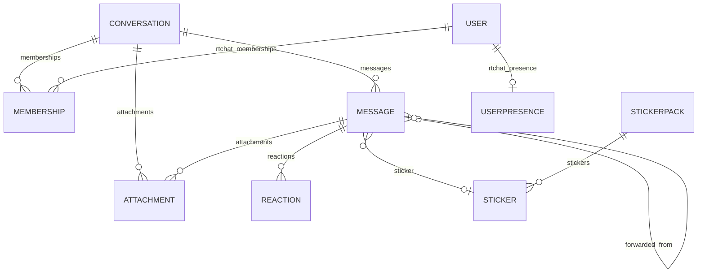
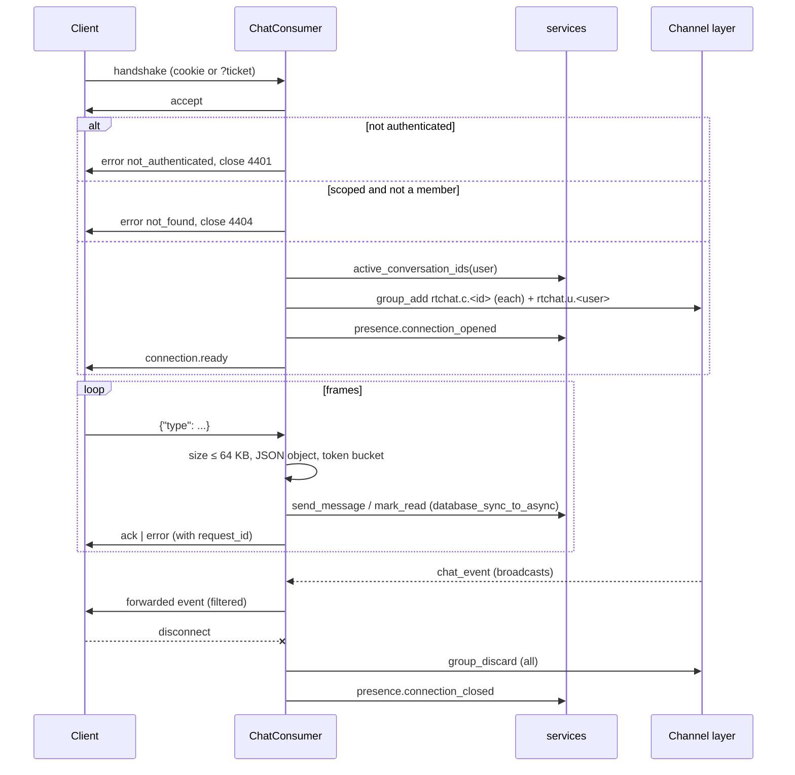

# Backend technical reference

**English** · [فارسی](fa/backend.md)

This document describes how the backend works internally: the reusable package `django_realtime_chat` (`packages/django-chat/src/django_realtime_chat/`) and the standalone server (`apps/server/`). For the public contracts see [api/rest-api.md](api/rest-api.md) and [api/websocket.md](api/websocket.md); for integration see [integration/django.md](integration/django.md).

Contents: [1 Layout](#1-layout) · [2 Configuration](#2-configuration) · [3 Data model](#3-data-model) · [4 Services](#4-services) · [5 Authorization](#5-authorization) · [6 Serialization](#6-serialization) · [7 REST layer](#7-rest-layer) · [8 WebSocket layer](#8-websocket-layer) · [9 Fan-out](#9-fan-out-eventspy) · [10 Presence](#10-presence) · [11 Rate limiting](#11-rate-limiting) · [12 Files and media](#12-files-and-media) · [13 Extension points](#13-extension-points) · [14 Standalone server](#14-standalone-server-appsserver) · [15 Tests](#15-tests) · [16 Error codes](#16-error-codes)

---

## 1. Layout

```
django_realtime_chat/
  apps.py            AppConfig (label "realtime_chat"); imports checks on ready()
  conf.py            CHAT_* settings with defaults (ChatSettings, Rate)
  checks.py          system checks validating CHAT_* (realtime_chat.E00x / W00x)
  models.py          Conversation, Membership, Message, Attachment, Reaction, UserPresence, StickerPack, Sticker
  errors.py          ChatError hierarchy with stable codes and HTTP statuses
  permissions.py     ChatPolicy (authorization hooks) + get_policy()
  users.py           DefaultUserAdapter (display name, handle, avatar, search) + clean_user_id()
  emoji.py           is_emoji() validator (no external data)
  files.py           content sniffing, safe file names, image verification, thumbnails
  serializers.py     JSON payload builders shared by REST and WebSocket
  events.py          channel-layer fan-out scheduled on transaction commit
  presence.py        MemoryPresenceStore / RedisPresenceStore (connection leases)
  ratelimit.py       TokenBucket (WebSocket) and ChatThrottle subclasses (DRF)
  signals.py         message_created, message_updated, message_deleted, conversation_created, members_changed
  services/          business rules — the only place that changes data
    conversations.py  membership resolution, direct/group creation, members, roles, read markers
    messages.py       sending (sequenced, idempotent), history, edit, delete, reactions, pins, forward, search
    attachments.py    upload validation, access, discard, cleanup
    stickers.py       packs, sticker resolution, upload inspection
    users.py          user search and profiles
    presence.py       connection opened/heartbeat/closed transitions
  api/views.py       thin DRF views (parse → service → serialize)
  api/urls.py        URL patterns; included via urls.py with app_name "realtime_chat"
  ws/consumer.py     ChatConsumer (AsyncJsonWebsocketConsumer)
  ws/middleware.py   TicketAuthMiddleware, ChatAuthMiddlewareStack, chat_websocket_application()
  ws/tickets.py      issue_ticket() / redeem_ticket()
  ws/routing.py      websocket_urlpatterns
  routing.py         convenience re-exports for asgi.py
  admin.py           admin registrations, StickerForm with upload validation
  management/commands/chat_purge_uploads.py
  migrations/        0001_initial, 0002_media_voice_stickers
```

**Dependency rule:** `api/` and `ws/` depend on `services/`; `services/` depend on models, policy, serializers and events; nothing in the package imports the host project. Views never touch models directly except through services and serializers.

## 2. Configuration

### `conf.py`

`DEFAULTS` lists every setting without the `CHAT_` prefix. `chat_settings.<NAME>` reads `settings.CHAT_<NAME>` **on every access** (no caching), which makes `override_settings` and pytest's `settings` fixture work. Dict settings (`DEFAULT_PERMISSIONS`, `RATE_LIMITS`) are **merged** with the defaults, so a host can override one key.

`Rate.parse("30/10s")` → `Rate(count=30, period=10.0)`. Format: `<count>/<multiplier?><s|m|h>`.

`chat_settings.import_setting(name)` imports a dotted path (`POLICY`, `USER_ADAPTER`) and raises `ImproperlyConfigured` with a readable message.

### `checks.py`

Registered with `@register(Tags.compatibility)` and imported from `RealtimeChatConfig.ready()`.

| ID | Condition |
| --- | --- |
| W001 | Unknown `CHAT_*` setting (typo protection) |
| E001 | Integer limits not positive integers |
| E002 | Feature flags not booleans |
| E003 | `EDIT_WINDOW` neither `None` nor positive int |
| E004/E005 | Invalid presence backend / `redis` without `CHAT_REDIS_URL` |
| W002 | Memory presence with `DEBUG=False` (process-local) |
| E006 | Unparseable rate |
| E007 | Active content types in the attachment allow-list (SVG, HTML, JS) |
| E008 | Policy/adapter not importable |
| E009 | `ALLOWED_REACTIONS` not `None` or not a non-empty list of emoji |

## 3. Data model



All user foreign keys point to `settings.AUTH_USER_MODEL` (swappable dependency in migrations). Reverse accessors are prefixed `rtchat_` so they cannot clash with host models (a clash with the legacy `chat` app was found and fixed this way).

| Model | Key fields | Constraints / indexes | Notes |
| --- | --- | --- | --- |
| `Conversation` | `id` UUID, `kind` direct/group, `title`, `description`, `direct_key`, `last_seq`, `last_message_at`, `last_activity_at` | `direct_key` unique; index `(-last_activity_at, -id)` | `direct_key = "<low pk>:<high pk>"` (sorted by length then value so `"9" < "10"`). Uniqueness makes "start direct chat" race-free. |
| `Membership` | `conversation`, `user`, `role` owner/admin/member, `last_read_seq`, `joined_at`, `left_at` | unique `(conversation, user)`; index `(user, left_at)` | One row per pair forever. Leaving sets `left_at`; re-adding clears it and moves `last_read_seq` to the current end. |
| `Message` | `id` UUID, `seq`, `client_id`, `sender` (SET_NULL), `body`, `reply_to`, `forwarded_from`, `sticker`, `created_at`, `updated_at`, `edited_at`, `deleted_at`, `pinned_at/by` | unique `(conversation, seq)`; unique `(conversation, sender, client_id)`; index `(conversation, updated_at)` | `seq` is gap-free per conversation. Deleted messages are tombstones. `updated_at` (auto_now) drives `updated_since` recovery. |
| `Attachment` | `id` UUID, `conversation`, `message` (nullable = pending), `uploaded_by`, `file`, `thumbnail`, `original_name`, `content_type` (detected), `size`, `width`, `height`, `is_voice`, `duration`, `waveform` | index `(uploaded_by, message)` | Files use random names (`attachment_upload_to`). |
| `Reaction` | `message`, `user`, `emoji` | unique `(message, user, emoji)` | |
| `UserPresence` | `user` (PK), `last_seen_at` | | Durable half of presence. |
| `StickerPack` / `Sticker` | name, `is_active`, `position` / `emoji`, `file`, `content_type`, `width`, `height` | | Staff-curated in the admin. |

**Storage:** `Attachment.file`, `.thumbnail` and `Sticker.file` use `attachment_storage()`, which returns a `LazyObject` resolving `storages[CHAT_ATTACHMENT_STORAGE]` on first use and again after a `setting_changed` signal. A plain callable would be evaluated once at import time (Django behavior), ignoring later configuration.

## 4. Services

Services are synchronous functions taking the acting `user` first. They validate input, check the policy, run inside `transaction.atomic()` where they write, schedule broadcasts with `events.*` (which use `transaction.on_commit`) and send signals after commit. They raise `ChatError` subclasses; the transports translate those.

### 4.1 Membership resolution — `conversations.get_membership(user, conversation_id, for_update=False)`

Returns the caller's **active** membership with the conversation joined, or raises `NotFound` for: unknown id, malformed UUID (`ValidationError`), not a member, or left. This one function is the authorization gate for every conversation-scoped operation, and the reason private conversations answer 404.

With `for_update=True` it uses `SELECT … FOR UPDATE` without `of=`, which on PostgreSQL also locks the joined conversation row. Member-changing operations rely on that to serialize per conversation (proven by `tests/test_concurrency.py`).

### 4.2 Conversations

| Function | Behavior |
| --- | --- |
| `list_conversations(user, before, kind, query, limit)` | Ordered by `(-last_activity_at, -id)`. Cursor = base64url of `"<iso>|<uuid>"`; continuation filter `activity < t OR (activity = t AND id < cursor_id)`. `query` matches titles or, for direct chats, peers found by the user adapter. Limit 1–100. |
| `start_direct(user, other_id)` | Resolves the other user through the policy's `user_queryset` (ids validated by `clean_user_id`), checks `can_start_direct`, looks up `direct_key`, else creates conversation + two memberships in one transaction. An `IntegrityError` (concurrent creator won) returns the existing row. Previously-left memberships are reactivated. |
| `create_group(user, title, member_ids, description)` | Feature flag + `can_create_group`; title 1–`MAX_TITLE_LENGTH`; description ≤500; size ≤`MAX_GROUP_MEMBERS`. Creator becomes owner. |
| `update_conversation` | Locks, checks `can_edit_conversation`, saves title/description, notifies all members. |
| `add_members` | Locks, checks `can_add_members`, reactivates or creates memberships, enforces the size limit, notifies, sends `members_changed`. |
| `remove_member` | Locks requester and target; `can_remove_member`; sets `left_at`; transfers ownership if the owner left (`_transfer_ownership`: longest-standing admin, else member); sends `conversation.removed` to the removed user and `conversation.updated` to the rest. |
| `change_role` | Owner only (policy); transferring `owner` demotes the previous owner to admin. |
| `mark_read(user, id, seq)` | Clamps to `[0, last_seq]` and runs `UPDATE … WHERE last_read_seq < seq`, which is monotonic and race-safe without a transaction. Broadcasts `read.updated` only when the row changed. |
| `notify_conversation(conv, user_ids)` | After commit, builds a **viewer-specific** payload for each member and sends it to that member's user group. |

### 4.3 Messages — `messages._create(...)`

The heart of the system. Called by `send_message` and `forward_message`.

1. `normalize_client_id` — generates a UUID hex if absent; otherwise `^[A-Za-z0-9_.:\-]{1,64}$`.
2. **Fast idempotency path:** an existing `(conversation, sender, client_id)` row is returned with `created=False`. No sequence number is consumed and nothing is broadcast.
3. Policy `can_send_message`, `normalize_body` (CRLF→LF, strip NUL and bidi override/isolate characters U+202A–202E and U+2066–2069, trim, length limit), attachment ids (feature flag, max count, dedupe), sticker rules (a sticker cannot be combined with text/files), reply target must belong to the same conversation.
4. `transaction.atomic()`:
   - `UPDATE conversation SET last_seq = last_seq + 1, last_message_at = now, last_activity_at = now` — this takes the row lock that serializes concurrent senders (PostgreSQL); then the new value is read back.
   - `INSERT message` with that `seq`.
   - `_bind_attachments`: `SELECT … FOR UPDATE` the listed attachments filtered by `conversation`, `uploaded_by=user` and `message IS NULL`; the count must match, otherwise `ValidationFailed` rolls back everything, including the sequence increment.
   - Forwarded attachments are copied as new rows that reference the same stored file names.
   - The sender's `last_read_seq` is advanced to the new seq (own messages are read).
   - Payload built and `message.created` scheduled with `on_commit`; `message_created` signal scheduled.
5. `IntegrityError` → an identical concurrent request won the unique constraint; the winner is returned with `created=False`.

Other functions:

| Function | Notes |
| --- | --- |
| `list_messages` | Exactly one mode: newest page / `before=<seq>` (descending query, reversed to ascending), `after=<seq>` (ascending), `updated_since=<iso>` (≤200 by `updated_at`), or `pinned`. Results are **always ascending** by seq; `next_cursor` is a seq string. |
| `search_messages` | `body__icontains` across active memberships, deleted messages excluded, 30 per page, cursor = ISO `created_at`. |
| `edit_message` | `SELECT … FOR UPDATE OF message`; sender via policy; edit window; empty body only allowed if attachments exist; broadcasts `message.updated`. |
| `delete_message` | Tombstone: body emptied, `deleted_at`, unpinned, reactions and attachments deleted; files removed after commit if no other row references them; broadcasts `message.deleted`. |
| `toggle_reaction` | `is_emoji()` (or the configured allow-list); locked toggle; bumps `updated_at` so reconnecting clients receive the change through `updated_since`; broadcasts the aggregated summary. |
| `toggle_pin` | Policy `can_pin_message`; broadcasts `message.updated`. |
| `forward_message` | Requires membership in source and target; copies body, sticker and attachments; idempotent by `client_id`. |

### 4.4 Attachments — `services/attachments.py`

`upload_attachment(user, conversation_id, upload, voice=False, duration=None, waveform=None)`:

1. Feature flag, membership, non-empty, `size ≤ MAX_ATTACHMENT_SIZE`, pending uploads in the last 24 h `< MAX_PENDING_ATTACHMENTS`.
2. `sniff_upload` → detected type (see §12); must be in `ALLOWED_ATTACHMENT_TYPES`.
3. Voice: `ENABLE_VOICE`, audio type, `0 < duration ≤ MAX_VOICE_DURATION`, waveform = list of ≤128 ints 0–100 (accepts JSON text from multipart).
4. Images: verified with Pillow (`image_dimensions` raises on corrupt/bomb images); a WebP thumbnail is generated for still images larger than `THUMBNAIL_SIZE`.
5. Saved as a **pending** attachment (`message = NULL`), visible only to its uploader.

`get_attachment` requires active membership and, for pending files, ownership. `discard_attachment` deletes your own pending upload. `delete_attachment_files` defers storage deletion to `on_commit` and skips names still referenced by another row (forwards share files). `purge_stale_uploads` backs the `chat_purge_uploads` command.

### 4.5 Users, presence, stickers

- `users.search_users` — policy gate; empty query returns co-members ("people you talk to"); otherwise adapter search over `policy.user_queryset(user)`; max 20; payload includes presence; never e-mail.
- `users.get_user_profile` — visible if discoverable or sharing a conversation; ids validated with `clean_user_id`.
- `presence.connection_opened/heartbeat/connection_closed` — see §10.
- `stickers.resolve_sticker` (for sending: pack must be active), `get_sticker` (for display: any), `inspect_sticker_file` (PNG/WebP/GIF, ≤`MAX_STICKER_SIZE`, ≤512×512).

## 5. Authorization

`ChatPolicy` (`permissions.py`) centralizes every decision. Services call `get_policy()`, which instantiates `CHAT_POLICY` once per dotted path (LRU cache keyed by the setting value).

| Method | Default |
| --- | --- |
| `user_queryset(user)` | active users |
| `can_search_users` | `ENABLE_USER_SEARCH` |
| `can_start_direct(user, other)` | not yourself |
| `can_create_group` | `ENABLE_GROUPS` |
| `can_edit_conversation` | group admin/owner, or flag `members_can_edit_info` |
| `can_add_members` | group admin/owner, or `members_can_add_members` |
| `can_remove_member` | yourself (leave); owner removes anyone but the owner; admins remove members |
| `can_change_role` | owner, not on themself |
| `can_send_message` | active membership |
| `can_edit_message` | sender |
| `can_delete_message` | sender, or group admin with `admins_can_delete_messages` |
| `can_pin_message` | direct: anyone; group: admins or `members_can_pin` |

Identity always comes from `request.user` / `scope["user"]`. No endpoint accepts "act as user X".

## 6. Serialization

`serializers.py` builds plain dicts used by both transports, so event payloads and HTTP responses are identical.

- `message_queryset()` — `select_related` sender, reply/forward (+ senders), sticker; `prefetch_related` attachments and reactions. Every message read path starts from it, avoiding N+1 queries.
- `message_payload` — tombstones hide body, attachments, reactions and sticker; `kind` (`text | image | gif | video | audio | voice | file | sticker | deleted`) is derived for previews; reply/forward references carry a 280-character excerpt.
- `attachment_payload` — `url` and `thumbnail_url` are **reversed** through the `realtime_chat` namespace, so they follow the host's mount point.
- `conversation_queryset_for(user)` + `annotate_for_viewer` — subqueries add `my_last_read_seq`, `my_role` and `unread_count` (count of non-deleted messages from others with `seq > my_last_read_seq`) in the same SQL query; active memberships are prefetched into `active_memberships`.
- `conversation_payloads(rows, viewer)` — batch: one query for all last messages (OR of `(conversation, seq)` pairs), one presence lookup for all members, then per-row assembly. Direct conversations get `title` = peer's display name and `peer`.

## 7. REST layer

`api/views.py` defines `ChatAPIView(APIView)`:

- `permission_classes = [IsAuthenticated]`; authenticators from `CHAT_API_AUTHENTICATION_CLASSES` or the host's DRF defaults.
- `parser_classes = [JSONParser]` (upload view: multipart).
- `get_throttles()` adds the write throttle **only for unsafe methods**; search views add `SearchThrottle`.
- `handle_exception()` maps `ChatError` → `{"error": {code, message, details}}` with `Retry-After` for rate limits, and rewrites DRF's own errors (`NotAuthenticated`, validation) into the same envelope.

Downloads use `_harden()` — `Content-Disposition` (inline only for image/audio/video), `nosniff`, `CSP: default-src 'none'; sandbox`, `Cache-Control: private`, `CORP: same-site`. `?variant=thumb` serves the WebP preview. Sticker files are cached for a day (`immutable`).

## 8. WebSocket layer

### 8.1 ASGI stack

`chat_websocket_application(allowed_origins=None)` returns:

```
AllowedHostsOriginValidator | OriginValidator(origins)
  └─ AuthMiddlewareStack            (Channels: session cookie → scope["user"])
      └─ TicketAuthMiddleware        (?ticket= → scope["user"], or AnonymousUser if invalid)
          └─ URLRouter(websocket_urlpatterns) → ChatConsumer
```

Tickets (`ws/tickets.py`): `signing.dumps({"u": pk, "n": nonce}, salt=…)`, verified with `max_age=WS_TICKET_TTL`; single use via `cache.add("rtchat:ticket:<nonce>")`, which is atomic on Redis/Memcached/LocMem.

### 8.2 `ChatConsumer` lifecycle



Details:

- The connection is accepted **before** the auth check so the client receives an application close code (4401/4404) and knows not to retry.
- Frames > 64 KB or non-JSON produce `invalid_frame` / `invalid_event`; unknown types `unknown_event`. Daphne itself caps messages at 1 MB.
- Per-connection token buckets: `ws_message`, `ws_typing`, `ws_other` (see §11).
- `message.send` and `read.mark` require the conversation to be in the connection's subscription set (cheap pre-check); the service re-checks membership in the database.
- Typing is not persisted: `typing.start` is throttled to once per 2 s per conversation per connection; `typing.stop` is only sent if a start was sent.
- `chat_event` (handler for every broadcast): `conversation.updated` subscribes the socket to the conversation group (new memberships go live without reconnecting); `conversation.removed` unsubscribes; events for non-subscribed conversations are dropped (stale deliveries after removal); the user's own typing events are not echoed.
- `disconnect` leaves all groups and releases the presence lease.

## 9. Fan-out (`events.py`)

- Group names: `rtchat.c.<conversation uuid>` and `rtchat.u.<user pk>` (sanitized to the channel-layer charset, <100 characters).
- `to_conversation(id, type, payload)` and `to_users(ids, type, payload_or_callable)` register a `transaction.on_commit` callback. Subscribers never see data from a rolled-back transaction, and a send outside a transaction fires immediately.
- `_send` uses `async_to_sync(layer.group_send)`, which works from request threads and from `database_sync_to_async` threads; failures are logged and swallowed, so a broken channel layer never breaks a write.
- Delivery is best effort. Correctness comes from client recovery (`after`, `updated_since`), not from the transport.

## 10. Presence

Presence is split into a **transient** part (who is connected now) and a **durable** part (`UserPresence.last_seen_at`).

Each WebSocket connection holds a lease `connection_id → expiry`. A user is online while at least one lease is unexpired:

- `MemoryPresenceStore` — dict guarded by a lock; process-local (development/tests).
- `RedisPresenceStore` — sorted set `rtchat:presence:<user>` with score = expiry. `connect`: prune expired (`ZREMRANGEBYSCORE`), count, `ZADD`, `EXPIRE` in one pipeline; "came online" if the count before was 0. `disconnect`: `ZREM`, prune, count; offline if 0. `online_user_ids`: pipelined `ZCOUNT(now, +inf)`.

The consumer calls `heartbeat` on every `ping` (clients ping every `max(5, PRESENCE_TTL // 2)` seconds). A crashed worker's leases expire after `PRESENCE_TTL`, so stale "online" states resolve themselves. Those expiries are not broadcast (known limitation). Transitions are broadcast as `presence.updated` to every conversation the user belongs to.

## 11. Rate limiting

| Transport | Mechanism | Key |
| --- | --- | --- |
| HTTP (chat) | `ChatThrottle(SimpleRateThrottle)`; rate read from `CHAT_RATE_LIMITS[scope]`; history in the Django cache | `rtchat:throttle:<scope>:<user pk>` |
| HTTP (auth, server) | DRF `ScopedRateThrottle` scope `auth` (20/min) | client IP |
| WebSocket | `TokenBucket(count, period)` per connection and category; refill rate = count/period; returns seconds to wait | the connection |

The client IP for anonymous throttles comes from DRF's `NUM_PROXIES` (`TRUSTED_PROXY_COUNT` in the server). With `0`, `X-Forwarded-For` is ignored. Before this was set, DRF trusted the client-supplied header and the login limit could be bypassed (regression test: `apps/server/tests/test_hardening.py`).

## 12. Files and media

`files.py`:

- `detect_content_type(head, declared)` — magic bytes for JPEG, PNG, GIF, WebP, WAV (RIFF/WAVE), PDF, Ogg, MP3 (ID3/frame sync), WebM (EBML) and MP4 (`ftyp`). WebM and MP4 are containers: the **declared** type only selects the audio variant (`audio/webm`, `audio/mp4` — browser voice recordings) versus video. It is never trusted to identify a format.
- `looks_like_text` — UTF-8 decodable (tolerating a cut multi-byte sequence), no NUL, not starting with HTML/SVG/XML/script markers; only for `.txt/.log/.md/.csv` or extension-less names.
- `safe_filename` — basename, NFC, control characters removed, unsafe characters replaced, length cap (display only; storage names are random).
- `image_dimensions` — Pillow `verify()`; raises for corrupt images or more than 80 megapixels.
- `make_thumbnail` — EXIF-aware, WebP, max side `THUMBNAIL_SIZE`; skipped for animated or small images.

`emoji.py` — `is_emoji(value)` accepts a single emoji token: pictographic code-point ranges, ZWJ (U+200D), variation selectors, keycaps (`[0-9#*]` + optional VS16 + U+20E3), tag sequences (subdivision flags); requires at least one pictograph; maximum length.

## 13. Extension points

| Hook | Use |
| --- | --- |
| `CHAT_POLICY` | Tenancy, blocking, moderation, custom role rules |
| `CHAT_USER_ADAPTER` | Display names, handles, avatars, search fields |
| `CHAT_API_AUTHENTICATION_CLASSES` | JWT or token auth for chat only |
| `CHAT_ATTACHMENT_STORAGE` | S3/GCS/any Django storage |
| `signals.*` | Notifications, analytics, indexing (sent after commit) |
| `services.*` | Call business operations from your own code (same authorization) |

## 14. Standalone server (`apps/server`)

| Module | Role |
| --- | --- |
| `core/settings.py` | Environment-driven settings; `.env` loader; refuses to start without `DJANGO_SECRET_KEY` when `DEBUG=0`; Postgres when `DB_ENGINE` contains `postgresql`; Redis cache + channel layer + Redis presence when `REDIS_URL` is set; private `chat_attachments` storage; production cookie/HSTS flags; `NUM_PROXIES` from `TRUSTED_PROXY_COUNT`; demo login only with `DEBUG`. |
| `core/asgi.py` | `ProtocolTypeRouter` with Django for HTTP and `chat_websocket_application(WEBSOCKET_ALLOWED_ORIGINS or None)`. |
| `core/urls.py` | admin, `/api/health/…`, `/api/auth/`, `/api/chat/v1/`, `/api/v1/*` → 410 with a migration hint, social auth; in DEBUG serves static files and **only** `media/avatars/`. |
| `core/health.py` | Liveness, readiness (database, Redis), `LegacyApiGoneView`. |
| `core/docs.py` | Documentation viewer in the admin: README, `docs/`, `README.fa.md`; Persian pages (`docs/fa/`, the Persian guide) right-to-left, `docs/learn/en/` left-to-right. |
| `accounts/models.py` | Legacy custom `User` (`USERNAME_FIELD = "phone"`, phone optional); `VerificationCode`. Usernames generated with `secrets` if missing. |
| `accounts/managers.py` | `create_user(phone=None, password, username=…)` — phone or username required. |
| `accounts/authentication.py` | `CustomModelBackend(ModelBackend)` — e-mail (case-insensitive), digits → phone, else username; `user_can_authenticate`; runs the hasher for unknown users to equalize timing. |
| `accounts/api.py` | `/api/auth/` — `session/` (bootstrap, sets CSRF cookie, lists providers, `demo_auth`), `login/` (password, or phone + `DEMO_AUTH_CODE` with `secrets.compare_digest` when enabled), `register/`, `logout/`, `me/` (profile + avatar validated by magic bytes and Pillow), `me/password/` (keeps the session via `update_session_auth_hash`). Login/register use `csrf_protect` even for anonymous users (login CSRF) and the `auth` throttle. |
| `accounts/chat_adapter.py` | Null-safe display names; hides handles equal to the phone number. |
| `accounts/management/commands/seed_demo.py` | Demo users, groups, direct chats, reactions, a generated image (thumbnail path), a reply, a generated sticker pack and a WAV voice note — all through the package services. Refuses with `DEBUG=0` unless `--force`. |
| `chat/` | Legacy models + migrations only, read-only admin, `import_legacy_chat` (idempotent: deterministic UUIDv5 ids, skips imported rooms, never modifies legacy rows; see ADR 0008). |

## 14.1 Translations

- Every user-facing message is a gettext call: `gettext("Message not found.")`, with `%(name)s` placeholders filled afterwards (`gettext("%(name)s must be positive.") % {"name": name}`). `ChatError.default_message` uses `gettext_lazy`; `ChatError.__init__` resolves the message with `str()` so it is worded in the language active when the error is raised.
- REST requests get their language from `LocaleMiddleware` (`Accept-Language`). The WebSocket consumer has no middleware: `connection_language(scope)` picks `?lang=`, else the handshake's `Accept-Language`, else `LANGUAGE_CODE`, and each received event is handled under `translation.override`.
- Catalogs: `packages/django-chat/src/django_realtime_chat/locale/fa/LC_MESSAGES/django.po` (shipped in the wheel, see `package-data`) and `apps/server/locale/fa/LC_MESSAGES/django.po` (`LOCALE_PATHS`). Both `.po` and the compiled `.mo` are in git.
- `scripts/i18n.py` replaces makemessages/compilemessages without the GNU gettext tools: `extract` finds literal arguments of `gettext`/`gettext_lazy`/`_`/`pgettext` with `ast`, `compile` writes the `.mo`, `check` (CI) fails on untranslated or stale catalogs.
- Developer-facing messages (system checks, settings errors) stay English on purpose.

## 15. Tests

| Suite | Path | Notes |
| --- | --- | --- |
| Package | `packages/django-chat/tests/` | Uses `django.contrib.auth.User` (`tests/settings.py`) to prove independence from the host. `TEST_DATABASE_URL` switches to PostgreSQL (TCP or unix socket). |
| — conversations / messages / attachments / media | `test_*.py` | Authorization, isolation, idempotency, pagination, edits, tombstones, reactions, uploads, voice, thumbnails, stickers, emoji, malformed ids. |
| — WebSocket | `test_websocket.py` | `WebsocketCommunicator`; uses `receive_nothing` polling (a timed-out `receive_json_from` cancels the application in asgiref). |
| — concurrency | `test_concurrency.py` | Real threads on PostgreSQL: direct creation, concurrent member adds, member limit, 60 concurrent sends with retries → gap-free seq. Skipped on SQLite. |
| — Redis presence | `test_redis_presence.py` | `fakeredis`. |
| — translations | `test_i18n.py` | Errors in the active language, `connection_language` for sockets. |
| Server | `apps/server/tests/` | Responses in the `Accept-Language` language (`test_i18n.py`); auth flows, CSRF, demo login, profile, integration with `accounts.User`, private storage, 410, ASGI origin check, legacy import, seed, proxy/throttle hardening. |
| External host | `examples/django-integration/tests/` | Stock `auth.User`, custom policy, host settings. |

`transaction.on_commit` callbacks do not run inside `TestCase` transactions; tests use `django_capture_on_commit_callbacks(execute=True)` or `transaction=True`.

## 16. Error codes

| Code | Status | Raised by |
| --- | --- | --- |
| `validation_error`, `invalid_request` | 400 | generic |
| `not_authenticated` | 403 | DRF auth / WS 4401 |
| `forbidden` | 403 | policy denials |
| `feature_disabled` | 403 | groups, attachments, reactions, search, stickers, voice |
| `not_found` | 404 | anything you cannot access |
| `rate_limited` | 429 | throttles / token buckets (`details.retry_after`) |
| `invalid_kind`, `invalid_title`, `invalid_description`, `invalid_members`, `too_many_members`, `invalid_role`, `invalid_seq`, `invalid_cursor` | 400 | conversations |
| `invalid_body`, `empty_message`, `message_too_long`, `invalid_client_id`, `invalid_reply`, `invalid_attachments`, `too_many_attachments`, `message_deleted`, `edit_window_expired` (403), `invalid_reaction`, `invalid_sticker`, `invalid_query` | 400 | messages |
| `file_required`, `empty_file`, `file_too_large`, `too_many_pending`, `unsupported_file_type`, `invalid_image`, `invalid_voice`, `voice_too_long` | 400 | attachments |
| `invalid_frame`, `invalid_event`, `unknown_event`, `internal_error` | — | WebSocket only |
