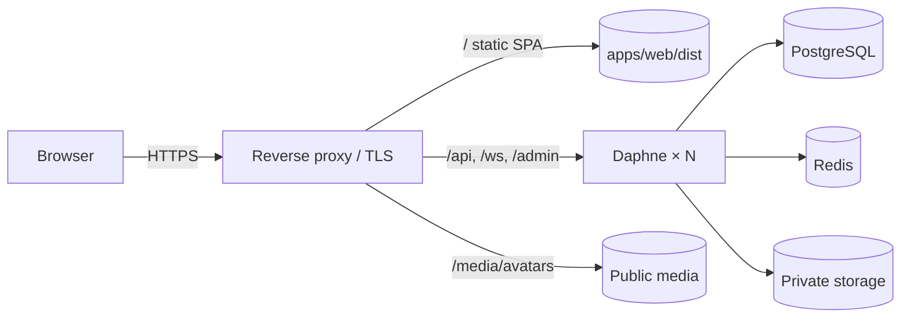

# Deployment

**English** · [فارسی](fa/deployment.md)

The standalone product is one ASGI service (Django + Channels on Daphne), PostgreSQL, Redis, private file storage, and the static web build. Nothing here has been load-tested; size infrastructure from your own measurements (`scripts/load_test.js` is a k6 starting point).



## Build

```bash
# server image (contains packages/django-chat and apps/server)
docker build -t talkio-server .

# web
npm ci && npm run build:packages && npm run build -w @talkio/web   # → apps/web/dist
```

Serve `apps/web/dist` as static files with an SPA fallback to `index.html`, and route `/api/`, `/ws/`, `/admin/`, `/social-auth/`, `/static/` to Daphne. Serve **only** `/media/avatars/` publicly; chat attachments are in `PRIVATE_MEDIA_ROOT` (or another private storage) and are streamed by Django after authorization.

## Required configuration (`DEBUG=0`)

| Variable | Notes |
| --- | --- |
| `DJANGO_SECRET_KEY` | Long random value. Startup fails without it. |
| `ALLOWED_HOSTS` | Your domains. Also used to validate WebSocket origins. |
| `CSRF_TRUSTED_ORIGINS` | `https://your.domain` |
| `DB_ENGINE=django.db.backends.postgresql`, `DB_*` | PostgreSQL 14+. |
| `REDIS_URL` | Enables the Redis cache, channel layer, presence, shared throttles and single-use tickets. **Required with more than one process.** |
| `TRUSTED_PROXY_COUNT` | Number of reverse proxies in front of Django (usually `1`). Rate limits use the client IP; with the default `0`, `X-Forwarded-For` is ignored because clients can forge it. Set it correctly or every user shares the proxy's IP budget. |
| `TRUST_X_FORWARDED_PROTO=1` | When TLS terminates at a proxy that sets `X-Forwarded-Proto`. |
| `SECURE_SSL_REDIRECT=1` | If the proxy does not redirect HTTP→HTTPS itself. |
| `PRIVATE_MEDIA_ROOT`, `MEDIA_ROOT` | Persistent volumes. |
| `LANGUAGE_CODE` | Default language of server messages when a client asks for none (`en` or `fa`). |

Run `python manage.py check --deploy` — it also reports chat configuration problems (`realtime_chat.*`).

## Release steps

```bash
python manage.py migrate --noinput     # additive migrations only in this release
python manage.py collectstatic --noinput
python manage.py import_legacy_chat    # once, when upgrading a database from the legacy chat app (idempotent)
```

Schedule `python manage.py chat_purge_uploads` (e.g. hourly) and database backups. Do not run `seed_demo` in production (it refuses without `--force` when `DEBUG=0`).

## Proxy notes

- **Limit the request body size at the proxy** (e.g. nginx `client_max_body_size 12m;`). Daphne buffers a whole request body before Django can reject an oversized upload; the chat package then refuses files above `CHAT_MAX_ATTACHMENT_SIZE`, but without a proxy limit a huge upload still costs disk and bandwidth. WebSocket messages are capped by Daphne at 1 MB by default.
- WebSockets need `Upgrade`/`Connection` headers and an idle timeout above the heartbeat (clients ping every 30 s by default).
- Health: `/api/health/` (liveness), `/api/health/ready/` (database and Redis).
- Sticky sessions are not required: any worker can serve any socket because fan-out goes through Redis.

## Local development

See the README. Compose (`docker compose up --build`) runs PostgreSQL, Redis, Daphne (`127.0.0.1:4800`) and Vite (`127.0.0.1:4801`).
