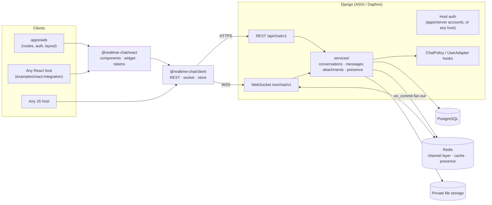
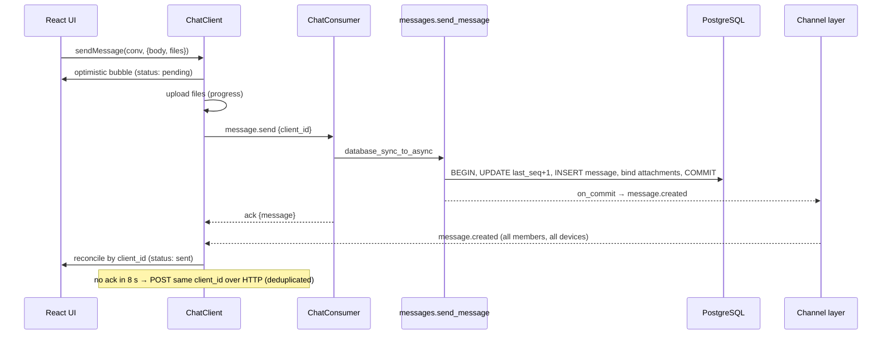

# نمای کلی معماری

[English](../architecture/overview.md) · **فارسی**

Talkio یک monolith ماژولار به‌همراه سه پکیج قابل استفادهٔ دوباره است. محصول مستقل از پکیج‌ها دقیقاً مثل یک میزبان شخص ثالث استفاده می‌کند؛ یک بک‌اند پیام‌رسانی و یک مجموعه کامپوننت چت وجود دارد.

## مسیر درخواست‌ها

**ارسال پیام (مسیر سوکت):**

۱. رابط کاربری پیام را به SDK می‌دهد و SDK بلافاصله یک حباب «خوش‌بینانه» با وضعیت «در حال ارسال» نشان می‌دهد.
۲. فایل‌ها (اگر هستند) با نمایش پیشرفت آپلود می‌شوند.
۳. `message.send` با یک `client_id` روی سوکت فرستاده می‌شود؛ سرویس در یک تراکنش شمارهٔ ترتیب را یکی بالا می‌برد، پیام را درج می‌کند و پیوست‌ها را وصل می‌کند.
۴. بعد از commit، `message.created` به همهٔ اعضا و همهٔ دستگاه‌هایشان پخش می‌شود و فرستنده `ack` می‌گیرد.
۵. SDK حباب خوش‌بینانه را با `client_id` با پیام واقعی جایگزین می‌کند. اگر ۸ ثانیه `ack` نرسد، همان `client_id` را با HTTP می‌فرستد و سرور تکرار را تشخیص می‌دهد.

**اتصال دوباره:** backoff با jitter کامل ← `connection.ready` ← بار دوبارهٔ گفت‌وگوها ← `after=<آخرین seq>` برای هر گفت‌وگوی باز ← `updated_since=<آخرین ready>` ← ارسال دوبارهٔ پیام‌های ناموفق با همان `client_id`.

**زبان:** SDK زبان رابط را در هر درخواست REST به‌صورت `Accept-Language` و روی سوکت به‌صورت `?lang=` می‌فرستد؛ `LocaleMiddleware` و مصرف‌کنندهٔ WebSocket پیام‌های خطا را به همان زبان می‌سازند (کاتالوگ‌های gettext در `locale/`).

## نقشهٔ ماژول‌ها

| بخش | مسیر |
| --- | --- |
| تنظیمات و اعتبارسنجی | `packages/django-chat/src/django_realtime_chat/conf.py`، `checks.py` |
| مدل‌ها / migrationها | `…/models.py`، `…/migrations/` |
| قواعد کسب‌وکار | `…/services/` |
| قلاب‌های مجوز | `…/permissions.py` (`ChatPolicy`)، `…/users.py` (`DefaultUserAdapter`) |
| REST | `…/api/views.py`، `…/api/urls.py` |
| WebSocket | `…/ws/consumer.py`، `…/ws/middleware.py`، `…/ws/tickets.py` |
| پخش رویداد | `…/events.py` |
| حضور | `…/presence.py` (lease در حافظه/Redis)، `…/services/presence.py` |
| ترجمه | `…/locale/fa/`، `apps/server/locale/fa/`، `scripts/i18n.py`؛ اپ: `apps/web/src/lib/i18n.ts`؛ کتابخانه: `packages/react-chat/src/locales/fa.ts` |
| SDK | `packages/chat-client/src/` (`client.ts`، `socket.ts`، `store.ts`، `api.ts`، `http.ts`، `auth.ts`) |
| کامپوننت‌ها | `packages/react-chat/src/components/` |
| سرور مستقل | `apps/server/` (`core/`، `accounts/`، `chat/` قدیمی) |
| اپ وب مستقل | `apps/web/src/` |

تصمیم‌ها در [decisions/](../architecture/decisions/) (انگلیسی) ثبت شده‌اند. بررسی پیش از بازسازی در [current-state.md](../architecture/current-state.md) (انگلیسی) است.
