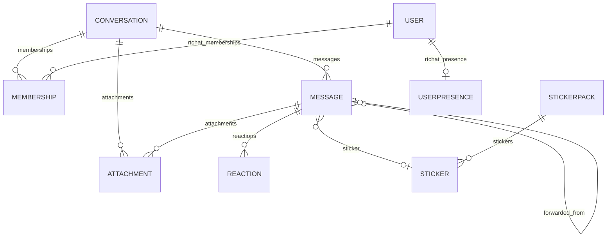
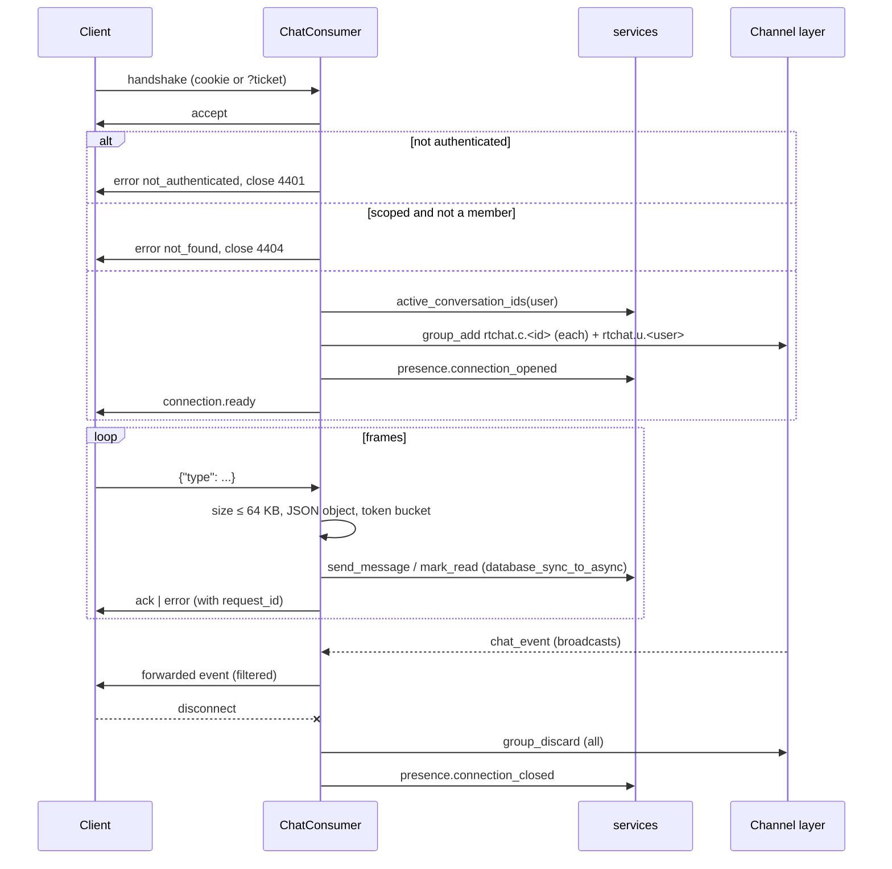

# مرجع فنی بک‌اند

[English](../backend.md) · **فارسی**

این سند توضیح می‌دهد بک‌اند از درون چطور کار می‌کند: پکیج قابل استفادهٔ دوبارهٔ `django_realtime_chat` (`packages/django-chat/src/django_realtime_chat/`) و سرور مستقل (`apps/server/`). قراردادهای عمومی را در [rest-api.md](rest-api.md) و [websocket.md](websocket.md) و یکپارچه‌سازی را در [integration-django.md](integration-django.md) ببینید.

---

## ۱. ساختار

```
django_realtime_chat/
  apps.py            AppConfig (label "realtime_chat"); imports checks on ready()
  conf.py            CHAT_* settings with defaults (ChatSettings, Rate)
  checks.py          system checks validating CHAT_* (realtime_chat.E00x / W00x)
  models.py          Conversation, Membership, Message, Attachment, Reaction, UserPresence, StickerPack, Sticker
  errors.py          ChatError hierarchy with stable codes and HTTP statuses
  permissions.py     ChatPolicy (authorization hooks) + get_policy()
  users.py           DefaultUserAdapter (display name, handle, avatar, search) + clean_user_id()
  emoji.py           is_emoji() validator (no external data)
  files.py           content sniffing, safe file names, image verification, thumbnails
  serializers.py     JSON payload builders shared by REST and WebSocket
  events.py          channel-layer fan-out scheduled on transaction commit
  presence.py        MemoryPresenceStore / RedisPresenceStore (connection leases)
  ratelimit.py       TokenBucket (WebSocket) and ChatThrottle subclasses (DRF)
  signals.py         message_created, message_updated, message_deleted, conversation_created, members_changed
  services/          business rules — the only place that changes data
  api/               thin DRF views and URL patterns
  ws/                ChatConsumer, ticket auth middleware, routing
  locale/fa/         Persian gettext catalog (.po + compiled .mo)
  admin.py           admin registrations, StickerForm with upload validation
  management/commands/chat_purge_uploads.py
  migrations/        0001_initial, 0002_media_voice_stickers
```

**قاعدهٔ وابستگی:** `api/` و `ws/` به `services/` وابسته‌اند؛ `services/` به مدل‌ها، policy، serializerها و events؛ هیچ چیزی در پکیج پروژهٔ میزبان را import نمی‌کند. viewها جز از طریق سرویس‌ها و serializerها به مدل‌ها دست نمی‌زنند.

## ۲. پیکربندی

### `conf.py`

`DEFAULTS` همهٔ تنظیمات را بدون پیشوند `CHAT_` فهرست می‌کند. `chat_settings.<NAME>` مقدار `settings.CHAT_<NAME>` را **در هر دسترسی** می‌خواند (بدون کش)؛ به همین دلیل `override_settings` و fixture `settings` در pytest کار می‌کنند. تنظیمات دیکشنری (`DEFAULT_PERMISSIONS`، `RATE_LIMITS`) با پیش‌فرض‌ها **ادغام** می‌شوند؛ پس میزبان می‌تواند فقط یک کلید را عوض کند.

`Rate.parse("30/10s")` ← `Rate(count=30, period=10.0)`. قالب: `<count>/<multiplier?><s|m|h>`.

`chat_settings.import_setting(name)` یک مسیر نقطه‌دار (`POLICY`، `USER_ADAPTER`) را import می‌کند و با پیام خوانا `ImproperlyConfigured` می‌دهد.

### `checks.py`

با `@register(Tags.compatibility)` ثبت و از `RealtimeChatConfig.ready()` import می‌شود. پیام‌های این بخش برای توسعه‌دهنده‌اند و عمداً انگلیسی می‌مانند.

| شناسه | شرط |
| --- | --- |
| W001 | تنظیم `CHAT_*` ناشناخته (محافظت در برابر غلط تایپی) |
| E001 | سقف‌های عددی، عدد صحیح مثبت نیستند |
| E002 | پرچم‌های قابلیت boolean نیستند |
| E003 | `EDIT_WINDOW` نه `None` است نه عدد صحیح مثبت |
| E004/E005 | backend حضور نامعتبر / `redis` بدون `CHAT_REDIS_URL` |
| W002 | حضور در حافظه با `DEBUG=False` (محدود به یک پروسه) |
| E006 | نرخ غیرقابل پارس |
| E007 | انواع محتوای فعال در فهرست مجاز پیوست (SVG، HTML، JS) |
| E008 | policy/adapter قابل import نیست |
| E009 | `ALLOWED_REACTIONS` نه `None` است نه فهرست غیرخالی ایموجی |

## ۳. مدل داده



همهٔ کلیدهای خارجی کاربر به `settings.AUTH_USER_MODEL` اشاره می‌کنند (وابستگی swappable در migrationها). دسترسی‌های معکوس پیشوند `rtchat_` دارند تا با مدل‌های میزبان تداخل نکنند (تداخل با اپ قدیمی `chat` همین‌طور پیدا و رفع شد).

| مدل | فیلدهای کلیدی | قیدها / ایندکس‌ها | توضیح |
| --- | --- | --- | --- |
| `Conversation` | `id` UUID، `kind` direct/group، `title`، `description`، `direct_key`، `last_seq`، `last_message_at`، `last_activity_at` | `direct_key` یکتا؛ ایندکس `(-last_activity_at, -id)` | `direct_key = "<pk کوچک‌تر>:<pk بزرگ‌تر>"` (مرتب بر اساس طول و بعد مقدار تا `"9" < "10"`). یکتایی، «شروع گفت‌وگوی مستقیم» را بدون race می‌کند. |
| `Membership` | `conversation`، `user`، `role` owner/admin/member، `last_read_seq`، `joined_at`، `left_at` | یکتا `(conversation, user)`؛ ایندکس `(user, left_at)` | برای هر جفت برای همیشه یک ردیف. ترک کردن `left_at` را پر می‌کند؛ اضافه شدن دوباره آن را خالی و `last_read_seq` را به انتهای فعلی می‌برد. |
| `Message` | `id` UUID، `seq`، `client_id`، `sender` (SET_NULL)، `body`، `reply_to`، `forwarded_from`، `sticker`، `created_at`، `updated_at`، `edited_at`، `deleted_at`، `pinned_at/by` | یکتا `(conversation, seq)`؛ یکتا `(conversation, sender, client_id)`؛ ایندکس `(conversation, updated_at)` | `seq` در هر گفت‌وگو بی‌فاصله است. پیام‌های حذف‌شده سنگ قبرند. `updated_at` (auto_now) بازیابی `updated_since` را ممکن می‌کند. |
| `Attachment` | `id` UUID، `conversation`، `message` (خالی = در انتظار)، `uploaded_by`، `file`، `thumbnail`، `original_name`، `content_type` (تشخیص‌داده‌شده)، `size`، `width`، `height`، `is_voice`، `duration`، `waveform` | ایندکس `(uploaded_by, message)` | فایل‌ها نام تصادفی دارند (`attachment_upload_to`). |
| `Reaction` | `message`، `user`، `emoji` | یکتا `(message, user, emoji)` | |
| `UserPresence` | `user` (کلید اصلی)، `last_seen_at` | | نیمهٔ ماندگار حضور. |
| `StickerPack` / `Sticker` | نام، `is_active`، `position` / `emoji`، `file`، `content_type`، `width`، `height` | | انتخاب‌شده توسط مدیران در ادمین. |

**ذخیره‌سازی:** `Attachment.file`، `.thumbnail` و `Sticker.file` از `attachment_storage()` استفاده می‌کنند که یک `LazyObject` برمی‌گرداند؛ `storages[CHAT_ATTACHMENT_STORAGE]` را در اولین استفاده و دوباره بعد از سیگنال `setting_changed` resolve می‌کند. یک callable ساده فقط یک بار در زمان import ارزیابی می‌شد (رفتار جنگو) و پیکربندی بعدی را نادیده می‌گرفت.

## ۴. سرویس‌ها

سرویس‌ها توابع هم‌گامی هستند که اول `user` عمل‌کننده را می‌گیرند. ورودی را اعتبارسنجی می‌کنند، policy را بررسی می‌کنند، جایی که می‌نویسند داخل `transaction.atomic()` اجرا می‌شوند، پخش رویداد را با `events.*` (که از `transaction.on_commit` استفاده می‌کند) زمان‌بندی می‌کنند و بعد از commit سیگنال می‌فرستند. زیرکلاس‌های `ChatError` را پرتاب می‌کنند و لایه‌های انتقال آن‌ها را تبدیل می‌کنند. پیام هر خطا در لحظهٔ ساخته شدن، به زبان فعال (درخواست یا اتصال سوکت) به رشته تبدیل می‌شود (§۱۴٫۱).

### ۴٫۱ پیدا کردن عضویت — `conversations.get_membership(user, conversation_id, for_update=False)`

عضویت **فعال** فراخواننده را همراه گفت‌وگو برمی‌گرداند، یا `NotFound` می‌دهد برای: شناسهٔ ناشناخته، UUID خراب (`ValidationError`)، عضو نبودن، یا ترک کردن. همین یک تابع دروازهٔ مجوز همهٔ عملیات وابسته به گفت‌وگوست و دلیل اینکه گفت‌وگوهای خصوصی 404 برمی‌گردانند.

با `for_update=True` از `SELECT … FOR UPDATE` بدون `of=` استفاده می‌کند که در PostgreSQL ردیف گفت‌وگوی join‌شده را هم قفل می‌کند. عملیات تغییر عضویت برای سریالی شدن در هر گفت‌وگو به این تکیه دارند (اثبات در `tests/test_concurrency.py`).

### ۴٫۲ گفت‌وگوها

| تابع | رفتار |
| --- | --- |
| `list_conversations(user, before, kind, query, limit)` | مرتب با `(-last_activity_at, -id)`. cursor = base64url از `"<iso>|<uuid>"`؛ فیلتر ادامه `activity < t OR (activity = t AND id < cursor_id)`. `query` با عنوان‌ها، یا برای گفت‌وگوی مستقیم با طرف مقابلی که adapter کاربر پیدا می‌کند تطبیق می‌دهد. سقف ۱ تا ۱۰۰. |
| `start_direct(user, other_id)` | کاربر دیگر را از `user_queryset` در policy پیدا می‌کند (شناسه‌ها با `clean_user_id` اعتبارسنجی می‌شوند)، `can_start_direct` را بررسی می‌کند، `direct_key` را می‌گردد، وگرنه گفت‌وگو و دو عضویت را در یک تراکنش می‌سازد. `IntegrityError` (سازندهٔ هم‌زمان برنده شده) ردیف موجود را برمی‌گرداند. عضویت‌های ترک‌شده دوباره فعال می‌شوند. |
| `create_group(user, title, member_ids, description)` | پرچم قابلیت + `can_create_group`؛ عنوان ۱ تا `MAX_TITLE_LENGTH`؛ توضیحات ≤۵۰۰؛ اندازه ≤`MAX_GROUP_MEMBERS`. سازنده مالک می‌شود. |
| `update_conversation` | قفل می‌کند، `can_edit_conversation` را بررسی می‌کند، عنوان/توضیحات را ذخیره و به همهٔ اعضا اطلاع می‌دهد. |
| `add_members` | قفل، `can_add_members`، فعال‌سازی دوباره یا ساخت عضویت‌ها، اعمال سقف اندازه، اطلاع‌رسانی، `members_changed`. |
| `remove_member` | درخواست‌کننده و هدف را قفل می‌کند؛ `can_remove_member`؛ `left_at` را پر می‌کند؛ اگر مالک رفته، مالکیت را منتقل می‌کند (`_transfer_ownership`: قدیمی‌ترین مدیر، وگرنه عضو)؛ به کاربر حذف‌شده `conversation.removed` و به بقیه `conversation.updated` می‌فرستد. |
| `change_role` | فقط مالک (policy)؛ انتقال `owner` مالک قبلی را مدیر می‌کند. |
| `mark_read(user, id, seq)` | به `[0, last_seq]` محدود می‌کند و `UPDATE … WHERE last_read_seq < seq` را اجرا می‌کند که بدون تراکنش هم یکنوا و امن در برابر race است. `read.updated` را فقط وقتی ردیف تغییر کرده پخش می‌کند. |
| `notify_conversation(conv, user_ids)` | بعد از commit برای هر عضو محتوای **مخصوص بیننده** می‌سازد و به گروه کاربری همان عضو می‌فرستد. |

### ۴٫۳ پیام‌ها — `messages._create(...)`

قلب سیستم. `send_message` و `forward_message` آن را صدا می‌زنند.

1. `normalize_client_id`: اگر نیست یک UUID hex می‌سازد؛ وگرنه `^[A-Za-z0-9_.:\-]{1,64}$`.
2. **مسیر سریع idempotency:** ردیف موجود `(conversation, sender, client_id)` با `created=False` برگردانده می‌شود. هیچ شمارهٔ ترتیبی مصرف و هیچ چیزی پخش نمی‌شود.
3. policy `can_send_message`، `normalize_body` (CRLF←LF، حذف NUL و نویسه‌های override/isolate جهت U+202A تا 202E و U+2066 تا 2069، trim، سقف طول)، شناسه‌های پیوست (پرچم قابلیت، حداکثر تعداد، حذف تکرار)، قواعد استیکر (استیکر با متن/فایل ترکیب نمی‌شود)، هدف پاسخ باید در همان گفت‌وگو باشد.
4. `transaction.atomic()`:
   - `UPDATE conversation SET last_seq = last_seq + 1, last_message_at = now, last_activity_at = now`؛ این همان قفل ردیفی است که فرستنده‌های هم‌زمان را سریالی می‌کند (PostgreSQL)؛ بعد مقدار جدید خوانده می‌شود.
   - `INSERT message` با همان `seq`.
   - `_bind_attachments`: پیوست‌های فهرست‌شده را با فیلتر `conversation`، `uploaded_by=user` و `message IS NULL` با `SELECT … FOR UPDATE` می‌گیرد؛ تعداد باید بخواند، وگرنه `ValidationFailed` همه‌چیز را rollback می‌کند، حتی افزایش شمارهٔ ترتیب.
   - پیوست‌های هدایت‌شده به‌صورت ردیف‌های جدید کپی می‌شوند که به همان نام فایل ذخیره‌شده ارجاع می‌دهند.
   - `last_read_seq` فرستنده به seq جدید می‌رسد (پیام‌های خود آدم خوانده‌شده‌اند).
   - محتوا ساخته و `message.created` با `on_commit` زمان‌بندی می‌شود؛ سیگنال `message_created` هم.
5. `IntegrityError` ← درخواست یکسان هم‌زمانی قید یکتایی را برده؛ برنده با `created=False` برگردانده می‌شود.

توابع دیگر:

| تابع | توضیح |
| --- | --- |
| `list_messages` | دقیقاً یک حالت: آخرین صفحه / `before=<seq>` (کوئری نزولی که صعودی برگردانده می‌شود)، `after=<seq>` (صعودی)، `updated_since=<iso>` (≤۲۰۰ بر اساس `updated_at`)، یا `pinned`. نتیجه **همیشه صعودی** بر اساس seq است؛ `next_cursor` رشتهٔ seq است. |
| `search_messages` | `body__icontains` روی عضویت‌های فعال، بدون پیام‌های حذف‌شده، ۳۰ در هر صفحه، cursor = `created_at` به‌صورت ISO. |
| `edit_message` | `SELECT … FOR UPDATE OF message`؛ فرستنده از طریق policy؛ مهلت ویرایش؛ متن خالی فقط با وجود پیوست؛ `message.updated` را پخش می‌کند. |
| `delete_message` | سنگ قبر: متن خالی، `deleted_at`، برداشتن سنجاق، حذف واکنش‌ها و پیوست‌ها؛ فایل‌ها بعد از commit پاک می‌شوند اگر ردیف دیگری به آن‌ها ارجاع ندهد؛ `message.deleted` را پخش می‌کند. |
| `toggle_reaction` | `is_emoji()` (یا فهرست مجاز تنظیم‌شده)؛ toggle با قفل؛ `updated_at` را جلو می‌برد تا کلاینت‌هایی که دوباره وصل می‌شوند تغییر را از `updated_since` بگیرند؛ خلاصهٔ تجمیعی را پخش می‌کند. |
| `toggle_pin` | policy `can_pin_message`؛ `message.updated` را پخش می‌کند. |
| `forward_message` | عضویت در مبدأ و مقصد لازم است؛ متن، استیکر و پیوست‌ها را کپی می‌کند؛ با `client_id` idempotent است. |

### ۴٫۴ پیوست‌ها — `services/attachments.py`

`upload_attachment(user, conversation_id, upload, voice=False, duration=None, waveform=None)`:

1. پرچم قابلیت، عضویت، غیرخالی، `size ≤ MAX_ATTACHMENT_SIZE`، آپلودهای در انتظار در ۲۴ ساعت گذشته `< MAX_PENDING_ATTACHMENTS`.
2. `sniff_upload` ← نوع تشخیص‌داده‌شده (§۱۲)؛ باید در `ALLOWED_ATTACHMENT_TYPES` باشد.
3. صدا: `ENABLE_VOICE`، نوع صوتی، `0 < duration ≤ MAX_VOICE_DURATION`، شکل موج = فهرستی از حداکثر ۱۲۸ عدد صحیح ۰ تا ۱۰۰ (متن JSON از multipart هم پذیرفته می‌شود).
4. تصاویر: با Pillow بررسی می‌شوند (`image_dimensions` برای تصویر خراب یا بمب خطا می‌دهد)؛ برای تصاویر ثابت بزرگ‌تر از `THUMBNAIL_SIZE` پیش‌نمایش WebP ساخته می‌شود.
5. به‌صورت پیوست **در انتظار** (`message = NULL`) ذخیره می‌شود که فقط آپلودکننده آن را می‌بیند.

`get_attachment` عضویت فعال و برای فایل‌های در انتظار مالکیت را لازم دارد. `discard_attachment` آپلود در انتظار خود شما را پاک می‌کند. `delete_attachment_files` پاک کردن از storage را به `on_commit` موکول می‌کند و نام‌هایی را که ردیف دیگری هنوز به آن‌ها ارجاع می‌دهد رد می‌کند (هدایت‌ها فایل را شریک‌اند). `purge_stale_uploads` پشتوانهٔ فرمان `chat_purge_uploads` است.

### ۴٫۵ کاربران، حضور، استیکرها

- `users.search_users`: دروازهٔ policy؛ عبارت خالی هم‌گفت‌وگوها («کسانی که با آن‌ها حرف می‌زنید») را برمی‌گرداند؛ وگرنه جست‌وجوی adapter روی `policy.user_queryset(user)`؛ حداکثر ۲۰؛ محتوا شامل حضور است؛ هیچ‌وقت ایمیل ندارد.
- `users.get_user_profile`: اگر قابل پیدا کردن باشد یا گفت‌وگوی مشترک داشته باشید دیده می‌شود؛ شناسه‌ها با `clean_user_id` اعتبارسنجی می‌شوند.
- `presence.connection_opened/heartbeat/connection_closed`: §۱۰ را ببینید.
- `stickers.resolve_sticker` (برای ارسال: بسته باید فعال باشد)، `get_sticker` (برای نمایش: هر کدام)، `inspect_sticker_file` (PNG/WebP/GIF، ≤`MAX_STICKER_SIZE`، ≤۵۱۲×۵۱۲).

## ۵. مجوز

`ChatPolicy` (`permissions.py`) همهٔ تصمیم‌ها را متمرکز می‌کند. سرویس‌ها `get_policy()` را صدا می‌زنند که برای هر مسیر نقطه‌دار `CHAT_POLICY` یک نمونه می‌سازد (کش LRU با کلید مقدار تنظیم).

| متد | پیش‌فرض |
| --- | --- |
| `user_queryset(user)` | کاربران فعال |
| `can_search_users` | `ENABLE_USER_SEARCH` |
| `can_start_direct(user, other)` | نه با خودتان |
| `can_create_group` | `ENABLE_GROUPS` |
| `can_edit_conversation` | مدیر/مالک گروه، یا پرچم `members_can_edit_info` |
| `can_add_members` | مدیر/مالک گروه، یا `members_can_add_members` |
| `can_remove_member` | خودتان (ترک)؛ مالک هر کسی جز مالک را حذف می‌کند؛ مدیران اعضا را حذف می‌کنند |
| `can_change_role` | مالک، نه روی خودش |
| `can_send_message` | عضویت فعال |
| `can_edit_message` | فرستنده |
| `can_delete_message` | فرستنده، یا مدیر گروه با `admins_can_delete_messages` |
| `can_pin_message` | مستقیم: همه؛ گروه: مدیران یا `members_can_pin` |

هویت همیشه از `request.user` / `scope["user"]` می‌آید. هیچ endpointی «به‌جای کاربر X عمل کن» نمی‌پذیرد.

## ۶. سریال‌سازی

`serializers.py` دیکشنری‌های ساده‌ای می‌سازد که هر دو لایهٔ انتقال استفاده می‌کنند؛ پس محتوای رویدادها و پاسخ‌های HTTP یکسان‌اند.

- `message_queryset()`: `select_related` فرستنده، پاسخ/هدایت (+ فرستنده‌هایشان)، استیکر؛ `prefetch_related` پیوست‌ها و واکنش‌ها. هر مسیر خواندن پیام از آن شروع می‌شود تا کوئری N+1 نداشته باشیم.
- `message_payload`: سنگ قبرها متن، پیوست، واکنش و استیکر را پنهان می‌کنند؛ `kind` (`text | image | gif | video | audio | voice | file | sticker | deleted`) برای پیش‌نمایش محاسبه می‌شود؛ ارجاع پاسخ/هدایت یک گزیدهٔ ۲۸۰ نویسه‌ای دارد.
- `attachment_payload`: `url` و `thumbnail_url` از طریق فضای نام `realtime_chat` **reverse** می‌شوند؛ پس از نقطهٔ اتصال میزبان پیروی می‌کنند.
- `conversation_queryset_for(user)` + `annotate_for_viewer`: زیرکوئری‌ها `my_last_read_seq`، `my_role` و `unread_count` (تعداد پیام‌های حذف‌نشدهٔ دیگران با `seq > my_last_read_seq`) را در همان کوئری SQL اضافه می‌کنند؛ عضویت‌های فعال در `active_memberships` از قبل بار می‌شوند.
- `conversation_payloads(rows, viewer)`: دسته‌ای؛ یک کوئری برای همهٔ آخرین پیام‌ها (OR از جفت‌های `(conversation, seq)`)، یک جست‌وجوی حضور برای همهٔ اعضا، و بعد ساخت ردیف به ردیف. گفت‌وگوهای مستقیم `title` = نام نمایشی طرف مقابل و `peer` می‌گیرند.

## ۷. لایهٔ REST

`api/views.py` کلاس `ChatAPIView(APIView)` را تعریف می‌کند:

- `permission_classes = [IsAuthenticated]`؛ احراز هویت از `CHAT_API_AUTHENTICATION_CLASSES` یا پیش‌فرض‌های DRF میزبان.
- `parser_classes = [JSONParser]` (view آپلود: multipart).
- `get_throttles()` محدودیت نوشتن را **فقط برای متدهای غیرامن** اضافه می‌کند؛ viewهای جست‌وجو `SearchThrottle` اضافه می‌کنند.
- `handle_exception()` خطای `ChatError` را به `{"error": {code, message, details}}` با `Retry-After` برای محدودیت نرخ تبدیل می‌کند و خطاهای خود DRF (`NotAuthenticated`، اعتبارسنجی) را هم به همین قالب درمی‌آورد.

دانلودها از `_harden()` استفاده می‌کنند: `Content-Disposition` (فقط برای تصویر/صوت/ویدیو inline)، `nosniff`، `CSP: default-src 'none'; sandbox`، `Cache-Control: private`، `CORP: same-site`. `?variant=thumb` پیش‌نمایش WebP را سرو می‌کند. فایل‌های استیکر یک روز کش می‌شوند (`immutable`).

## ۸. لایهٔ WebSocket

### ۸٫۱ استک ASGI

`chat_websocket_application(allowed_origins=None)` این را برمی‌گرداند:

```
AllowedHostsOriginValidator | OriginValidator(origins)
  └─ AuthMiddlewareStack            (Channels: session cookie → scope["user"])
      └─ TicketAuthMiddleware        (?ticket= → scope["user"], or AnonymousUser if invalid)
          └─ URLRouter(websocket_urlpatterns) → ChatConsumer
```

بلیت‌ها (`ws/tickets.py`): `signing.dumps({"u": pk, "n": nonce}, salt=…)` که با `max_age=WS_TICKET_TTL` بررسی می‌شود؛ یک‌بارمصرف بودن با `cache.add("rtchat:ticket:<nonce>")` که در Redis/Memcached/LocMem اتمی است.

### ۸٫۲ چرخهٔ عمر `ChatConsumer`



جزئیات:

- اتصال **پیش از** بررسی احراز هویت پذیرفته می‌شود تا کلاینت یک کد بستن در سطح اپلیکیشن (4401/4404) بگیرد و بداند نباید دوباره تلاش کند.
- زبان اتصال هنگام connect تعیین می‌شود (`connection_language`: `?lang=`، بعد `Accept-Language` handshake، بعد `LANGUAGE_CODE`) و هر رویداد دریافتی زیر `translation.override` پردازش می‌شود.
- frameهای بزرگ‌تر از ۶۴ کیلوبایت یا غیر JSON خطای `invalid_frame` / `invalid_event` می‌گیرند؛ نوع‌های ناشناخته `unknown_event`. خود Daphne پیام‌ها را به ۱ مگابایت محدود می‌کند.
- سطل‌های توکن برای هر اتصال: `ws_message`، `ws_typing`، `ws_other` (§۱۱).
- `message.send` و `read.mark` لازم دارند گفت‌وگو در مجموعهٔ اشتراک‌های اتصال باشد (پیش‌بررسی ارزان)؛ سرویس عضویت را دوباره در دیتابیس بررسی می‌کند.
- «در حال نوشتن» ذخیره نمی‌شود: `typing.start` برای هر گفت‌وگو و اتصال به یک بار در ۲ ثانیه محدود است؛ `typing.stop` فقط وقتی فرستاده می‌شود که start فرستاده شده باشد.
- `chat_event` (handler همهٔ پخش‌ها): `conversation.updated` سوکت را در گروه گفت‌وگو مشترک می‌کند (عضویت‌های جدید بدون اتصال دوباره زنده می‌شوند)؛ `conversation.removed` اشتراک را لغو می‌کند؛ رویدادهای گفت‌وگوهای غیرمشترک دور ریخته می‌شوند (تحویل‌های کهنه بعد از حذف)؛ رویدادهای «در حال نوشتن» خود کاربر به خودش برنمی‌گردند.
- `disconnect` از همهٔ گروه‌ها خارج می‌شود و lease حضور را آزاد می‌کند.

## ۹. پخش رویداد (`events.py`)

- نام گروه‌ها: `rtchat.c.<conversation uuid>` و `rtchat.u.<user pk>` (پاک‌سازی‌شده به مجموعه‌نویسهٔ channel layer، کمتر از ۱۰۰ نویسه).
- `to_conversation(id, type, payload)` و `to_users(ids, type, payload_or_callable)` یک callback `transaction.on_commit` ثبت می‌کنند. مشترک‌ها هیچ‌وقت دادهٔ یک تراکنش rollback‌شده را نمی‌بینند و ارسال بیرون از تراکنش فوراً اجرا می‌شود.
- `_send` از `async_to_sync(layer.group_send)` استفاده می‌کند که از threadهای درخواست و threadهای `database_sync_to_async` کار می‌کند؛ شکست‌ها لاگ و بلعیده می‌شوند تا channel layer خراب هیچ‌وقت نوشتن را خراب نکند.
- تحویل با بهترین تلاش است. درستی از بازیابی کلاینت (`after`، `updated_since`) می‌آید، نه از لایهٔ انتقال.

## ۱۰. حضور

حضور به یک بخش **موقت** (چه کسی همین الان متصل است) و یک بخش **ماندگار** (`UserPresence.last_seen_at`) تقسیم می‌شود.

هر اتصال WebSocket یک lease دارد: `connection_id ← انقضا`. کاربر تا وقتی دست‌کم یک lease منقضی‌نشده دارد آنلاین است:

- `MemoryPresenceStore`: دیکشنری محافظت‌شده با قفل؛ محدود به یک پروسه (توسعه/تست).
- `RedisPresenceStore`: sorted set `rtchat:presence:<user>` با امتیاز = انقضا. `connect`: حذف منقضی‌ها (`ZREMRANGEBYSCORE`)، شمارش، `ZADD`، `EXPIRE` در یک pipeline؛ اگر شمار قبلی ۰ بوده «آنلاین شد». `disconnect`: `ZREM`، حذف منقضی‌ها، شمارش؛ اگر ۰ آفلاین. `online_user_ids`: `ZCOUNT(now, +inf)` در pipeline.

مصرف‌کننده در هر `ping` تابع `heartbeat` را صدا می‌زند (کلاینت‌ها هر `max(5, PRESENCE_TTL // 2)` ثانیه ping می‌کنند). leaseهای workerی که کرش کرده بعد از `PRESENCE_TTL` منقضی می‌شوند؛ پس حالت‌های «آنلاین» کهنه خودشان حل می‌شوند. این انقضاها پخش نمی‌شوند (محدودیت شناخته‌شده). تغییرات به‌صورت `presence.updated` به همهٔ گفت‌وگوهای کاربر پخش می‌شوند.

## ۱۱. محدودیت نرخ

| لایه | سازوکار | کلید |
| --- | --- | --- |
| HTTP (چت) | `ChatThrottle(SimpleRateThrottle)`؛ نرخ از `CHAT_RATE_LIMITS[scope]`؛ تاریخچه در کش جنگو | `rtchat:throttle:<scope>:<user pk>` |
| HTTP (احراز هویت، سرور) | `ScopedRateThrottle` در DRF با scope `auth` (۲۰ در دقیقه) | IP کلاینت |
| WebSocket | `TokenBucket(count, period)` برای هر اتصال و دسته؛ نرخ پر شدن = count/period؛ تعداد ثانیه‌های انتظار را برمی‌گرداند | اتصال |

IP کلاینت برای محدودیت‌های ناشناس از `NUM_PROXIES` در DRF می‌آید (`TRUSTED_PROXY_COUNT` در سرور). با `0`، `X-Forwarded-For` نادیده گرفته می‌شود. پیش از تنظیم این، DRF به هدری که کلاینت می‌فرستاد اعتماد می‌کرد و سقف ورود قابل دور زدن بود (تست رگرسیون: `apps/server/tests/test_hardening.py`).

## ۱۲. فایل و رسانه

`files.py`:

- `detect_content_type(head, declared)`: magic bytes برای JPEG، PNG، GIF، WebP، WAV (RIFF/WAVE)، PDF، Ogg، MP3 (ID3/frame sync)، WebM (EBML) و MP4 (`ftyp`). WebM و MP4 ظرف‌اند: نوع **اعلام‌شده** فقط بین نسخهٔ صوتی (`audio/webm`، `audio/mp4`؛ ضبط صدای مرورگر) و ویدیویی انتخاب می‌کند. هیچ‌وقت برای شناسایی قالب به آن اعتماد نمی‌شود.
- `looks_like_text`: قابل رمزگشایی با UTF-8 (با تحمل یک دنبالهٔ چندبایتی بریده)، بدون NUL، بدون شروع با نشانه‌های HTML/SVG/XML/script؛ فقط برای `.txt/.log/.md/.csv` یا نام‌های بی‌پسوند.
- `safe_filename`: basename، NFC، حذف نویسه‌های کنترلی، جایگزینی نویسه‌های ناامن، سقف طول (فقط برای نمایش؛ نام ذخیره تصادفی است).
- `image_dimensions`: `verify()` در Pillow؛ برای تصویر خراب یا بیش از ۸۰ مگاپیکسل خطا می‌دهد.
- `make_thumbnail`: با توجه به EXIF، WebP، بیشترین ضلع `THUMBNAIL_SIZE`؛ برای تصاویر متحرک یا کوچک ساخته نمی‌شود.

`emoji.py`: `is_emoji(value)` یک ایموجی تکی را می‌پذیرد: بازه‌های code point تصویری، ZWJ (U+200D)، variation selectorها، keycapها (`[0-9#*]` + VS16 اختیاری + U+20E3)، دنباله‌های tag (پرچم زیرمنطقه‌ها)؛ دست‌کم یک تصویرنگاشت لازم است؛ سقف طول.

## ۱۳. نقاط گسترش

| قلاب | کاربرد |
| --- | --- |
| `CHAT_POLICY` | چندمستأجری، مسدود کردن، نظارت، قواعد نقش سفارشی |
| `CHAT_USER_ADAPTER` | نام نمایشی، شناسه، آواتار، فیلدهای جست‌وجو |
| `CHAT_API_AUTHENTICATION_CLASSES` | JWT یا توکن فقط برای چت |
| `CHAT_ATTACHMENT_STORAGE` | S3/GCS/هر storage جنگو |
| `signals.*` | اعلان، تحلیل، ایندکس (بعد از commit فرستاده می‌شوند) |
| `services.*` | صدا زدن عملیات کسب‌وکار از کد خودتان (با همان مجوزها) |
| `LOCALE_PATHS` در میزبان | بازنویسی ترجمهٔ هر پیام یا افزودن زبان جدید |

## ۱۴. سرور مستقل (`apps/server`)

| ماژول | نقش |
| --- | --- |
| `core/settings.py` | تنظیمات مبتنی بر متغیر محیطی؛ بارگذار `.env`؛ با `DEBUG=0` بدون `DJANGO_SECRET_KEY` بالا نمی‌آید؛ وقتی `DB_ENGINE` شامل `postgresql` است Postgres؛ وقتی `REDIS_URL` تنظیم است کش Redis + channel layer + حضور Redis؛ storage خصوصی `chat_attachments`؛ پرچم‌های کوکی/HSTS در production؛ `NUM_PROXIES` از `TRUSTED_PROXY_COUNT`؛ ورود نمایشی فقط با `DEBUG`؛ `LocaleMiddleware`، `LANGUAGES` (en، fa) و `LOCALE_PATHS`. |
| `core/asgi.py` | `ProtocolTypeRouter` با Django برای HTTP و `chat_websocket_application(WEBSOCKET_ALLOWED_ORIGINS or None)`. |
| `core/urls.py` | ادمین، `/api/health/…`، `/api/auth/`، `/api/chat/v1/`، `/api/v1/*` ← 410 با راهنمای مهاجرت، ورود اجتماعی؛ در DEBUG فایل‌های ایستا و **فقط** `media/avatars/` را سرو می‌کند. |
| `core/health.py` | زنده بودن، آمادگی (دیتابیس، Redis)، `LegacyApiGoneView`. |
| `core/docs.py` | نمایشگر مستندات در ادمین؛ README، `docs/`، `README.fa.md`؛ صفحه‌های فارسی (`docs/fa/`، راهنمای فارسی) راست‌به‌چپ و `docs/learn/en/` چپ‌به‌راست. |
| `accounts/models.py` | `User` سفارشی قدیمی (`USERNAME_FIELD = "phone"`، تلفن اختیاری)؛ `VerificationCode`. اگر نام کاربری نباشد با `secrets` ساخته می‌شود. |
| `accounts/managers.py` | `create_user(phone=None, password, username=…)`؛ تلفن یا نام کاربری لازم است. |
| `accounts/authentication.py` | `CustomModelBackend(ModelBackend)`: ایمیل (بدون حساسیت به حروف)، رقم‌ها ← تلفن، وگرنه نام کاربری؛ `user_can_authenticate`؛ برای کاربران ناشناخته هم hasher را اجرا می‌کند تا زمان‌ها یکسان شوند. |
| `accounts/api.py` | `/api/auth/`: `session/` (راه‌اندازی، کوکی CSRF، فهرست providerها، `demo_auth`)، `login/` (رمز، یا تلفن + `DEMO_AUTH_CODE` با `secrets.compare_digest` وقتی فعال است)، `register/`، `logout/`، `me/` (پروفایل + آواتار بررسی‌شده با magic bytes و Pillow)، `me/password/` (نشست را با `update_session_auth_hash` نگه می‌دارد). ورود/ثبت‌نام حتی برای کاربر ناشناس `csrf_protect` و محدودیت `auth` دارند. پیام خطاها با gettext ترجمه می‌شوند. |
| `accounts/chat_adapter.py` | نام نمایشی امن در برابر null؛ شناسه‌هایی را که برابر شماره‌تلفن‌اند پنهان می‌کند. |
| `accounts/management/commands/seed_demo.py` | کاربران، گروه‌ها، گفت‌وگوهای مستقیم، واکنش‌ها، یک تصویر ساخته‌شده (مسیر پیش‌نمایش)، یک پاسخ، یک بستهٔ استیکر و یک پیام صوتی WAV نمونه؛ همه از طریق سرویس‌های پکیج. با `DEBUG=0` بدون `--force` اجرا نمی‌شود. |
| `chat/` | فقط مدل‌ها و migrationهای قدیمی، ادمین فقط‌خواندنی، `import_legacy_chat` (idempotent: شناسه‌های قطعی UUIDv5، رد اتاق‌های واردشده، هیچ‌وقت ردیف‌های قدیمی را تغییر نمی‌دهد؛ ADR 0008). |

### ۱۴٫۱ ترجمه‌ها

- هر پیامی که به کاربر می‌رسد یک فراخوانی gettext است: `gettext("Message not found.")`، با placeholderهای `%(name)s` که بعد پر می‌شوند (`gettext("%(name)s must be positive.") % {"name": name}`). `ChatError.default_message` از `gettext_lazy` استفاده می‌کند؛ `ChatError.__init__` پیام را با `str()` resolve می‌کند تا به زبانی باشد که هنگام پرتاب خطا فعال است.
- درخواست‌های REST زبانشان را از `LocaleMiddleware` (`Accept-Language`) می‌گیرند. مصرف‌کنندهٔ WebSocket middleware ندارد: `connection_language(scope)` اول `?lang=`، بعد `Accept-Language` handshake و بعد `LANGUAGE_CODE` را انتخاب می‌کند و هر رویداد دریافتی زیر `translation.override` پردازش می‌شود.
- کاتالوگ‌ها: `packages/django-chat/src/django_realtime_chat/locale/fa/LC_MESSAGES/django.po` (داخل wheel؛ `package-data` را ببینید) و `apps/server/locale/fa/LC_MESSAGES/django.po` (`LOCALE_PATHS`). هر دو `.po` و `.mo` کامپایل‌شده در git هستند.
- `scripts/i18n.py` بدون ابزارهای GNU gettext جای makemessages/compilemessages را می‌گیرد: `extract` آرگومان‌های رشته‌ای `gettext`/`gettext_lazy`/`_`/`pgettext` را با `ast` پیدا می‌کند، `compile` فایل `.mo` را می‌نویسد و `check` (در CI) برای کاتالوگ بی‌ترجمه یا کهنه شکست می‌خورد.
- پیام‌های مخصوص توسعه‌دهنده (system checkها، خطای تنظیمات) عمداً انگلیسی می‌مانند.

## ۱۵. تست‌ها

| مجموعه | مسیر | توضیح |
| --- | --- | --- |
| پکیج | `packages/django-chat/tests/` | از `django.contrib.auth.User` استفاده می‌کند (`tests/settings.py`) تا استقلال از میزبان ثابت شود. `TEST_DATABASE_URL` به PostgreSQL تغییر می‌دهد (TCP یا unix socket). |
| — گفت‌وگو / پیام / پیوست / رسانه | `test_*.py` | مجوز، جداسازی، idempotency، صفحه‌بندی، ویرایش، سنگ قبر، واکنش، آپلود، صدا، پیش‌نمایش، استیکر، ایموجی، شناسه‌های خراب. |
| — WebSocket | `test_websocket.py` | `WebsocketCommunicator`؛ از polling با `receive_nothing` استفاده می‌کند (یک `receive_json_from` که مهلتش تمام شود اپلیکیشن را در asgiref لغو می‌کند). |
| — هم‌زمانی | `test_concurrency.py` | threadهای واقعی روی PostgreSQL: ساخت گفت‌وگوی مستقیم، افزودن هم‌زمان عضو، سقف عضو، ۶۰ ارسال هم‌زمان با تلاش دوباره ← seq بدون فاصله. روی SQLite رد می‌شود. |
| — حضور Redis | `test_redis_presence.py` | `fakeredis`. |
| — ترجمه | `test_i18n.py` | خطا به زبان فعال، `connection_language` برای سوکت‌ها. |
| سرور | `apps/server/tests/` | پاسخ به زبان `Accept-Language` (`test_i18n.py`)؛ جریان‌های احراز هویت، CSRF، ورود نمایشی، پروفایل، یکپارچگی با `accounts.User`، storage خصوصی، 410، بررسی مبدأ ASGI، واردات قدیمی، seed، سخت‌سازی proxy/محدودیت نرخ، نمایشگر مستندات. |
| میزبان بیرونی | `examples/django-integration/tests/` | `auth.User` استاندارد، policy سفارشی، تنظیمات میزبان. |

callbackهای `transaction.on_commit` داخل تراکنش‌های `TestCase` اجرا نمی‌شوند؛ تست‌ها از `django_capture_on_commit_callbacks(execute=True)` یا `transaction=True` استفاده می‌کنند.

## ۱۶. کدهای خطا

`code`ها ثابت و انگلیسی‌اند؛ فقط `message` ترجمه می‌شود.

| کد | وضعیت | منبع |
| --- | --- | --- |
| `validation_error`، `invalid_request` | 400 | عمومی |
| `not_authenticated` | 403 | احراز هویت DRF / WS 4401 |
| `forbidden` | 403 | رد شدن توسط policy |
| `feature_disabled` | 403 | گروه، پیوست، واکنش، جست‌وجو، استیکر، صدا |
| `not_found` | 404 | هر چیزی که به آن دسترسی ندارید |
| `rate_limited` | 429 | محدودیت نرخ / سطل توکن (`details.retry_after`) |
| `invalid_kind`، `invalid_title`، `invalid_description`، `invalid_members`، `too_many_members`، `invalid_role`، `invalid_seq`، `invalid_cursor` | 400 | گفت‌وگوها |
| `invalid_body`، `empty_message`، `message_too_long`، `invalid_client_id`، `invalid_reply`، `invalid_attachments`، `too_many_attachments`، `message_deleted`، `edit_window_expired` (403)، `invalid_reaction`، `invalid_sticker`، `invalid_query` | 400 | پیام‌ها |
| `file_required`، `empty_file`، `file_too_large`، `too_many_pending`، `unsupported_file_type`، `invalid_image`، `invalid_voice`، `voice_too_long` | 400 | پیوست‌ها |
| `invalid_frame`، `invalid_event`، `unknown_event`، `internal_error` | — | فقط WebSocket |
