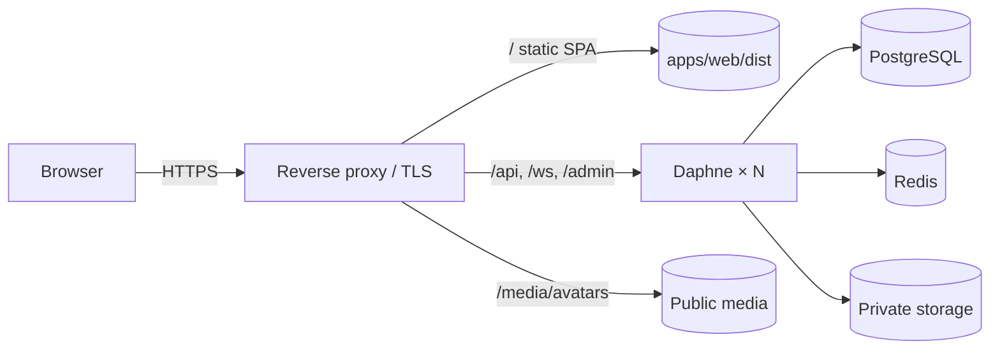

# استقرار

[English](../deployment.md) · **فارسی**

محصول مستقل یک سرویس ASGI (Django و Channels روی Daphne)، PostgreSQL، Redis، فضای ذخیره‌سازی خصوصی فایل و build ایستای وب است. هیچ بخشی از این‌ها تست بار نشده؛ زیرساخت را بر اساس اندازه‌گیری‌های خودتان تعیین کنید (`scripts/load_test.js` نقطهٔ شروعی برای k6 است).



## ساخت

```bash
# ایمیج سرور (شامل packages/django-chat و apps/server)
docker build -t talkio-server .

# وب
npm ci && npm run build:packages && npm run build -w @talkio/web   # → apps/web/dist
```

`apps/web/dist` را به‌صورت فایل ایستا با بازگشت SPA به `index.html` سرو کنید و `/api/`، `/ws/`، `/admin/`، `/social-auth/` و `/static/` را به Daphne بفرستید. **فقط** `/media/avatars/` را عمومی سرو کنید؛ پیوست‌های چت در `PRIVATE_MEDIA_ROOT` (یا فضای خصوصی دیگری) هستند و Django بعد از بررسی مجوز آن‌ها را استریم می‌کند.

## پیکربندی لازم (`DEBUG=0`)

| متغیر | توضیح |
| --- | --- |
| `DJANGO_SECRET_KEY` | مقدار تصادفی بلند. بدون آن سرور بالا نمی‌آید. |
| `ALLOWED_HOSTS` | دامنه‌های شما. برای اعتبارسنجی مبدأ WebSocket هم استفاده می‌شود. |
| `CSRF_TRUSTED_ORIGINS` | `https://your.domain` |
| `DB_ENGINE=django.db.backends.postgresql`، `DB_*` | PostgreSQL 14 به بالا. |
| `REDIS_URL` | کش Redis، channel layer، حضور، محدودیت نرخ مشترک و بلیت‌های یک‌بارمصرف را فعال می‌کند. **با بیش از یک پروسه لازم است.** |
| `TRUSTED_PROXY_COUNT` | تعداد reverse proxyهای جلوی Django (معمولاً `1`). محدودیت نرخ از IP کلاینت استفاده می‌کند؛ با پیش‌فرض `0`، `X-Forwarded-For` نادیده گرفته می‌شود چون کلاینت می‌تواند جعلش کند. درست تنظیمش کنید، وگرنه همهٔ کاربران سهمیهٔ IP همان proxy را شریک می‌شوند. |
| `TRUST_X_FORWARDED_PROTO=1` | وقتی TLS در proxyی تمام می‌شود که `X-Forwarded-Proto` را می‌گذارد. |
| `SECURE_SSL_REDIRECT=1` | اگر proxy خودش HTTP را به HTTPS ریدایرکت نمی‌کند. |
| `PRIVATE_MEDIA_ROOT`، `MEDIA_ROOT` | volumeهای ماندگار. |
| `LANGUAGE_CODE` | زبان پیش‌فرض پیام‌های سرور وقتی کلاینت زبانی نخواسته (`en` یا `fa`). |

`python manage.py check --deploy` را اجرا کنید؛ مشکلات پیکربندی چت (`realtime_chat.*`) را هم گزارش می‌دهد.

## مراحل انتشار

```bash
python manage.py migrate --noinput     # در این انتشار فقط migrationهای افزایشی
python manage.py collectstatic --noinput
python manage.py import_legacy_chat    # فقط یک بار، هنگام ارتقای دیتابیس از اپ چت قدیمی (idempotent)
```

`python manage.py chat_purge_uploads` (مثلاً ساعتی) و بکاپ دیتابیس را زمان‌بندی کنید. `seed_demo` را در production اجرا نکنید (با `DEBUG=0` بدون `--force` اجرا نمی‌شود).

ترجمه‌ها (`.mo`) داخل مخزن و پکیج هستند و به مرحلهٔ جداگانه‌ای نیاز ندارند؛ اگر `.po`ها را تغییر دادید، پیش از build فرمان `python scripts/i18n.py compile` را اجرا کنید.

## نکته‌های proxy

- **اندازهٔ بدنهٔ درخواست را در proxy محدود کنید** (مثلاً در nginx: `client_max_body_size 12m;`). Daphne کل بدنهٔ درخواست را بافر می‌کند پیش از اینکه Django بتواند آپلود بزرگ را رد کند؛ پکیج چت فایل‌های بزرگ‌تر از `CHAT_MAX_ATTACHMENT_SIZE` را رد می‌کند، ولی بدون محدودیت proxy، یک آپلود عظیم همچنان دیسک و پهنای باند مصرف می‌کند. پیام‌های WebSocket را Daphne به‌طور پیش‌فرض به ۱ مگابایت محدود می‌کند.
- WebSocket به هدرهای `Upgrade`/`Connection` و timeout بیکاری بیشتر از فاصلهٔ ضربان نیاز دارد (کلاینت‌ها به‌طور پیش‌فرض هر ۳۰ ثانیه ping می‌فرستند).
- سلامت: `/api/health/` (زنده بودن)، `/api/health/ready/` (دیتابیس و Redis).
- sticky session لازم نیست: هر worker می‌تواند هر سوکتی را سرویس دهد، چون پخش رویدادها از Redis می‌گذرد.

## توسعهٔ محلی

README را ببینید. Compose (`docker compose up --build`) سرویس‌های PostgreSQL، Redis، Daphne (`127.0.0.1:4800`) و Vite (`127.0.0.1:4801`) را اجرا می‌کند.
