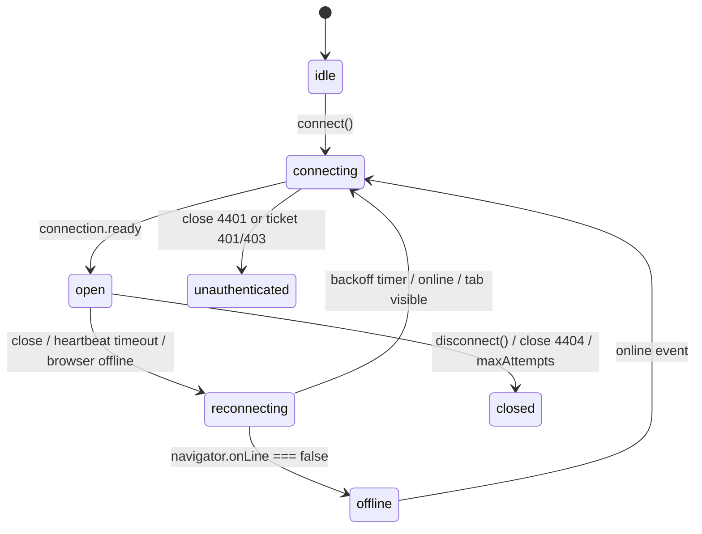
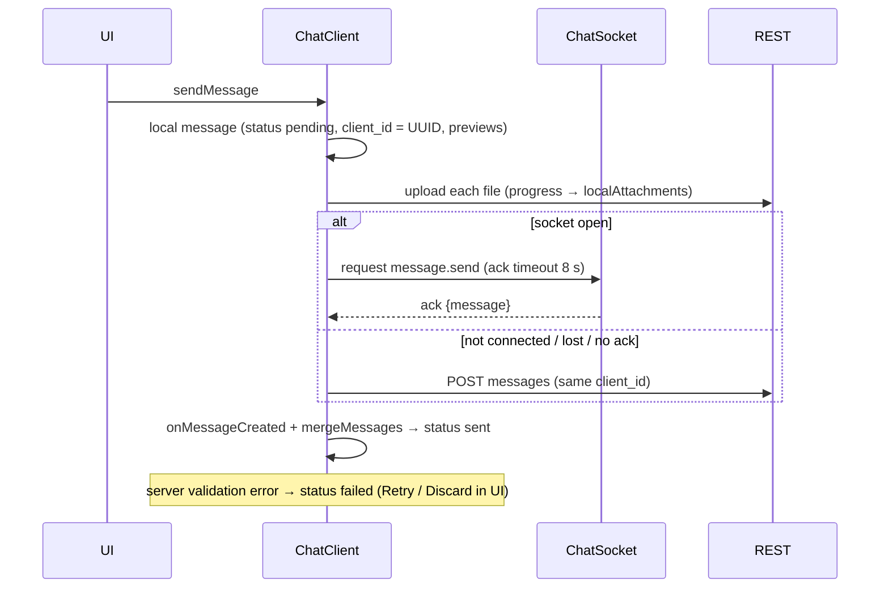

# مرجع فنی فرانت‌اند

[English](../frontend.md) · **فارسی**

سه لایه، که هر کدام به‌تنهایی قابل استفاده‌اند:

| لایه | مسیر | وابسته به |
| --- | --- | --- |
| `@realtime-chat/client` (SDK) | `packages/chat-client/src/` | هیچ (فقط APIهای DOM) |
| `@realtime-chat/react` (کتابخانهٔ رابط) | `packages/react-chat/src/` | SDK، React، Radix (dialog، dropdown-menu، popover)، Lucide، `emojibase-data` |
| اپ وب | `apps/web/src/` | هر دو پکیج، React Router، TanStack Query، Motion، Tailwind |

قاعده: **وضعیت و منطق پروتکل در SDK، نمایش در کتابخانه، تصمیم‌های محصول (مسیرها، صفحه‌های ورود، چیدمان) در اپ.** اپ هیچ کامپوننت چت مخصوص خودش ندارد.

---

## ۱. SDK (`@realtime-chat/client`)

### ۱٫۱ ماژول‌ها

| فایل | مسئولیت |
| --- | --- |
| `types.ts` | نوع‌های پروتکل نسخهٔ ۱ (`Message`، `Conversation`، `Attachment`، `Sticker`، `ChatConfig`، همهٔ unionهای `ServerEvent`/`ClientEvent`) |
| `errors.ts` | `ChatError` (`kind: http|socket|network|timeout|aborted`، `code`، `status`، `details`، `retryAfter`، `retryable`) |
| `auth.ts` | رابط `AuthAdapter`؛ `sessionAuth()` (کوکی + هدر CSRF از کوکی `csrftoken`)، `bearerAuth({ getToken })` (هدر در هر درخواست + بلیت سوکت) |
| `http.ts` | `HttpClient`: ساخت URL، هدرهای احراز هویت و زبان، JSON، مهلت، لغو، پارس قالب خطا، آپلود XHR با پیشرفت |
| `api.ts` | `ChatApi`: یک متد تایپ‌شده برای هر endpoint REST، همه با پشتیبانی از `AbortSignal` |
| `socket.ts` | `ChatSocket`: ماشین حالت اتصال، backoff، ضربان، درخواست/ack |
| `store.ts` | `ChatStore` + reducerها و selectorهای خالص |
| `emitter.ts` | emitter تایپ‌شدهٔ کوچک (خطای listenerها جدا می‌شود) |
| `client.ts` | `createChatClient()`: همه‌چیز را هماهنگ می‌کند |

همهٔ importهای نسبی پسوند `.js` دارند تا ESM کامپایل‌شده در Node و bundlerها کار کند (`scripts/verify-packages.sh` این را بررسی می‌کند).

### ۱٫۲ HTTP (`http.ts`)

- `request(path, {method, query, body, signal, timeoutMs})`: هدرهای `adapter.getHeaders({method, url})` را ادغام می‌کند، `Accept-Language` را از گزینهٔ `language` می‌گذارد، بدنه‌ها را JSON می‌کند (نه `FormData`)، `credentials` را از adapter می‌گیرد و `AbortSignal` فراخواننده را با یک کنترل‌کنندهٔ مهلت داخلی (پیش‌فرض ۲۰ ثانیه) پیوند می‌دهد. تمام شدن مهلت `ChatError(kind: timeout)` و لغو توسط فراخواننده `kind: aborted` می‌شود (به‌عنوان خطا گزارش نمی‌شود).
- `parse()` قالب `{error: {code, message, details}}` را به `ChatError(kind: http)` تبدیل می‌کند و برای `not_authenticated`/401 تابع `adapter.onUnauthorized()` را صدا می‌زند.
- `resolve(path)` وقتی `baseUrl` مطلق است، آدرس‌های نسبی سرور (پیوست، استیکر) را مطلق می‌کند (میزبان‌های cross-origin).
- `upload()` وقتی پیشرفت خواسته شده از `XMLHttpRequest` استفاده می‌کند (fetch پیشرفت آپلود ندارد).

### ۱٫۳ سوکت (`socket.ts`)

حالت‌ها: `idle → connecting → open ⇄ reconnecting | offline → closed | unauthenticated`.



- **backoff با jitter کامل:** `delay = max(min, random() × min(max, min × 2^(attempt-1)))` با پیش‌فرض‌های ۵۰۰ میلی‌ثانیه / ۳۰ ثانیه. jitter نمی‌گذارد همهٔ کلاینت‌ها بعد از ری‌استارت سرور در یک لحظه وصل شوند.
- **ضربان:** بعد از `connection.ready` هر `heartbeat_interval` ثانیه یک `ping` فرستاده می‌شود؛ اگر در `pongTimeoutMs` (۱۰ ثانیه) `pong` نرسد، سوکت با 4000 بسته و دوباره وصل می‌شود. این، اتصال‌های TCP نیمه‌باز را که هیچ‌وقت frame بستن نمی‌فرستند تشخیص می‌دهد.
- **سیگنال‌های مرورگر:** `online` و `visibilitychange` زبانه ← `reconnectNow()`؛ `offline` سوکت باز را فوراً می‌بندد (مرورگرها ممکن است چند دقیقه آن را «باز» نگه دارند) و حالت آفلاین را نشان می‌دهد.
- **درخواست/ack:** `request(event)` یک `request_id` اضافه می‌کند، با `ack` مطابق resolve و با `error` مطابق (`kind: socket`) یا بعد از `requestTimeoutMs` (`ack_timeout`) reject می‌شود؛ با قطع اتصال همهٔ درخواست‌های در انتظار reject می‌شوند (`connection_lost`).
- رویدادهای `ready` بعد از اولین نشست موفق `recovered: true` دارند که بازیابی را در کلاینت شروع می‌کند.
- قلاب `resolveUrl`: پیش از **هر** تلاش اتصال، زبان رابط را به‌صورت `?lang=` اضافه می‌کند و با `adapter.useSocketTicket` یک بلیت تازه می‌گیرد و `?ticket=` را می‌افزاید.

### ۱٫۴ Store (`store.ts`)

```ts
interface ChatState {
  connection: ConnectionState;
  config: ChatConfig | null;
  me: ChatUser | null;
  conversations: Record<string, Conversation>;   // normalized by id
  list: { ids, loaded, loading, hasMore, cursor, error };
  messages: Record<string, { items: ChatMessage[]; loaded; loading; hasMoreBefore; error }>;
  typing: Record<conversationId, Record<userId, expiresAtMs>>;
  presence: Record<userId, { online; last_seen_at }>;
  stickers: { packs; loaded; loading };
}
```

- هر به‌روزرسانی فقط اشیای تغییرکرده را جایگزین و بقیه را نگه می‌دارد (اشتراک ساختاری)؛ پس مقایسه‌های `Object.is` در selectorهای React ارزان و درست‌اند.
- `ChatMessage` = `Message` سرور + `status: pending|sent|failed`، `error`، `localAttachments` (آدرس پیش‌نمایش، پیشرفت، فرادادهٔ صدا).
- `mergeMessages(items, incoming, meId)` هستهٔ آشتی دادن است: پیام‌های تأییدشده با `id` کلید می‌خورند و با `seq` مرتب می‌شوند؛ پیام‌های در انتظار به ترتیب محلی بعد از آن‌ها می‌مانند؛ پیام ورودی از **خود من** با `client_id` مطابق نسخهٔ در انتظار را حذف می‌کند. پس مهم نیست پخش زودتر برسد یا ack.
- selectorها: `selectConversationList`، `selectUnreadTotal`، `selectTypingUsers` (موارد منقضی را حذف می‌کند)، `selectPresence`، `selectReadBy`.

### ۱٫۵ جریان‌های کلاینت (`client.ts`)

**`start()`** (idempotent): `GET /config/` ← `me`، اتصال سوکت، بار کردن اولین صفحهٔ گفت‌وگوها.

**`sendMessage(conversationId, {body, files, voice, sticker, replyToId})`:**



تلاش دوباره (`retryMessage`) فقط فایل‌هایی را که هنوز آپلود نشده‌اند دوباره آپلود می‌کند و با **همان** `client_id` می‌فرستد؛ پس اگر تلاش اول در واقع موفق بوده، سرور پیام اصلی را برمی‌گرداند. بعد از اتصال دوباره، `flushPending` پیام‌هایی را که به‌خاطر مشکل انتقال شکست خورده‌اند خودکار دوباره می‌فرستد.

**`message.created` ورودی** (`onMessageCreated`): ادغام در فهرست بارشده؛ به‌روزرسانی `last_seq`، `last_message`، `last_activity_at`، مرتب‌سازی دوبارهٔ فهرست و افزایش `unread_count` برای پیام‌های دیگران بعد از `my_last_read_seq`. اگر `seq > lastSeen + 1`، `fetchGap` مقدار `after=lastSeen` را بار می‌کند (تا ۵ صفحه، بعد آخرین صفحه را دوباره بار می‌کند). گفت‌وگوهای ناشناخته گرفته می‌شوند. برای اعلان‌ها `incoming` را emit می‌کند.

**بازیابی** (`ready.recovered`): بار دوبارهٔ گفت‌وگوها، `fetchGap` برای هر گفت‌وگوی بارشده، بعد `updated_since=<server_time آخرین ready>` تا ویرایش‌ها، حذف‌ها و واکنش‌های زمان قطع اعمال شوند.

**`markRead`:** debounce ۲۵۰ میلی‌ثانیه؛ `unread_count = 0` خوش‌بینانه؛ `read.mark` روی سوکت با جایگزین REST.

**`setTyping`:** `typing.start` را حداکثر هر ۳ ثانیه و `typing.stop` را فقط بعد از یک start می‌فرستد. «در حال نوشتن» دیگران بعد از `expires_in` منقضی می‌شود (فقط وقتی موردی هست هر ثانیه پاک‌سازی می‌شود).

**`resolveAttachmentUrl`:** احراز هویت با کوکی ← خود آدرس؛ با توکن ← `fetch` با هدرها ← آدرس blob (کش‌شده، هنگام `dispose` آزاد می‌شود).

**`dispose()`:** اول پرچم dispose را می‌گذارد (تا بعد از آن هیچ چیزی store را به‌روز نکند)، سوکت را می‌بندد، تایمرها را پاک می‌کند، آدرس‌های blob/پیش‌نمایش را آزاد و listenerها را پاک می‌کند.

## ۲. کتابخانهٔ React (`@realtime-chat/react`)

### ۲٫۱ Provider و هوک‌ها

`ChatProvider` (`context.tsx`) کلاینت و وضعیت نمایشی سطح اپ را نگه می‌دارد:

| prop | کاربرد |
| --- | --- |
| `client` | لازم. مالکش provider نیست (با `useCreateChatClient` بسازید). |
| `autoStart` | هنگام mount `client.start()` را صدا می‌زند (پیش‌فرض true). |
| `preferences` / `onPreferencesChange` / `storageKey` | پوسته، ارسال با Enter و حالت فشرده؛ کنترل‌شده یا ذخیره‌شده (`localStorage`). |
| `tokens` | بازنویسی توکن‌ها ← متغیرهای `--rc-*` درون‌خطی روی هر ریشه. |
| `strings` / `locale` | بومی‌سازی: همهٔ متن‌های رابط در `strings.ts` هستند؛ `faStrings` (در `locales/fa.ts`) نسخهٔ کامل فارسی است و `locale` تاریخ‌ها، زمان‌های نسبی و ارقام را با `Intl` تعیین می‌کند. |
| `emoji` | `{ baseUrl }` ← ایموجی تصویری (§۴٫۱). |
| `onError` | هر `ChatError` گزارش‌شده را می‌گیرد (اپ toast نشان می‌دهد). |

`useThemeRoot()` برای هر عنصری که ریشهٔ رابط چت است `{className: "rc-root", data-rc-theme, style}` برمی‌گرداند، از جمله محتوای portal در Radix که بیرون از درخت کامپوننت رندر می‌شود.

`hooks.ts`:

- `useChatState(selector)`: `useSyncExternalStore(client.subscribe, getSnapshot)` با snapshot حافظه‌دار؛ selector فقط وقتی شیء وضعیت store عوض شده دوباره اجرا می‌شود و اگر نتیجه با `Object.is` برابر باشد نتیجهٔ قبلی استفاده می‌شود. `useStableArray` هم آرایه‌هایی را که اعضایشان یکسان است دوباره استفاده می‌کند.
- هوک‌های دامنه: `useConversations`، `useConversation(id)`، `useMessages(id)` (در اولین استفاده آخرین صفحه را بار می‌کند و `loadOlder` را در اختیار می‌گذارد)، `useTypingUsers`، `usePresence`، `useConnection`، `useUnreadTotal`، `useMe`، `useChatConfig`، `useUserSearch(q)` (debounce + لغو هنگام تغییر)، `useAttachmentUrl`، `useNow(interval)`، `useMediaQuery`.
- `useCreateChatClient(factory, deps)`: کلاینت را داخل یک effect می‌سازد و در cleanup آزادش می‌کند. React StrictMode در توسعه effectها را دو بار mount می‌کند؛ کلاینتی که با `useMemo` ساخته و در cleanup یک effect آزاد شود، در حین استفاده آزاد می‌شد (باگی که مجموعهٔ E2E پیدا کرد).

### ۲٫۲ کامپوننت‌ها

| کامپوننت | رفتار مهم |
| --- | --- |
| `ChatWindow` | سربرگ، `ConnectionBanner`، `MessageList`، `TypingIndicator`، `MessageComposer` و `ForwardDialog` را کنار هم می‌گذارد؛ وضعیت پاسخ/ویرایش را مدیریت می‌کند؛ گفت‌وگوهایی را که با لینک مستقیم باز شده‌اند و در صفحهٔ اول نیستند تازه می‌کند. |
| `ConversationList` / `ConversationItem` | فیلتر محلی، skeleton، بار کردن بی‌پایان با `IntersectionObserver`، پیمایش با کلیدهای جهت، پشتیبانی از `href` برای router میزبان (کلیک با کلید کمکی زبانهٔ جدید باز می‌کند)، پیش‌نمایش آگاه از نوع («🎤 پیام صوتی»)، پیش‌نمایش «در حال نوشتن». پیش‌نمایش نویسنده و متن را جدا نگه می‌دارد و متن را داخل `<bdi>` می‌گذارد. |
| `MessageList` | پایین‌تر را ببینید. |
| `MessageBubble` (memoized) | متن بی‌خطر با لینک امن و جهت خودکار؛ گروه‌بندی؛ نقل‌قول پاسخ (کلیک برای رفتن)؛ برچسب هدایت؛ پیوست‌ها؛ استیکر (بدون حباب)؛ پیام‌های ۱ تا ۳ ایموجی بزرگ (بدون حباب)؛ رسانهٔ فقط‌تصویری با زمان روی آن؛ آیکون تحویل (ساعت، ✓، ✓✓)؛ چیپ‌های واکنش؛ منوی Radix (واکنش سریع + انتخابگر ایموجی «بیشتر»، پاسخ، کپی، ویرایش، سنجاق، هدایت، حذف با تأیید)؛ حالت ناموفق با تلاش دوباره/دور انداختن. وقتی پاسخ/ویرایش فوکوس را به کادر نوشتن می‌برد، فوکوس از دکمهٔ منو دور می‌ماند. |
| `MessageComposer` | کادر متن خودبزرگ‌شو، پیش‌نویس برای هر گفت‌وگو (map سطح ماژول)، مدیریت Enter امن برای IME، Esc لغو می‌کند، ↑ آخرین پیام را ویرایش می‌کند، چسباندن/کشیدن فایل با اعتبارسنجی نوع/حجم از `config`، پنل ایموجی/استیکر (popover روی دسکتاپ، برگهٔ چسبیده روی گوشی)، ضبط صدا (وقتی کادر خالی است میکروفون جای ارسال را می‌گیرد)، سیگنال «در حال نوشتن» با توقف بعد از ۳ ثانیه بیکاری، شمارندهٔ نویسه نزدیک سقف، فاصلهٔ ناحیهٔ امن. |
| `ConversationHeader`، `ConversationInfoPanel`، `GroupMemberList`، `UserPicker`، `NewConversationDialog`، `AddMembersDialog`، `ForwardDialog`، `ChatSearch`، `ChatSettings`، `ConnectionBanner`، `PresenceIndicator`، `TypingIndicator`، `UnreadBadge`، `UserAvatar`، `AttachmentPreview` | [integration-react.md](integration-react.md) را ببینید. |
| `ChatWidget` | دکمه با نشان نخوانده، پنل (فهرست ← پنجره)، زیر ۶۴۰ پیکسل تمام‌صفحه، Esc یک قدم برمی‌گردد و بعد می‌بندد، وضعیت باز/گفت‌وگوی کنترل‌شده یا کنترل‌نشده. |

**اسکرول `MessageList`** (`useLayoutEffect` بعد از هر تغییر موارد):

- رندر اول: اسکرول به جداکنندهٔ «پیام‌های جدید» (عکس‌فوری از `my_last_read_seq + 1` که یک بار هنگام باز شدن گفت‌وگو گرفته می‌شود) یا به پایین.
- اضافه شدن به ابتدا (اولین id عوض شده، آخری نه): `scrollTop += newHeight − oldHeight`. ظرف اسکرول `overflow-anchor: none` دارد تا لنگر اسکرول خود مرورگر اصلاح را دو بار اعمال نکند.
- اضافه شدن به انتها: اگر کاربر تا ۸۰ پیکسلی پایین بوده یا خودش پیام فرستاده، به پایین می‌چسبد؛ وگرنه پیام‌های جدید را برای دکمهٔ «رفتن به آخرین پیام» می‌شمارد.
- تا ۲۴۰ پیکسلی بالا ← `loadOlder()`. در پایین و قابل دیدن ← `markRead`.
- `jumpTo(id)` صفحه‌های قدیمی‌تر را تا رندر شدن پیام بار می‌کند، بعد اسکرول و برجسته‌اش می‌کند.
- فهرست یک ناحیهٔ زندهٔ `role="log"` است؛ تیک‌های خوانده‌شدن یک بار در هر رندر از نشانگرهای خواندن اعضای دیگر محاسبه می‌شوند.

## ۳. ظاهر و تم

CSS کتابخانه (`src/styles/index.css` ← `dist/styles.css`) با CLI در Tailwind ساخته می‌شود:

```css
@import 'tailwindcss/theme.css' layer(theme) prefix(rc);   /* prefixed theme variables */
@import './base.css';                                     /* tokens + scoped reset, BEFORE utilities */
@import 'tailwindcss/utilities.css' prefix(rc);           /* .rc\:flex etc., unlayered */
@source "../";
```

- **پیشوند:** همهٔ کلاس‌ها `rc:*` هستند؛ پس نام‌ها هیچ‌وقت با میزبان تداخل نمی‌کنند.
- **utilityهای بدون layer:** CSS بدون layer میزبان بر هر CSS layerدار غلبه می‌کند. خروجی گرفتن از utilityهای کتابخانه بدون layer اجازه می‌دهد عادی رقابت کنند.
- **reset محدود:** `.rc-root, .rc-root :where(*)` specificity (0,1,0) دارد: بر selectorهای عنصر میزبان (`button {}`، `* {}`) غلبه می‌کند ولی به utilityها (آن‌ها هم (0,1,0)) می‌بازد **چون زودتر می‌آید**. یک build قبلی آن را بعد از utilityها گذاشته بود (Tailwind `@import` را بالا می‌برد) و همهٔ paddingها پاک شده بود؛ حالا `base.css` پیش از utilityها import می‌شود و یک تست ترتیب را تضمین می‌کند.
- **برقراری دوبارهٔ ارث‌بری:** قواعد میزبان مثل `* { font-family: Georgia }` مستقیم به عناصر می‌خورند و بر ارث‌بری غلبه می‌کنند؛ پس reset مقدارهای `font-family/size/weight/line-height/letter-spacing/text-transform/text-align: inherit` را از `.rc-root` می‌گذارد.
- **توکن‌ها:** custom propertyهای `--rc-*` روی `.rc-root` (کامپوننت‌ها) و `.rc-tokens` (صفحه‌های میزبان که فقط متغیرها را می‌خواهند). مقادیر تیره با `[data-rc-theme='dark']` اعمال می‌شوند. بلوک `@theme inline` آن‌ها را به utilityها نگاشت می‌کند (`rc:bg-surface` ← `var(--rc-surface)`).
- **راست‌به‌چپ:** utilityهای منطقی (`ps/pe`، `start/end`، `rounded-es/ee`)، `dir="auto"` روی متن کاربر، `[dir=rtl]` به `--rc-font-rtl` تغییر می‌کند. وقتی میزبان روی ظرف `dir="rtl"` بگذارد کل رابط آینه می‌شود.
- **حرکت:** keyframeهای کوچک (`rc-enter`، `rc-pop`، نقطه‌های «در حال نوشتن»، درخشش skeleton) که همه با `prefers-reduced-motion` خاموش می‌شوند.

تست‌ها: `test/styles.test.tsx` بررسی می‌کند reset پیش از utilityها باشد، هیچ قاعده‌ای عناصر خام میزبان را هدف نگیرد، و utilityهای همهٔ پوشه‌های کامپوننت وجود داشته باشند (یک الگوی `.gitignore` روزی `components/media/` را از اسکن منبع Tailwind پنهان کرده بود).

## ۴. رسانه (ایموجی، استیکر، صدا، پیوست)

### ۴٫۱ ایموجی

- **داده** (`media/emojiData.ts`): `emojibase-data/en/compact.json` (حدود ۱۹۰۰ مورد با برچسب، تگ، گروه و رنگ پوست)، با `import()` پویا در اولین استفاده؛ پس هیچ‌وقت بخشی از bundle اولیه نیست. موارد اخیر (۲۷)، استیکرهای اخیر (۱۵) و رنگ پوست هر ایموجی در `localStorage` نگه داشته می‌شوند. برچسب‌های جست‌وجو انگلیسی‌اند.
- **رندر** (`media/Emoji.tsx`): با `emoji.baseUrl`، `<Emoji>` تصویر `` را رندر می‌کند. نام فایل‌ها از قاعدهٔ Twemoji پیروی می‌کند: U+FE0F حذف می‌شود مگر دنباله ZWJ داشته باشد (`❤️` ← `2764`، `❤️‍🔥` ← `2764-fe0f-200d-1f525`). تصویر روی همهٔ سیستم‌عامل‌ها ایموجی یکسان می‌دهد و جایی که فونت ایموجی رنگی نیست، مربع خالی نمی‌گذارد. اگر فایل نباشد کامپوننت به متن برمی‌گردد و `onMissing` را گزارش می‌دهد (انتخابگر این موارد را پنهان می‌کند: نسخه‌های یونیکد جدیدتر از مجموعهٔ تصاویر).
- **`splitEmoji` / `EmojiText`:** تقسیم به grapheme با `Intl.Segmenter` خانواده‌های ZWJ، پرچم‌ها و رنگ پوست را سالم نگه می‌دارد؛ برای متن پیام، پیش‌نمایش و نقل‌قول.
- **انتخابگر** (`EmojiPicker.tsx`): جست‌وجو با برچسب/تگ، بخش‌ها با سربرگ چسبان، نوار دسته‌ها با scroll spy، شبکهٔ `auto-fill` از خانه‌های ۴۰ پیکسلی، پنجرهٔ رنگ پوست با راست‌کلیک یا نگه داشتن ۴۲۰ میلی‌ثانیه.
- **ایموجی بزرگ:** `emojiOnlyCount(text)` (۱ تا ۳ grapheme، همه تصویری) ← ۵۶/۴۴/۳۶ پیکسل بدون حباب.

### ۴٫۲ استیکر

`StickerPicker` بسته‌ها را یک بار بار می‌کند (`client.loadStickers()`)، بخش «اخیراً استفاده‌شده» و نوار بسته با تصویر جلد نشان می‌دهد؛ `StickerImage` آدرس‌ها را از طریق `useAttachmentUrl` resolve می‌کند (با احراز هویت توکنی هم کار می‌کند). ارسال با `client.sendMessage(id, { sticker })`.

### ۴٫۳ صدا

`useVoiceRecorder(maxSeconds)`:

1. `getUserMedia({audio: {echoCancellation, noiseSuppression}})`.
2. `MediaRecorder` با اولین نوع پشتیبانی‌شده از `audio/webm;codecs=opus`، `audio/mp4` (Safari)، `audio/ogg;codecs=opus`.
3. یک `AnalyserNode` هر ۸۰ میلی‌ثانیه RMS را نمونه می‌گیرد ← نوارهای سطح زنده و فهرست نمونه‌های خام.
4. `stop(true)` مقدار `{file, duration, waveform}` را برمی‌گرداند که `toWaveform` نمونه‌ها را به ۶۴ نوار نرمال‌شده با اوج (۰ تا ۱۰۰) کاهش می‌دهد؛ ضبط‌های کوتاه‌تر از ۰٫۵ ثانیه دور ریخته می‌شوند؛ در `max_voice_duration` خودکار متوقف می‌شود.

`VoicePlayer`: `<audio>` پنهان، پخش/توقف، شکل موج قابل کلیک و قابل جابه‌جایی با صفحه‌کلید (`role="slider"`)، زمان گذشته/کل، سرعت ۱×/۱٫۵×/۲×، پیشرفت آپلود هنگام ارسال.

### ۴٫۴ پیوست

`AttachmentPreview`: تصاویر پیش‌نمایش WebP را درون پیام نشان می‌دهند و فایل کامل را فقط وقتی lightbox باز می‌شود می‌گیرند؛ GIFها یک نشان دارند؛ ویدیو/صوت از پخش‌کنندهٔ بومی استفاده می‌کنند؛ فایل‌های دیگر کارتی با حجم و لینک دانلود دارند؛ فایل‌های محلی (ارسال‌نشده) پیش‌نمایش object-URL و پیشرفت آپلود دارند.

## ۵. اپ وب (`apps/web`)

| بخش | پیاده‌سازی |
| --- | --- |
| ورودی | `main.tsx`: `QueryClientProvider` ← `ToastProvider` ← `App` (`createBrowserRouter`، `MotionConfig reducedMotion="user"`). |
| مسیرها | `/` صفحهٔ اول، `/login`، `/register` (فقط مهمان)، `/app`، `/app/c/:conversationId`، `/app/profile`، `/app/u/:userId`، `/app/settings` (lazy، پشت `RequireAuth`)، `*`. |
| نشست | `useSession()` = TanStack Query `['session']` ← `GET /api/auth/session/`. `ChatSession` برای هر شناسهٔ کاربر با `useCreateChatClient` یک کلاینت چت می‌سازد؛ `onUnauthorized` نشست را باطل می‌کند (← ریدایرکت به ورود)؛ خطاها toast می‌شوند (نویز انتقال فیلتر می‌شود). |
| API احراز هویت | `lib/auth.ts`: CSRF از کوکی (یا توکنی که API بعد از چرخش ورود برمی‌گرداند)، `login`، `loginWithCode`، `register`، `logout`، `updateProfile` (JSON یا multipart)، `changePassword`؛ هر درخواست `Accept-Language` را با زبان اپ می‌فرستد. |
| ورود | زبانهٔ تلفن + کد (پیش‌فرض وقتی `demo_auth`)، زبانهٔ نام کاربری/رمز، دکمه‌های provider اجتماعی وقتی پیکربندی شده‌اند. |
| پوسته | `AppShell`: نوار ناوبری دسکتاپ (گفت‌وگوها با نشان نخوانده، جست‌وجو، جدید، تنظیمات، پروفایل)، نوار زبانهٔ موبایل که داخل گفت‌وگو پنهان می‌شود، میان‌برهای سراسری (Ctrl/⌘+K، Alt+N، Alt+↑/↓، Ctrl/⌘+,)، دیالوگ جست‌وجو، دیالوگ گفت‌وگو/گروه جدید. |
| محیط کار | دسکتاپ: فهرست ۳۲۰ تا ۳۴۰ پیکسل، پنجره، پنل جزئیات (درون صفحه از ۱۱۸۰ پیکسل، زیر آن روی صفحه). موبایل: فهرست و گفت‌وگو به‌صورت دو صفحهٔ متحرک جدا. وضعیت پنل جزئیات ذخیره می‌شود. |
| پوسته (تم) | `index.html` پیش از اولین رندر `data-rc-theme` را از تنظیم ذخیره‌شده می‌گذارد؛ `ThemeSync` کلاس `<html class="rc-tokens">` و `theme-color` را همگام نگه می‌دارد؛ تم Tailwind اپ به همان توکن‌های `--rc-*` نگاشت می‌شود. |
| زبان | `lib/i18n.ts`: `t(english, vars)` با `src/locales/fa.json` (متن انگلیسی کلید است)، `msg()` برای ثابت‌ها، `useLang()`/`setLang()`. `index.html` پیش از اولین رندر `<html lang dir>` را از انتخاب ذخیره‌شده (`talkio:lang`) یا زبان مرورگر تنظیم می‌کند. تعویض زبان رابط اپ را زیر `ChatSession` دوباره mount می‌کند؛ پس کلاینت چت و سوکتش زنده می‌مانند. `ChatProvider` مقدار `faStrings` و `intlLocale()` را می‌گیرد؛ SDK و `lib/auth.ts` زبان را به‌صورت `Accept-Language` (و `?lang=` روی سوکت) می‌فرستند. `LangSwitch` در سربرگ صفحه‌های ورود، صفحهٔ اول و تنظیمات است. `npm run i18n:check` وقتی متنی ترجمهٔ فارسی نداشته باشد شکست می‌خورد. |
| اعلان‌ها | تعداد نخوانده در عنوان صفحه؛ اعلان دسکتاپ اختیاری برای پیام‌هایی که وقتی زبانه پنهان است می‌رسند (`lib/notifications.ts`). |
| فایل‌های ایموجی | افزونهٔ `emojiAssets()` در `vite.config.ts` فایل‌های `@twemoji/svg` را در hook `config` به `public/emoji/` کپی می‌کند (پیش از اینکه Vite پوشهٔ `public/` را ایندکس کند؛ `buildStart` برای سرور توسعه دیر است). این پوشه در gitignore است. |
| سرور توسعه | `127.0.0.1:4801` که `/api`، `/media`، `/social-auth` و `/ws` را به `TALKIO_API_TARGET` (پیش‌فرض `:4800`) می‌فرستد تا مرورگر یک مبدأ ببیند. `VITE_BASE` میزبانی در زیرمسیر را پشتیبانی می‌کند؛ همهٔ آدرس‌های API از `BASE_URL` ساخته می‌شوند. |
| آیکون‌ها | `public/logo.svg`، `favicon.svg`، `apple-touch-icon.png`، `icon-192/512.png`، `manifest.webmanifest`؛ کامپوننت `LogoMark` در `components/ui.tsx`. |

## ۶. ساخت و بسته‌بندی

- `npm run build:packages` ← SDK با `tsc -p tsconfig.build.json` (ESM + `.d.ts` + map)؛ کتابخانه با `tsc` + CSS از CLI در Tailwind.
- `exports` پکیج‌ها: `"."` (types + import) و `"./styles.css"`؛ `sideEffects` برابر false (SDK) / فقط CSS (کتابخانه).
- وابستگی همتا: React ≥ ۱۸٫۲؛ مخزن روی React 19 با یک نسخهٔ hoistشده توسعه داده می‌شود (چند نسخهٔ React خطای «element from an older version» داده بود).
- TypeScript سخت‌گیرانه (`strict`، `noUncheckedIndexedAccess`، `verbatimModuleSyntax`).
- `scripts/verify-packages.sh` فایل‌های tarball حاصل از `npm pack` را در یک پروژهٔ تمیز نصب می‌کند، یک مصرف‌کننده را با `skipLibCheck: false` نوع‌بررسی می‌کند و هر دو پکیج را در Node ساده import می‌کند.

## ۷. تست‌ها

| مجموعه | ابزار | پوشش |
| --- | --- | --- |
| SDK در `packages/chat-client/test/` | Vitest (node) + `FakeWebSocket` + `fakeFetch` جدول‌مسیر | خطاهای HTTP، هدرهای احراز هویت و زبان، لغو، backoff، 4401، مهلت ضربان، درخواست/ack، ارسال خوش‌بینانه، جایگزینی ack با HTTP، شکست/تلاش دوباره، نخوانده، debounce خواندن، پر کردن جاافتادگی، بازیابی با ویرایش‌ها، محدودیت «در حال نوشتن»، بلیت، dispose، ارسال صدا/استیکر |
| کتابخانه در `packages/react-chat/test/` | Vitest (jsdom) + Testing Library، `ChatClient` واقعی روی fakeها | فهرست‌ها، رندر بی‌خطر، Enter/Shift+Enter، خوش‌بینانه ← ارسال‌شده، تلاش دوباره با همان id، پاسخ/فوکوس Esc، «در حال نوشتن»، خواندن خودکار، ویجت، بنر، تنظیمات/توکن‌ها، چرخهٔ عمر کلاینت در StrictMode، انتخابگر ایموجی/رنگ پوست/تصاویر، استیکر، پخش‌کنندهٔ صدا، شکل موج، CSS ساخته‌شده، متن‌های فارسی کامل و قالب‌بندی بر اساس locale |
| اپ در `apps/web/src/**/*.test.tsx` | Vitest | اعتبارسنجی ثبت‌نام و خطاهای فیلدی سرور؛ ترجمه، جهت و رندر یک صفحه به فارسی |
| E2E در `apps/web/e2e/` | Playwright (دسکتاپ، Pixel 7، میزبان نمونه) | ورود (تلفن + 1234، رمز، خطاها)، ثبت‌نام، تحویل بلادرنگ بین دو مرورگر، نخوانده/رسید خواندن، «در حال نوشتن»، کارهای منو، صفحه‌کلید، آفلاین ← بازیابی با پر کردن جاافتادگی، گروه‌ها، ناوبری موبایل، ایموجی/واکنش، استیکر، ضبط صدا با میکروفون جعلی Chromium، ایزوله‌سازی استایل ویجت در هر دو جهت |
| تصاویر | `e2e/screenshots.spec.ts` | تصاویر README از اپ در حال اجرا، از جمله تصاویر فارسی (`*-fa.png`) |

Playwright می‌تواند با `PLAYWRIGHT_CHROMIUM_PATH` از یک مرورگر مشخص استفاده کند (مثلاً وقتی دانلود مرورگر در شبکهٔ شما مسدود است)؛ CI از دانلود استاندارد استفاده می‌کند.
