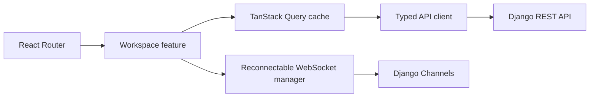

# Frontend Architecture

## Runtime boundary

The frontend is a React/Vite TypeScript application. Django remains the source of truth for authentication, conversation membership, message history, attachments, and authorization. The browser uses an HTTP-only Django session cookie and CSRF headers; it does not store credentials or bearer tokens in localStorage.

## Structure

- `app/`: providers and application routes.
- `features/auth/`: validation and session entry UI.
- `features/workspace/`: conversation shell, message rendering, composer, details panel.
- `lib/`: typed HTTP and WebSocket integration boundaries.
- `state/`: only persisted client preference state (currently theme).
- `types/`: backend contract types.

Server state belongs in TanStack Query. Zustand is limited to local presentation preferences. The WebSocket manager owns connection lifecycle, exponential backoff, and event parsing; message deduplication happens when events enter the query cache.

## Integration decisions

- WebSocket delivery is treated as at-least-once. The client sends a request ID and ignores a duplicate server message ID.
- Reconnect delay grows from one second to a ten-second cap and is reset after a successful connection.
- Unsupported capabilities are not presented as working product actions. The attachment backend exists, but attachment selection UI remains a follow-up integration.
- The Vite proxy is environment-aware: local development targets `127.0.0.1:8000`; Compose targets the `web` service.
