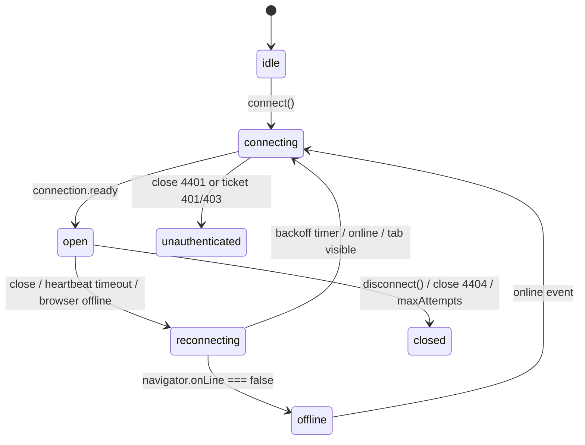
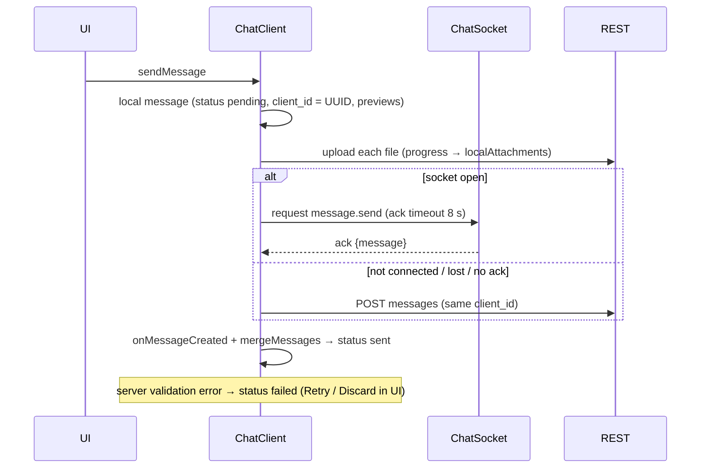

# Frontend technical reference

**English** · [فارسی](fa/frontend.md)

Three layers, each usable on its own:

| Layer | Path | Depends on |
| --- | --- | --- |
| `@realtime-chat/client` (SDK) | `packages/chat-client/src/` | nothing (DOM APIs only) |
| `@realtime-chat/react` (UI library) | `packages/react-chat/src/` | SDK, React, Radix (dialog, dropdown-menu, popover), Lucide, `emojibase-data` |
| Web app | `apps/web/src/` | both packages, React Router, TanStack Query, Motion, Tailwind |

Rule: **state and protocol logic live in the SDK, presentation in the library, product decisions (routes, auth screens, layout) in the app.** The app contains no chat components of its own.

Contents: [1 SDK](#1-sdk-realtime-chatclient) · [2 React library](#2-react-library-realtime-chatreact) · [3 Styling](#3-styling-and-theming) · [4 Media](#4-media-emoji-stickers-voice-attachments) · [5 Web app](#5-web-app-appsweb) · [6 Build and packaging](#6-build-and-packaging) · [7 Tests](#7-tests)

---

## 1. SDK (`@realtime-chat/client`)

### 1.1 Modules

| File | Responsibility |
| --- | --- |
| `types.ts` | Wire types for protocol v1 (`Message`, `Conversation`, `Attachment`, `Sticker`, `ChatConfig`, all `ServerEvent`/`ClientEvent` unions) |
| `errors.ts` | `ChatError` (`kind: http|socket|network|timeout|aborted`, `code`, `status`, `details`, `retryAfter`, `retryable`) |
| `auth.ts` | `AuthAdapter` interface; `sessionAuth()` (cookies + CSRF header from the `csrftoken` cookie), `bearerAuth({ getToken })` (header per request + socket tickets) |
| `http.ts` | `HttpClient` — URL building, auth headers, JSON, timeouts, cancellation, error envelope parsing, XHR uploads with progress |
| `api.ts` | `ChatApi` — one typed method per REST endpoint, all accepting `AbortSignal` |
| `socket.ts` | `ChatSocket` — connection state machine, backoff, heartbeat, request/ack |
| `store.ts` | `ChatStore` + pure reducers and selectors |
| `emitter.ts` | Tiny typed emitter (listener errors are isolated) |
| `client.ts` | `createChatClient()` — orchestrates everything |

All relative imports carry `.js` extensions so the compiled ESM works in Node and bundlers (verified by `scripts/verify-packages.sh`).

### 1.2 HTTP (`http.ts`)

- `request(path, {method, query, body, signal, timeoutMs})`: merges `adapter.getHeaders({method, url})`, JSON-encodes bodies (not `FormData`), uses `credentials` from the adapter, and links the caller's `AbortSignal` with an internal timeout controller (default 20 s). A timeout becomes `ChatError(kind: timeout)`; a caller abort becomes `kind: aborted` (not reported as an error).
- `parse()` converts `{error: {code, message, details}}` into `ChatError(kind: http)` and calls `adapter.onUnauthorized()` for `not_authenticated`/401.
- `resolve(path)` turns server-relative URLs (attachments, stickers) into absolute ones when `baseUrl` is absolute (cross-origin hosts).
- `upload()` uses `XMLHttpRequest` when progress is requested (fetch has no upload progress).

### 1.3 Socket (`socket.ts`)

States: `idle → connecting → open ⇄ reconnecting | offline → closed | unauthenticated`.



- **Backoff with full jitter:** `delay = max(min, random() × min(max, min × 2^(attempt-1)))`, defaults 500 ms / 30 s. Jitter prevents every client reconnecting at the same moment after a server restart.
- **Heartbeat:** after `connection.ready` a `ping` is sent every `heartbeat_interval` seconds; if no `pong` arrives within `pongTimeoutMs` (10 s) the socket is closed with 4000 and reconnects. This detects half-open TCP connections that never deliver a close frame.
- **Browser signals:** `online` and tab `visibilitychange` → `reconnectNow()`; `offline` closes an open socket immediately (browsers can keep it "open" for minutes) and shows the offline state.
- **Request/ack:** `request(event)` adds a `request_id`, resolves on the matching `ack`, rejects on the matching `error` (`kind: socket`) or after `requestTimeoutMs` (`ack_timeout`); all pending requests reject on disconnect (`connection_lost`).
- `ready` events carry `recovered: true` after the first successful session, which triggers recovery in the client.
- `resolveUrl` hook: before **every** attempt the client appends the UI language as `?lang=` and, with `adapter.useSocketTicket`, fetches a fresh ticket and appends `?ticket=`.

### 1.4 Store (`store.ts`)

```ts
interface ChatState {
  connection: ConnectionState;
  config: ChatConfig | null;
  me: ChatUser | null;
  conversations: Record<string, Conversation>;   // normalized by id
  list: { ids, loaded, loading, hasMore, cursor, error };
  messages: Record<string, { items: ChatMessage[]; loaded; loading; hasMoreBefore; error }>;
  typing: Record<conversationId, Record<userId, expiresAtMs>>;
  presence: Record<userId, { online; last_seen_at }>;
  stickers: { packs; loaded; loading };
}
```

- Every update replaces changed objects and keeps unchanged ones (structural sharing), so `Object.is` comparisons in React selectors are cheap and correct.
- `ChatMessage` = server `Message` + `status: pending|sent|failed`, `error`, `localAttachments` (preview URL, progress, voice metadata).
- `mergeMessages(items, incoming, meId)` is the reconciliation core: confirmed messages are keyed by `id` and sorted by `seq`; pending ones stay after them in local order; an incoming message from **me** with a matching `client_id` removes the pending copy. It therefore does not matter whether the broadcast or the ack arrives first.
- Selectors: `selectConversationList`, `selectUnreadTotal`, `selectTypingUsers` (drops expired entries), `selectPresence`, `selectReadBy`.

### 1.5 Client flows (`client.ts`)

**`start()`** (idempotent): `GET /config/` → `me`, connect socket, load the first conversation page.

**`sendMessage(conversationId, {body, files, voice, sticker, replyToId})`:**



Retries (`retryMessage`) re-upload only the files that are not uploaded yet and resend with the **same** `client_id`, so the server returns the original message if the first attempt actually succeeded. After a reconnect, `flushPending` automatically retries messages that failed for transport reasons.

**Incoming `message.created`** (`onMessageCreated`): merge into the loaded list; update `last_seq`, `last_message`, `last_activity_at`, re-sort the list, and increment `unread_count` for messages from others beyond `my_last_read_seq`. If `seq > lastSeen + 1`, `fetchGap` loads `after=lastSeen` (up to 5 pages, then reloads the latest page). Unknown conversations are fetched. Emits `incoming` for notifications.

**Recovery** (`ready.recovered`): reload conversations, `fetchGap` every loaded conversation, then `updated_since=<previous ready.server_time>` to apply edits, deletions and reactions made while disconnected.

**`markRead`:** debounced 250 ms; optimistic `unread_count = 0`; `read.mark` over the socket with REST fallback.

**`setTyping`:** sends `typing.start` at most every 3 s and `typing.stop` only after a start. Remote typing entries expire after `expires_in` (swept every second only while entries exist).

**`resolveAttachmentUrl`:** cookie auth → the URL itself; token auth → `fetch` with headers → blob URL (cached, revoked on `dispose`).

**`dispose()`:** sets the disposed flag first (so nothing updates the store afterwards), closes the socket, clears timers, revokes blob/preview URLs, clears listeners.

## 2. React library (`@realtime-chat/react`)

### 2.1 Provider and hooks

`ChatProvider` (`context.tsx`) holds the client and app-level presentation state:

| Prop | Purpose |
| --- | --- |
| `client` | Required. Not owned by the provider (create with `useCreateChatClient`). |
| `autoStart` | Calls `client.start()` on mount (default true). |
| `preferences` / `onPreferencesChange` / `storageKey` | Controlled or persisted (`localStorage`) theme, Enter-to-send, compact mode. |
| `tokens` | Token overrides → inline `--rc-*` variables on every root. |
| `strings` / `locale` | Localization: all UI text lives in `strings.ts`; `faStrings` (`locales/fa.ts`) is the complete Persian set, and `locale` drives dates, relative times and digits through `Intl`. |
| `emoji` | `{ baseUrl }` → image emoji (see §4.1). |
| `onError` | Receives every reported `ChatError` (the app shows toasts). |

`useThemeRoot()` returns `{className: "rc-root", data-rc-theme, style}` for every element that roots chat UI, including Radix portal content, which renders outside the component tree.

`hooks.ts`:

- `useChatState(selector)` — `useSyncExternalStore(client.subscribe, getSnapshot)` with a memoized snapshot: the selector re-runs only when the store state object changes and the previous result is reused when `Object.is` equal. `useStableArray` additionally reuses arrays whose items are identical.
- Domain hooks: `useConversations`, `useConversation(id)`, `useMessages(id)` (loads the latest page on first use and exposes `loadOlder`), `useTypingUsers`, `usePresence`, `useConnection`, `useUnreadTotal`, `useMe`, `useChatConfig`, `useUserSearch(q)` (debounced + aborted on change), `useAttachmentUrl`, `useNow(interval)`, `useMediaQuery`.
- `useCreateChatClient(factory, deps)` — creates the client inside an effect and disposes it in the cleanup. React StrictMode mounts effects twice in development; a client created with `useMemo` and disposed in an effect cleanup would be disposed while still in use (a bug found by the E2E suite).

### 2.2 Components

| Component | Notable behavior |
| --- | --- |
| `ChatWindow` | Composes header, `ConnectionBanner`, `MessageList`, `TypingIndicator`, `MessageComposer`, `ForwardDialog`; manages reply/edit state; refreshes deep-linked conversations not in the first page. |
| `ConversationList` / `ConversationItem` | Local filter, skeletons, infinite loading via `IntersectionObserver`, arrow-key navigation, `href` support for the host router (modifier-click opens a new tab), kind-aware previews ("🎤 Voice message"), typing preview. |
| `MessageList` | See below. |
| `MessageBubble` (memoized) | Inert text with safe links and auto direction; grouping; reply quotes (click to jump); forwarded label; attachments; stickers (no bubble); 1–3 emoji messages large (no bubble); visual-only media with overlaid time; delivery icons (clock, ✓, ✓✓); reaction chips; Radix menu (quick reactions + "more" emoji picker, reply, copy, edit, pin, forward, delete with confirmation); failed state with Retry/Discard. Focus is kept off the menu trigger when Reply/Edit move focus to the composer. |
| `MessageComposer` | Auto-growing textarea, per-conversation drafts (module-level map), IME-safe Enter handling, Esc cancels, ↑ edits last, paste/drag-drop files with type/size validation from `config`, emoji/sticker panel (popover on desktop, docked sheet on phones), voice recording (mic replaces send when empty), typing signals with 3 s idle stop, character counter near the limit, safe-area padding. |
| `ConversationHeader`, `ConversationInfoPanel`, `GroupMemberList`, `UserPicker`, `NewConversationDialog`, `AddMembersDialog`, `ForwardDialog`, `ChatSearch`, `ChatSettings`, `ConnectionBanner`, `PresenceIndicator`, `TypingIndicator`, `UnreadBadge`, `UserAvatar`, `AttachmentPreview` | See [integration/react.md](integration/react.md). |
| `ChatWidget` | Launcher with unread badge, panel (list → window), full-screen below 640 px, Esc steps back then closes, controlled or uncontrolled open/conversation state. |

**`MessageList` scrolling** (`useLayoutEffect` after every item change):

- First render: scroll to the "New messages" divider (snapshot of `my_last_read_seq + 1` taken once when the conversation opens) or to the bottom.
- Prepend (first id changed, last unchanged): `scrollTop += newHeight − oldHeight`. The scroller sets `overflow-anchor: none` so the browser's own scroll anchoring does not apply the correction twice.
- Append: stick to the bottom if the user was within 80 px of it or sent the message; otherwise count new messages for the "jump to latest" pill.
- Within 240 px of the top → `loadOlder()`. At the bottom and visible → `markRead`.
- `jumpTo(id)` loads older pages until the message is rendered, then scrolls and highlights it.
- The list is a `role="log"` live region; read ticks are computed from the other members' read markers once per render.

## 3. Styling and theming

Library CSS (`src/styles/index.css` → `dist/styles.css`) is built with the Tailwind CLI:

```css
@import 'tailwindcss/theme.css' layer(theme) prefix(rc);   /* prefixed theme variables */
@import './base.css';                                     /* tokens + scoped reset, BEFORE utilities */
@import 'tailwindcss/utilities.css' prefix(rc);           /* .rc\:flex etc., unlayered */
@source "../";
```

- **Prefix** — every class is `rc:*`, so names never collide with the host.
- **Unlayered utilities** — unlayered host CSS beats any layered CSS. Emitting the library utilities unlayered lets them compete normally.
- **Scoped reset** — `.rc-root, .rc-root :where(*)` has specificity (0,1,0): it beats host element selectors (`button {}`, `* {}`) but loses to utilities (also (0,1,0)) **because it comes first**. An earlier build placed it after the utilities (Tailwind hoists `@import`), which wiped every padding; `base.css` is now imported before the utilities and a test asserts the order.
- **Inheritance re-established** — host rules such as `* { font-family: Georgia }` match elements directly and beat inheritance, so the reset sets `font-family/size/weight/line-height/letter-spacing/text-transform/text-align: inherit` from `.rc-root`.
- **Tokens** — `--rc-*` custom properties on `.rc-root` (components) and `.rc-tokens` (host pages that want only variables). Dark values apply with `[data-rc-theme='dark']`. The `@theme inline` block maps them to utilities (`rc:bg-surface` → `var(--rc-surface)`).
- **RTL** — logical utilities (`ps/pe`, `start/end`, `rounded-es/ee`), `dir="auto"` on user text, `[dir=rtl]` switches to `--rc-font-rtl`.
- **Motion** — small keyframes (`rc-enter`, `rc-pop`, typing dots, skeleton shimmer), all disabled under `prefers-reduced-motion`.

Tests: `test/styles.test.tsx` checks that the reset precedes the utilities, that no rule targets bare host elements, and that utilities from every component folder are present (a `.gitignore` pattern once hid `components/media/` from Tailwind's source scanning).

## 4. Media (emoji, stickers, voice, attachments)

### 4.1 Emoji

- **Data** (`media/emojiData.ts`): `emojibase-data/en/compact.json` (≈1,900 entries with labels, tags, groups, skin variants), loaded with a dynamic `import()` on first use, so it is never part of the initial bundle. Recents (27), sticker recents (15) and per-emoji skin tones are kept in `localStorage`.
- **Rendering** (`media/Emoji.tsx`): with `emoji.baseUrl`, `<Emoji>` renders ``. File names follow the Twemoji rule: drop U+FE0F unless the sequence contains a ZWJ (`❤️` → `2764`, `❤️‍🔥` → `2764-fe0f-200d-1f525`). Images give identical emoji on every OS and avoid empty boxes where no color-emoji font exists. On a missing file the component falls back to text and reports `onMissing` (the picker hides such entries: Unicode versions newer than the image set).
- **`splitEmoji` / `EmojiText`**: grapheme segmentation with `Intl.Segmenter` keeps ZWJ families, flags and skin tones intact; used for message text, previews, quotes.
- **Picker** (`EmojiPicker.tsx`): search by label/tag, sections with sticky headers, category bar with scroll spy, `auto-fill` grid of 40 px cells, skin-tone popup via right-click or 420 ms long-press.
- **Large emoji**: `emojiOnlyCount(text)` (1–3 graphemes, all pictographic) → 56/44/36 px without a bubble.

### 4.2 Stickers

`StickerPicker` loads packs once (`client.loadStickers()`), shows a "Recently used" section and a pack bar with cover images; `StickerImage` resolves URLs through `useAttachmentUrl` (works for token auth). Sending is `client.sendMessage(id, { sticker })`.

### 4.3 Voice

`useVoiceRecorder(maxSeconds)`:

1. `getUserMedia({audio: {echoCancellation, noiseSuppression}})`.
2. `MediaRecorder` with the first supported type of `audio/webm;codecs=opus`, `audio/mp4` (Safari), `audio/ogg;codecs=opus`.
3. An `AnalyserNode` samples RMS every 80 ms → live level bars and the raw sample list.
4. `stop(true)` returns `{file, duration, waveform}` where `toWaveform` reduces samples to 64 peak-normalized bars (0–100); recordings under 0.5 s are discarded; automatic stop at `max_voice_duration`.

`VoicePlayer`: hidden `<audio>`, play/pause, clickable/keyboard-seekable waveform (`role="slider"`), elapsed/total time, 1×/1.5×/2× speed, upload progress while sending.

### 4.4 Attachments

`AttachmentPreview`: images show the WebP thumbnail inline and fetch the full file only when the lightbox opens; GIFs carry a badge; video/audio use native players; other files show a card with size and download link; local (unsent) files show object-URL previews and upload progress.

## 5. Web app (`apps/web`)

| Area | Implementation |
| --- | --- |
| Entry | `main.tsx`: `QueryClientProvider` → `ToastProvider` → `App` (`createBrowserRouter`, `MotionConfig reducedMotion="user"`). |
| Routes | `/` landing, `/login`, `/register` (guest only), `/app`, `/app/c/:conversationId`, `/app/profile`, `/app/u/:userId`, `/app/settings` (lazy-loaded, behind `RequireAuth`), `*`. |
| Session | `useSession()` = TanStack Query `['session']` → `GET /api/auth/session/`. `ChatSession` creates one chat client per user id with `useCreateChatClient`; `onUnauthorized` invalidates the session (→ redirect to login); errors become toasts (transport noise filtered). |
| Auth API | `lib/auth.ts` — CSRF from cookie (or the token returned by the API after login rotation), `login`, `loginWithCode`, `register`, `logout`, `updateProfile` (JSON or multipart), `changePassword`. |
| Login | Phone + code tab (default when `demo_auth`), username/password tab, social provider buttons when configured. |
| Shell | `AppShell`: desktop navigation rail (chats with unread badge, search, new, settings, profile), mobile tab bar hidden inside conversations, global shortcuts (Ctrl/⌘+K, Alt+N, Alt+↑/↓, Ctrl/⌘+,), search dialog, new conversation/group dialog. |
| Workspace | Desktop: list 320–340 px, window, info panel (inline ≥1180 px, overlay below). Mobile: list and conversation as separate animated screens. Info-panel state persisted. |
| Theme | `index.html` sets `data-rc-theme` before first paint from the stored preference; `ThemeSync` keeps `<html class="rc-tokens">` and `theme-color` in sync; the app's Tailwind theme maps to the same `--rc-*` tokens. |
| Notifications | Unread count in the title; optional desktop notifications for messages while the tab is hidden (`lib/notifications.ts`). |
| Emoji assets | `vite.config.ts` plugin `emojiAssets()` copies `@twemoji/svg` into `public/emoji/` in the `config` hook (before Vite indexes `public/`; `buildStart` is too late for the dev server). The folder is gitignored. |
| Dev server | `127.0.0.1:4801`, proxies `/api`, `/media`, `/social-auth`, `/ws` to `TALKIO_API_TARGET` (default `:4800`) so the browser sees one origin. `VITE_BASE` supports sub-path hosting; all API URLs derive from `BASE_URL`. |
| Language | `lib/i18n.ts`: `t(english, vars)` with `src/locales/fa.json` (English text is the key), `msg()` for constants, `useLang()`/`setLang()`. `index.html` sets `<html lang dir>` before first paint from the saved choice (`talkio:lang`) or the browser language. Switching remounts the app UI below `ChatSession`, so the chat client and its socket survive. `ChatProvider` gets `faStrings` and `intlLocale()`; the SDK and `lib/auth.ts` send the language as `Accept-Language` (and `?lang=` on the socket). `LangSwitch` sits in the auth header, the landing page and Settings. `npm run i18n:check` fails when a string has no Persian entry. |
| Icons | `public/logo.svg`, `favicon.svg`, `apple-touch-icon.png`, `icon-192/512.png`, `manifest.webmanifest`; `LogoMark` component in `components/ui.tsx`. |

## 6. Build and packaging

- `npm run build:packages` → SDK `tsc -p tsconfig.build.json` (ESM + `.d.ts` + maps); library `tsc` + Tailwind CLI CSS.
- Package `exports`: `"."` (types + import) and `"./styles.css"`; `sideEffects` false (SDK) / CSS only (library).
- Peers: React ≥18.2; the repository develops on React 19 with a single hoisted copy (duplicate React copies caused "element from an older version" errors).
- Strict TypeScript (`strict`, `noUncheckedIndexedAccess`, `verbatimModuleSyntax`).
- `scripts/verify-packages.sh` installs `npm pack` tarballs in a clean project, typechecks a consumer with `skipLibCheck: false` and imports both packages under plain Node.

## 7. Tests

| Suite | Tooling | Covers |
| --- | --- | --- |
| SDK `packages/chat-client/test/` | Vitest (node) + `FakeWebSocket` + route-table `fakeFetch` | HTTP errors, auth headers, cancellation, backoff, 4401, heartbeat timeout, request/ack, optimistic send, ack→HTTP fallback, failure/retry, unread, read debounce, gap fill, recovery with edits, typing throttle, tickets, dispose, voice/sticker sends |
| Library `packages/react-chat/test/` | Vitest (jsdom) + Testing Library, real `ChatClient` over the fakes | Lists, inert rendering, Enter/Shift+Enter, optimistic → sent, retry with same id, reply/Esc focus, typing, auto read, widget, banner, preferences/tokens, StrictMode client lifecycle, emoji picker/skin tones/images, stickers, voice player, waveform, built CSS |
| App `apps/web/src/**/*.test.tsx` | Vitest | Registration validation and server field errors; translation, direction and a page rendered in Persian |
| E2E `apps/web/e2e/` | Playwright (desktop, Pixel 7, example host) | Sign-in (phone + 1234, password, errors), registration, real-time delivery between two browsers, unread/read receipts, typing, menu actions, keyboard, offline → recovery with gap fill, groups, mobile navigation, emoji/reactions, stickers, voice recording with Chromium's fake microphone, embedded widget style isolation both ways |
| Screenshots | `e2e/screenshots.spec.ts` | README images from the running app, including the Persian ones (`*-fa.png`) |

Playwright can use a specific browser binary through `PLAYWRIGHT_CHROMIUM_PATH`; CI uses the standard download.
