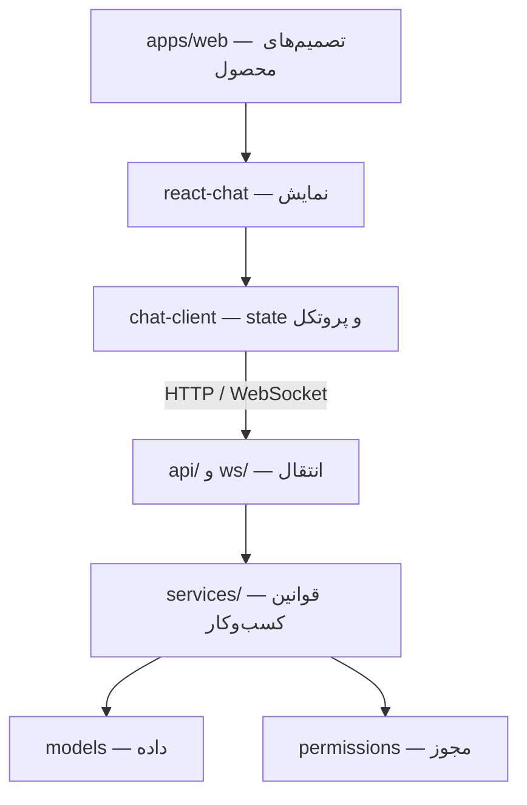

# فصل ۱ — نقشه‌ی معماری

## هدف این فصل

بفهمید پروژه از چه بخش‌هایی ساخته شده، هر بخش چه مسئولیتی دارد، و چرا مرزها دقیقاً همین‌جا کشیده شده‌اند.

## مسئله‌ای که حل می‌کنیم

پروژه سه هدف همزمان دارد:

1. یک اپ چت کامل و مستقل (Talkio).
2. یک پکیج Django که هر پروژه‌ی Django دیگری با `pip install` چت داشته باشد.
3. یک SDK و کتابخانه‌ی React که هر اپ React دیگری چت را embed کند.

اگر این سه را جدا بسازیم، سه پیاده‌سازی از منطق چت خواهیم داشت که به‌مرور از هم فاصله می‌گیرند. راه‌حل: **اپ مستقل خودش مصرف‌کننده‌ی همان پکیج‌هایی است که به دیگران می‌دهیم.** اگر پکیج برای Talkio کافی است، برای دیگران هم کافی است؛ و اگر چیزی در پکیج کم باشد، اول از همه خودمان می‌فهمیم.

## ساختار monorepo

```
apps/server            پروژه‌ی Django مستقل (تنظیمات، حساب کاربری، API ورود)
apps/web               اپ React مستقل (route، صفحات ورود، layout)
packages/django-chat   پکیج pip: django-realtime-chat
packages/chat-client   پکیج npm: @realtime-chat/client (بدون وابستگی به React)
packages/react-chat    پکیج npm: @realtime-chat/react
examples/              یک پروژه‌ی Django و یک اپ React «میزبان» جدا
docs/                  مستندات
```

**Monorepo** یعنی چند پکیج در یک ریپو. مزیتش این است که یک تغییر در پروتکل را می‌شود همزمان در سرور، SDK و UI اعمال کرد و با یک CI تست کرد. برای JavaScript از **npm workspaces** استفاده شده (فایل `package.json` ریشه، کلید `workspaces`)؛ npm پکیج‌های داخلی را با symlink به هم وصل می‌کند، پس `apps/web` همان `@realtime-chat/react` را import می‌کند که بیرونی‌ها نصب می‌کنند.

## لایه‌ها و جهت وابستگی



قانون طلایی: **وابستگی فقط رو به پایین است.** `services/` نمی‌داند HTTP یا WebSocket وجود دارد؛ برای همین هر دو لایه‌ی انتقال (REST و WebSocket) دقیقاً همان قوانین را اجرا می‌کنند. اگر قانون «فقط فرستنده می‌تواند پیام را ویرایش کند» در view نوشته می‌شد، باید در consumer هم تکرار می‌شد و روزی یکی فراموش می‌شد. این دقیقاً مشکل کد قدیمی بود (`MAX_MESSAGE_LENGTH` در دو فایل تعریف شده بود؛ رجوع کنید به [current-state.md](../architecture/current-state.md)).

## «Modular monolith» نه microservice

همه‌ی بک‌اند یک پروسه‌ی Django است. چرا microservice نه؟

- چت به تراکنش‌های دیتابیس وابسته است (شماره‌ی پیام، عضویت، خوانده‌شدن). تقسیم به سرویس‌های جدا یعنی تراکنش توزیع‌شده، که پیچیدگی بزرگی است.
- یک تیم کوچک با یک استقرار ساده سریع‌تر و امن‌تر کار می‌کند.
- مقیاس افقی هنوز ممکن است: چند پروسه‌ی Daphne پشت load balancer، با Redis برای پخش رویدادها بین پروسه‌ها.

«ماژولار» یعنی مرزهای داخلی واضح (پکیج، لایه‌ها)؛ اگر روزی لازم شد بخشی جدا شود، مرزش از قبل مشخص است.

## ADR: ثبت تصمیم‌ها

پوشه‌ی [decisions/](../architecture/decisions/) شامل **Architecture Decision Record** است: هر فایل یک تصمیم، دلیلش و پیامدهایش. وقتی شش ماه بعد کسی می‌پرسد «چرا شماره‌ی ترتیبی؟» جوابش مکتوب است. عادت خوبی است: هر تصمیم غیربدیهی را با «Context / Decision / Consequences» بنویسید.

## مسیر یک پیام، از اول تا آخر

برای اینکه کل نقشه در ذهنتان بنشیند، یک پیام را دنبال کنید:

1. `MessageComposer.tsx` → `client.sendMessage()` (SDK).
2. SDK یک پیام محلی با وضعیت `pending` می‌سازد (کاربر فوراً می‌بیندش) و رویداد `message.send` را روی WebSocket می‌فرستد.
3. `ws/consumer.py::_dispatch` → `services/messages.py::send_message` → `_create`.
4. در تراکنش: شماره‌ی `seq` گرفته می‌شود، پیام ذخیره می‌شود، پخش رویداد برای «بعد از commit» زمان‌بندی می‌شود.
5. بعد از commit، `events.py` رویداد را به group گفتگو در channel layer (Redis) می‌فرستد.
6. همه‌ی socketهای اعضا (همه‌ی دستگاه‌هایشان) `message.created` را می‌گیرند؛ فرستنده هم `ack` می‌گیرد.
7. SDK پیام محلی را با نسخه‌ی سرور جایگزین می‌کند (وضعیت `sent`). React دوباره render می‌کند.

هر کدام از این قدم‌ها در فصل‌های بعد با جزئیات باز می‌شود.

## تمرین

1. `apps/web/package.json` را باز کنید. کدام وابستگی‌ها نشان می‌دهند اپ از پکیج‌های خودمان استفاده می‌کند؟ چرا نسخه‌شان `0.1.0` نوشته شده نه یک مسیر فایل؟
2. در `packages/django-chat/src/django_realtime_chat/` دنبال هر `import` به `accounts` یا `core` بگردید. چرا هیچ‌کدام وجود ندارد؟
3. یک قانون جدید تصور کنید: «در گروه‌های بیش از ۱۰۰ نفر فقط ادمین‌ها پیام بفرستند». این قانون را کجا اضافه می‌کنید تا هم REST و هم WebSocket رعایتش کنند؟ (راهنما: `permissions.py`.)
