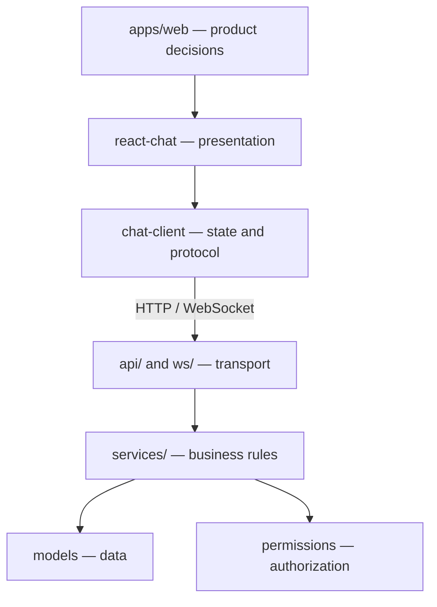

# Chapter 1 — The architecture map

**English** · [فارسی](../01-architecture.md)

## Goal of this chapter

Understand what the project is made of, what each part is responsible for, and why the boundaries are drawn exactly where they are.

## The problem we are solving

The project has three goals at once:

1. A complete, standalone chat app (Talkio).
2. A Django package that gives any other Django project chat with `pip install`.
3. An SDK and a React library that let any other React app embed chat.

If we built these three separately, we would have three implementations of the chat logic drifting apart over time. The solution: **the standalone app is itself a consumer of the same packages we give to others.** If the package is enough for Talkio, it is enough for others; and if something is missing from the package, we are the first to notice.

## The monorepo layout

```
apps/server            standalone Django project (settings, accounts, sign-in API)
apps/web               standalone React app (routes, sign-in pages, layout)
packages/django-chat   pip package: django-realtime-chat
packages/chat-client   npm package: @realtime-chat/client (no React dependency)
packages/react-chat    npm package: @realtime-chat/react
examples/              a separate "host" Django project and React app
docs/                  documentation
```

A **monorepo** means several packages in one repository. The benefit is that a protocol change can be made in the server, the SDK and the UI at the same time and tested by one CI. JavaScript uses **npm workspaces** (the root `package.json`, key `workspaces`); npm links the internal packages with symlinks, so `apps/web` imports the very same `@realtime-chat/react` that outsiders install.

## Layers and the direction of dependency



The golden rule: **dependencies only point down.** `services/` does not know that HTTP or WebSocket exist; that is why both transports (REST and WebSocket) enforce exactly the same rules. If the rule "only the sender may edit a message" were written in a view, it would have to be repeated in the consumer, and one day one of them would be forgotten. That was exactly the old code's problem (`MAX_MESSAGE_LENGTH` was defined in two files; see [current-state.md](../../architecture/current-state.md)).

## A "modular monolith", not microservices

The whole backend is one Django process. Why not microservices?

- Chat depends on database transactions (message numbers, membership, read markers). Splitting into separate services means distributed transactions, which is a big complexity.
- A small team with one simple deployment works faster and more safely.
- Horizontal scaling is still possible: several Daphne processes behind a load balancer, with Redis carrying events between processes.

"Modular" means clear internal boundaries (packages, layers); if one day a part has to be split out, its boundary is already drawn.

## ADRs: recording decisions

The [decisions/](../../architecture/decisions/) folder contains **Architecture Decision Records**: one file per decision, with its reason and consequences. When someone asks six months later "why sequence numbers?", the answer is written down. It is a good habit: write every non-obvious decision as "Context / Decision / Consequences".

## The path of one message, end to end

To fix the whole map in your mind, follow one message:

1. `MessageComposer.tsx` → `client.sendMessage()` (SDK).
2. The SDK creates a local message with status `pending` (the user sees it immediately) and sends a `message.send` event over the WebSocket.
3. `ws/consumer.py::_dispatch` → `services/messages.py::send_message` → `_create`.
4. In a transaction: a `seq` number is taken, the message is stored, and the event broadcast is scheduled for "after commit".
5. After the commit, `events.py` sends the event to the conversation's group in the channel layer (Redis).
6. All sockets of all members (all their devices) receive `message.created`; the sender also receives an `ack`.
7. The SDK replaces the local message with the server version (status `sent`). React renders again.

Each of these steps is opened up in detail in the following chapters.

## Exercises

1. Open `apps/web/package.json`. Which dependencies show that the app uses our own packages? Why is their version written as `0.1.0` and not as a file path?
2. Search `packages/django-chat/src/django_realtime_chat/` for any `import` of `accounts` or `core`. Why are there none?
3. Imagine a new rule: "in groups with more than 100 people, only admins may send messages". Where would you add it so that both REST and WebSocket respect it? (Hint: `permissions.py`.)
